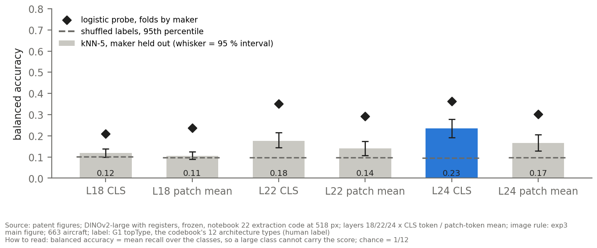
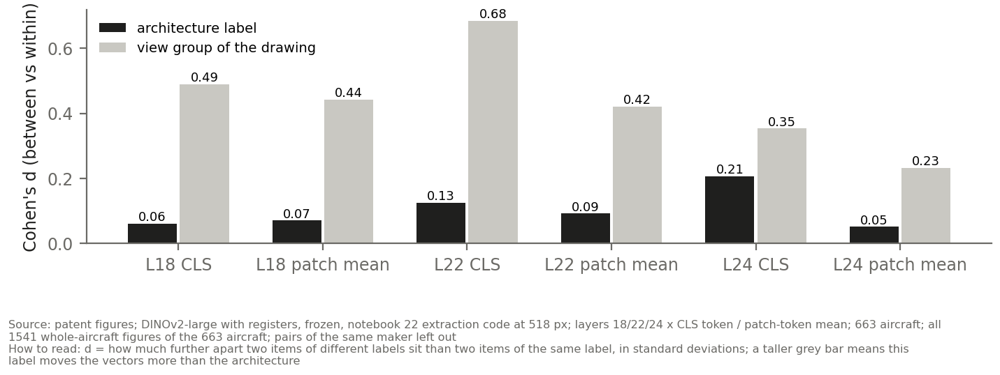

# Embedding Analysis: summary

## 1. The model: registers (decided 2026-09-30)

Both frozen models ran on the same images with the same protocol; only the model differs.
Score = kNN-5 balanced accuracy with the maker held out, layer 24 CLS (the layer both models
pick).

| | base (DINOv2) | registers (DINOv2 with registers) |
|---|---|---|
| patent drawings, 12 classes (chance 0.10) | 0.18 | **0.235** |
| patent drawings, 5 classes (chance 0.22) | 0.33 | **0.445** |
| photos, 5 classes (chance 0.22) | 0.53 | 0.56 |
| same aircraft found among the photos, top 10 / top 50 | 20 % / 37 % | 22 % / 48 % |
| attention maps usable in the late layers | no (collapse onto one padding cell) | yes |

**For registers:** better on every row, and the only model whose attention maps can be shown.
**Against:** once the view of the drawing is removed from the embedding (finding 4), the two
models score the same, so part of the registers gain is shared with the view.

**Decided:** registers is the chapter's model; the base numbers are printed beside it as the
robustness check.

## 2. The chosen setup (decided 2026-09-30)

Every choice below uses one rule: split the makers into two halves (200 times), choose on one
half, score on the other. That way a choice is never judged on the aircraft that picked it.

| choice | value | reason | type |
|---|---|---|---|
| model | DINOv2 with registers | fixes the attention collapse on blank drawing background; chosen in 68–90 % of held-out selections against base | image type |
| resolution | 518 px | the largest size the model was trained on; keeps thin lines | image type |
| layer + token | layer 24, CLS | chosen in 69 % of held-out selections (next: layer 22 CLS, 29 %) | labels |
| drawings | plain | thickening the lines lowers the score (thick2 significantly): it fills in fine detail such as rotor spokes and shading | labels |
| photos | colour | greyscale scores the same (+0.006, inside the interval), so the unchanged image is kept | labels |

**Fair comparison, same setup on both sources:** photos beat drawings on the shared 5 classes by
+0.12, and **by the same amount in greyscale**. The photo advantage is not colour.
Held-out scores sit 0.02–0.04 below the scores quoted elsewhere in this summary. That is the
honest size of the selection optimism, and it is small.

## 3. What the chapter can claim

| # | finding | evidence | strength |
|---|---|---|---|
| 1 | The embeddings are sound, and one layer is best everywhere | no invalid vector; L24 CLS wins for both sources and both models (82–100 % of random subsets) | solid |
| 2 | Patent drawings carry the architecture, weakly | 12 classes: 0.18 base, 0.235 registers, chance 0.10 | weak but real |
| 3 | Photos carry it better than drawings | 5 classes: photos 0.53–0.56, drawings 0.33–0.445 | moderate |
| 4 | The view of the drawing dominates the embedding, but architecture survives without it | view effect 1.7–2.2 × the architecture effect; after erasing the view, base scores unchanged (+0.005) | solid |
| 5 | Classes do not form clusters on their own | k-means against the labels: 0.03 drawings, 0.14 photos (0 = no match) | negative, reportable |
| 6 | Which image of an aircraft is used barely matters | the four image rules span 0.17–0.23 (registers), 0.18–0.19 (base) | robust |
| 7 | Photo backgrounds do not drive the photo result | cropping to the aircraft: +0.017, inside the interval | robust |
| 8 | The same aircraft can be matched from patent to photo | right photo page in the top 50 for 37–48 % of patents (random: 7.5 %) | moderate |
| 9 | What the model looks at | registers late-layer attention stays on the aircraft (Figure 4) | qualitative |

## 4. The four figures that carry it

{width=100%}

{width=100%}

{width=100%}

{width=100%}

## 5. What I need from you

1. Anything in section 3 you would not claim, or would claim differently.

Then I build the two final documents: the analysis (about 30 pages) and the advisor summary.
Every number here comes from the full reports in "Full reference", the second file in this
folder.
