# Visual Learning: DINOv2 embeddings of patent drawings and photographs

<!-- Date: 2026-09-30 -->

The analysis for research question RQ4. Private: contains evtol.news photographs, © their owners.

<!-- TOC -->

Contents

1 — The images and the labels: which drawings and photographs enter the analysis, and does the way they are chosen decide the result?2

1.1 — Which drawings and photographs enter the analysis, and with which labels?3

1.2 — How does each aircraft become one image and one vector, and does the choice of images decide the result?5

2 — The setup: which DINOv2 checkpoint, layer, token and image preparation read the images, and how are they chosen?7

2.1 — Does the registers checkpoint remove the attention artifact, and does it read the images better?7

2.2 — Which layer and which token carry the architecture?8

2.3 — Should the drawings or the photographs be transformed before the model reads them?9

2.4 — How much do the label-selected choices flatter the scores, and how firm is every paired contrast?10

3 — The drawings: do patent drawings carry the architecture, and what else does the model read in them?14

3.1 — How well do the drawings predict the architecture type?14

3.2 — What organises the drawing embedding: the architecture, or the way the aircraft is drawn?16

3.3 — Does the choice of drawing change the result?17

3.4 — Where does the model look on a drawing?18

4 — The photographs: do photographs of the aircraft carry the architecture, and does the choice of image matter?20

4.1 — How well do photographs predict the directory class?20

4.2 — What organises the photo embedding: the architecture, or the maturity of the aircraft?21

4.3 — Does the choice of photograph change the result?22

4.4 — Where does the model look on a photograph?22

5 — Drawings against photographs: is the comparison fair, which source carries more of the architecture, and can one aircraft be found in both?24

5.1 — Once pool, class mix, colour and background are controlled, do photographs carry more architecture than drawings?24

5.2 — Can the same aircraft be found in both sources?25

The answer to RQ4, what it rests on, and what is still open27

Appendix A — Every layer and token under both models29

<!-- /TOC -->

---

## 1 — The images and the labels: which drawings and photographs enter the analysis, and does the way they are chosen decide the result?

#### Method common to every chapter

**What is asked (RQ4).** Whether the figure alone carries the architecture: whether a frozen vision model, DINOv2 with registers (Oquab et al., 2023; Darcet et al., 2024), never trained on aircraft or on the codebook, places aircraft of the same architecture class near each other, judged against the human labels. Two image sources are read with the same model and the same protocol: the patent drawings of the labelled dataset, and the images of the World eVTOL Aircraft Directory (evtol.news, Vertical Flight Society), called photographs below.

**Unit of analysis: the aircraft.** One patent can disclose several aircraft and one directory page shows one, so every source is reduced to one vector per aircraft: 663 drawing aircraft and 1 157 photo aircraft. **The maker is held out of every comparison**: the applicant's company group for a patent (the first applicant for an individual inventor), the maker named on the page for a photo. A company's house style can therefore never count as architecture.

**The embedding.** The model turns an image into a vector of 1 024 numbers. It is read at one layer (18, 22 or 24 of the model's 24) and through one token: the CLS token, the summary token the model learns, or the mean of the patch tokens. One layer with one token is called a **matrix**; six are compared, and chapter 2 chooses one.

##### How to read the scores

*Every score, interval and chance level in the document is read as set out here.*

**The primary score: kNN-5 balanced accuracy.** Each aircraft's class is predicted by the vote of its five nearest aircraft, never from its own maker (**maker held out**), nearness being the cosine distance d(u, v) = 1 − u·v / (‖u‖ ‖v‖) (nearest-neighbour rule, Cover and Hart, 1967); a tie goes to the class of the nearer neighbour; k = 5 and the cosine distance were fixed in advance. The score is the **balanced accuracy**, BA = (1/K) Σ_c recall_c, with recall_c = (aircraft of class c predicted as c) / (aircraft of class c), over the K classes (Brodersen et al., 2010). Every class weighs the same, so a large class cannot carry the score, and guessing scores 1/K: 0.083 on 12 classes, 0.20 on 5.

**The 95 % intervals.** A score's interval resamples the aircraft with replacement 1 000 times on the same predictions and keeps the middle 95 % (bootstrap, Efron, 1979). A **paired contrast** (two setups on the same aircraft) resamples whole makers, with all their aircraft, for both setups: this maker interval is the primary one, slightly wider than the aircraft one because a maker's aircraft resemble each other. Beside it stands the share of the 400 held-out halves (below) in which the difference has the same sign. Between the two sources, whose aircraft differ, each set is resampled on its own. A share of a small count (a recall, an audit) gets the Wilson score interval (Wilson, 1927). **A difference whose interval takes in zero is read as no difference detected.**

**Many contrasts, read together.** The document makes 25 paired contrasts; after a Holm correction over the 25 (Holm, 1979) none survives at 0.05, so they are read as convergent evidence: by their direction, their intervals and their per-half consistency, not one by one.

**Chance, as the same neighbours reach it.** The labels are shuffled 200 times and the vote rerun; the 95th percentile of the shuffled scores is the **shuffled level**. A score above it is one that chance almost never produces with these neighbours.

**The linear probe.** A logistic regression reads every dimension of the vector, trained on four fifths of the makers and tested on the fifth (five folds grouped by maker), scored by the same balanced accuracy; L2 penalty of the default strength (C = 1), lbfgs solver, balanced class weights, C not tuned. Its chance is the same probe on 50 shuffled label sets. The neighbours use the overall distance only, so a probe above the kNN score means the architecture is in the vector without deciding which aircraft are nearest.

**The split-half selection rule** (the author's own definition). A choice made on the labels must not be scored on the aircraft that made it. The makers are split at random into two halves, 200 times (fixed seed 42, a rerun gives the same numbers), and every aircraft follows its maker. Each candidate is scored on half A with neighbours from A only, the best is scored on half B, and the halves are swapped: 400 choices per label set. Reported: how often each candidate is chosen (its **selection frequency**), its held-out score, and the **optimism gap** = in-sample score of the winner − its held-out score. The candidate with the highest selection frequency, averaged over the label sets of a source and then over the two sources, is chosen.

**Separation, clusters and what else is encoded.** Separation compares the mean cosine distance between aircraft of different classes with that between aircraft of the same class, over pairs of different makers: ratio = mean between / mean within, and d = (mean between − mean within) / pooled standard deviation; p is the share of 999 label shuffles with a ratio as large. The same d for a label that is not the architecture (the view of a drawing, the maturity of a photographed aircraft), divided by the architecture's d, is the **d ratio**: which label moves the vectors more. Clusters: k-means with as many clusters as classes, compared with the labels by the adjusted Rand index, ARI = (RI − E[RI]) / (max RI − E[RI]), where RI is the share of aircraft pairs on which the two partitions agree; 0 is a chance partition, 1 the labels themselves (Hubert and Arabie, 1985).

**The maps.** UMAP (McInnes, Healy and Melville, 2018) draws each 1 024-number vector in two dimensions so that similar vectors sit close. The axes have no unit, and a map is a picture, never a test.

**The seven tests of the protocol**, run with the same code and parameters on both sources:

| test | what it asks | measure |
|:---|:---|:---|
| T1 integrity | is every vector valid? | no NaN, infinite, all-zero or duplicate rows |
| T2 structure | do the vectors have structure at all? | variance on the first principal component against a random matrix of the same shape; Hopkins statistic (0.5 random, near 1 clumped) |
| T3 separation | are same-class aircraft closer? | ratio, d and p, as above |
| T4 prediction | how often is the class recovered? | kNN-5 balanced accuracy (primary), interval, shuffled level; probe |
| T5 clusters | do the classes form clusters? | k-means against the labels, ARI |
| T6 what else | does another label move the vectors more? | the d ratio |
| T7 image choice | does the image rule matter? | T4 under every image rule |

### 1.1 — Which drawings and photographs enter the analysis, and with which labels?

#### Method

**Objective.** Which images of each source reach the model, which label each aircraft carries, and how far that label can be trusted.

**Data and unit of analysis.** Drawings: the figures of the labelled dataset of eVTOL patents, counted as figures until each aircraft is reduced to one (1.2). A drawing aircraft carries its **G1 type**, one of the codebook's 12 architecture types, and the type's parent among 5 classes: **VT** Vectored Thrust, **LC** Lift + Cruise, **WM** Wingless (Multicopter), **ER** Electric Rotorcraft, **HB** Hover Bikes / PFD (the directory's own name, personal flying devices). **One labeller, the author, assigned every G1 type.** Photographs: the images of the directory pages (crawl of 2026-09-17); a photo aircraft carries the directory's own class, one of the same 5.

**Procedure.** Figure 1 follows each source from the files on disk to the analysis set, each image counted under the first rule that removed it. A drawing enters when the labeller approved it, its aircraft passes the domain gate (aircraft flagged as similar to a UAV, or not electric, leave) and its patent is not a duplicate of another; part figures leave, and so do the 2 aircraft marked unclassifiable. A photo passes fixed rules against small files and files shared with another page, then a zero-shot SigLIP score p(whole aircraft) that keeps an image at p ≥ 0.80, drops it below 0.35 and holds back the review band between; the page's first kept image, its **hero image**, stands for the aircraft. Figure 2 counts the classes, Table 1 the label checks, Figures 3 and 4 show one image per class.

**Scientific grounds.** The G1 label is compared with the author's whole-patent reading of the architecture by Cohen's κ = (p_o − p_e) / (1 − p_e), the observed agreement p_o corrected for the agreement p_e two readings would reach by chance (Cohen, 1960). The photo filter is checked on a random sample of hero, dropped and review-band images, each share with its Wilson interval.

**Assumptions and limits.** κ is not an independent agreement: the same person made both readings, the whole-patent one after the wizard labels were corrected. The audit judge was the AI assistant of the pipeline, working from sheets that showed the filter score: neither blind nor yet re-checked by the author. The photo label is the directory's class, not the codebook's: it agrees with the G1 parent for 83 of the 99 aircraft present in both (84 %).

#### Results and discussion

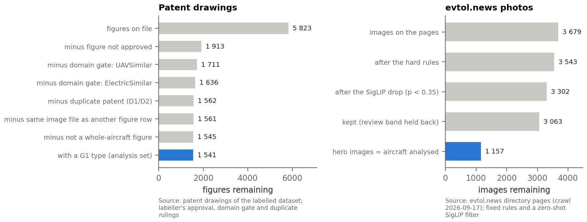{: width="100%" }

*Figure 1 — From the files on disk to the analysis sets: (i) patent drawings, (ii) directory photographs; the blue bar is the analysis set.*

*Takeaway: **1 541 whole-aircraft drawings of 663 aircraft from 572 patents, and 1 157 hero images, one per directory aircraft, enter the analysis.** (i) The labeller's approval removes most drawings (3 910 of 5 823 figures on file); the domain gate removes 277 more, the duplicate rule 74 and the part figures 16. (ii) The filter keeps 3 063 of 3 679 images, holding back the 239 of the review band.*

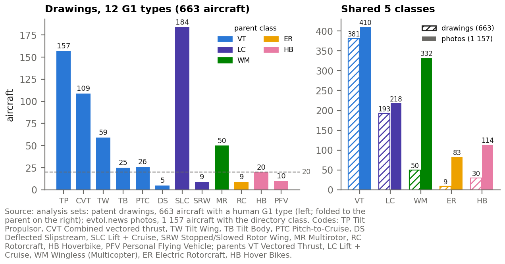{: width="100%" }

*Figure 2 — Aircraft per G1 type, coloured by the parent class (left), and per shared class in the two sources (right).*

*Takeaway: **Two types hold 51 % of the drawing aircraft, Lift + Cruise (184) and Tilt Propulsor (157), while 4 types have fewer than 20.** The two sources have different class mixes: Vectored Thrust is 57 % of the drawings and 35 % of the photos, Wingless 8 % against 29 %.*

**Table 1 — How far the labels and the photo filter can be trusted.**

| check | n | agree / count | measure |
|:---|---:|:---|:---|
| G1 label against the whole-patent reading (current labels) | 662 | 627 (95 %) | κ 0.936 |
| frozen labels of 2026-09-15 against the same reading (analysis set) | 658 | 589 (90 %) | κ 0.872 |
| frozen labels, whole ground-truth file (798 rows) | 794 | 706 (89 %) | κ 0.865 |
| frozen labels, project record of 2026-09-17 | 803 | (89 %) | κ 0.866 |
| hero images that show the whole aircraft | 100 | 96 of 100 [0.90, 0.98] | Wilson 95 % |
| images the filter dropped that were a whole vehicle | 40 | 3 of 40 [0.03, 0.20] | Wilson 95 % |
| review-band images that would have been usable | 40 | 18 of 40 [0.31, 0.60] | Wilson 95 % |

*Takeaway: **The current G1 labels agree with the author's whole-patent reading for 627 of 662 aircraft (κ 0.94), and the labels frozen before the last corrections for κ 0.866.** The disagreements concentrate in SLC (15 of 184: the reading says CVT 11; SRW 4), PTC (9 of 26: the reading says SLC 4; TP 2; CVT 2; MR 1). 96 of 100 audited hero images show the whole aircraft.*

{: width="100%" }

*Figure 3 — One main figure per G1 type, as the model receives it (518 px, padded square).*

*Takeaway: **The model receives the drawing as filed: black line-work on a white square, with reference numerals and figure labels left in.** Nothing in the image names the type; the type is what the labeller read from the drawing and the patent.*

{: width="100%" }

*Figure 4 — One hero image per directory class (built aircraft, highest filter score). Photo: evtol.news directory, © owners.*

*Takeaway: **A hero image shows the whole aircraft, a photograph or a rendering, often in a scene.** Hover Bikes / PFD is the directory's name for its fifth class, which holds the G1 types HB and PFV.*

### 1.2 — How does each aircraft become one image and one vector, and does the choice of images decide the result?

#### Method

**Objective.** An aircraft has a median of two whole-aircraft drawings, so a rule must pick the image that becomes its vector. The question is which rules exist, how often they agree, and whether any selection step moves the primary score.

**Data and unit of analysis.** The 663 drawing aircraft and their 1 541 figures; for the flight state, the figures of the 5 convertible types (TP; CVT, Combined Vectored Thrust; TW, Tilt Wing; DS, Deflected Slipstream; SRW, Stopped/Slowed Rotor Wing), whose shape changes between hover and cruise; the 1 157 photo aircraft for the sensitivity check.

**Procedure.** Four rules were fixed before any score was read (Table 2): **exp1 view-first** sorts on the view (Perspective > Plan > Side > Front/Rear), then on the flight state; **exp2 state-first** sorts on the flight state (Cruise > Both > Hover > Other), then on the view; **exp3 main figure** takes the figure the labeller marked as main, the primary rule; **exp4 view average** averages the vectors of the best figure in each of Perspective, Plan and Side. The flight state is recorded per figure as Cruise, Hover, or Both when the moving part is drawn in both positions. The chosen image is rotated by its labelled angle, padded to a white square and resized to 518 px, 37 × 37 patches of 14 px, for drawings and photos alike. Each selection step is then made stricter, or its measured errors removed, and the primary score recomputed (Table 3).

**Scientific grounds.** Cruise is the canonical state because more convertible aircraft have a Perspective figure in Cruise (220 aircraft) than in Hover (212) among the 339; Both is rare (31 figures). A selection step decides the result only if a variant leaves the interval of the set as built.

**Assumptions and limits.** The variants are subsets of the set as built, so their intervals are not independent of it.

#### Results and discussion

**Table 2 — The four image rules. exp4 averages 2 figures for 197 aircraft and 3 for 50, and is one figure for the other 416.**

| rule | which figure | same figure as exp3 |
|:---|:---|---:|
| exp1 view-first | best view, then best flight state | 83.9 % |
| exp2 state-first | best flight state, then best view | 83.4 % |
| exp3 main figure | the figure the labeller marked as main (primary rule) | 100.0 % |
| exp4 view average | mean of the best figure of each of Perspective, Plan and Side | n/a |

*Takeaway: **The flight state barely moves the choice: exp1 and exp2 differ on 26 aircraft only.** The labeller's main figure differs from the view-first pick on 107.*

**Table 3 — Sensitivity of the primary score to the selection (registers, layer 24 CLS, maker held out).**

| source | variant | aircraft | kNN-5 | 95 % interval |
|:---|:---|---:|---:|---:|
| drawings | as built | 663 | 0.235 | [0.19, 0.28] |
| drawings | only aircraft whose drawing label matches the whole-patent reading | 627 | 0.241 | [0.20, 0.28] |
| drawings | only aircraft whose main figure is a Perspective view | 477 | 0.244 | [0.18, 0.31] |
| drawings | without the main-figure fallbacks | 662 | 0.235 | [0.19, 0.28] |
| photos | as built | 1 157 | 0.563 | [0.53, 0.60] |
| photos | stricter filter: first image with SigLIP p(aircraft) of at least 0.95 | 1 113 | 0.564 | [0.53, 0.60] |
| photos | no line drawings: first image the style guess does not call a drawing | 1 141 | 0.563 | [0.53, 0.60] |
| photos | without the aircraft that share a near-duplicate hero image | 1 124 | 0.570 | [0.54, 0.60] |
| photos | without the 4 hero images the audit found unusable | 1 153 | 0.563 | [0.53, 0.59] |

*Takeaway: **Every variant stays inside the interval of the set as built: no selection step decides the result.** The drawing variants span 0.235 to 0.244, the photo variants 0.563 to 0.570.*

#### Answer

**663 drawing aircraft and 1 157 photo aircraft enter, each as one image and one vector; the labels agree closely with the author's own whole-patent reading, and no selection step moves the primary score outside its interval.**

- **Two sources, one unit.** 1 541 whole-aircraft drawings from 572 patents, and one hero image per directory page, each reduced to one vector per aircraft.
- **One labeller.** κ 0.94 against the author's whole-patent reading, 0.866 for the frozen labels; no second labeller has read the drawings.
- **Two label schemes.** The directory class agrees with the G1 parent for 83 of 99 aircraft present in both.
- **The selection does not decide the result.** Stricter filters, label-checked aircraft and Perspective-only aircraft all score inside the interval of the set as built.

## 2 — The setup: which DINOv2 checkpoint, layer, token and image preparation read the images, and how are they chosen?

A frozen model leaves few choices, but each can move the score. They fall into three kinds: **fixed** choices stated in advance (resolution, pad, rotation, one image per aircraft, k); **label-selected** choices, made on the labels and therefore chosen by the split-half rule (layer, token, each source's preparation); and the **model**, a property of the checkpoint that a label-free diagnostic can decide (Table 4).

#### How the model was reached

1. **Planned:** the base DINOv2-large, the model of the extraction pipeline (0.178 on the drawings' 12 types).
2. **Checked, then switched:** the registers check was run for the attention artifact of the base model (2.1) and also returned higher scores (+0.057 and +0.111 on the drawings); the switch was decided after those scores had been seen, so it is post hoc on the scores.
3. **Confirmed:** the split-half rule, run over all 12 candidates of both models, picks a registers candidate in 67.8 % to 89.5 % of the held-out choices.

**Table 4 — The setup: every choice, how it was decided, and what chapters 3 to 5 use.**

| choice | candidates | kind | how decided | carried forward |
|:---|:---|:---|:---|:---|
| model | DINOv2-large; DINOv2-large with registers | model property; label-free diagnostic, label-confirmed | attention check (2.1); split-half rule over all 12 candidates | with registers |
| resolution | 518 px | fixed (author ruling) | the model's largest training size; that it keeps thin lines is a rationale, not a measurement | 518 px |
| pad and rotation | white square pad; rotation by the labelled angle | fixed, not selected | the pad matches the paper of a drawing | as stated |
| image per aircraft | drawings: the labeller's main figure; photos: the hero image | fixed before the setup round | one representative image per aircraft on both sides, chosen by the source; the primary rule since 2026-09-22 (3.3, 4.3) | main figure; hero image |
| neighbours | k = 5, cosine distance | fixed in advance | k = 3 and 10 as sensitivity (3.1) | k = 5 |
| layer and token | layer 18, 22, 24; CLS or patch mean | label-selected | split-half rule (2.2) | layer 24 CLS |
| readout for both sources | one layer and token, or one per source | author ruling | one readout keeps the comparison fair; each source's own pick is reported (2.2) | one |
| drawing preparation | plain; thick1; thick2; grey and contrast as controls (added post hoc) | label-selected | split-half rule (2.3) | plain |
| photo preparation | colour; greyscale | label-selected | split-half rule (2.3): a tie, the default is kept | colour |

_Takeaway: **One model and one readout for both sources, the images left as they come; only the layer, token and preparation are chosen on the labels, and they are tested on makers that did not choose them.**_

### 2.1 — Does the registers checkpoint remove the attention artifact, and does it read the images better?

#### Method

**Objective.** Whether the base DINOv2 collapses its late attention onto blank background, whether the registers checkpoint removes the collapse, and whether it scores higher on the same aircraft.

**Data and unit of analysis.** Attention, per image, the unit at which attention exists: the 665 drawings of the patent main set (the 663 aircraft plus the 2 marked unclassifiable, which are never scored) and the 1 157 hero images, both models on the same images. Scores: the 663 drawing and 1 157 photo aircraft, same processed images and code for both models.

**Procedure.** Table 5 gives the collapse measure, the median share of the CLS token's attention on the single largest patch, per layer, and at layer 24 its 90th percentile, the share renormalised over the patches, the share the prefix tokens (CLS and registers) take, and the share of images whose largest patch lies in the white pad. Figure 5 maps four images. The scores of the two models are the first rows of the contrast figure of 2.4 (Figure 9).

**Scientific grounds.** DINOv2 without registers parks high-norm artifact tokens in low-information background patches, and the registers checkpoint adds four register tokens that absorb them (Darcet et al., 2024). The map is a = softmax(q_CLS · Kᵀ / √d_h), averaged over the heads; share = max_p a_p.

**Assumptions and limits.** The switch was decided after the scores were seen (post hoc). Part of the advantage does not survive the removal of the view (3.2).

#### Results and discussion

**Table 5 — The attention collapse: median share of the CLS attention on the single largest patch (665 drawings, 1 157 photos, both models on the same images).**

| model, source | L18 | L22 | L24 | L24 p90 | L24 renormalised | L24 prefix tokens | largest patch in the pad |
|:---|---:|---:|---:|---:|---:|---:|---:|
| base, drawings | 0.007 | 0.286 | 0.295 | 0.368 | 0.301 | 0.013 | 85.6 % |
| registers, drawings | 0.005 | 0.014 | 0.009 | 0.015 | 0.016 | 0.444 | 0.0 % |
| base, photos | 0.008 | 0.255 | 0.280 | 0.355 | 0.286 | 0.016 | 98.4 % |
| registers, photos | 0.006 | 0.015 | 0.011 | 0.020 | 0.020 | 0.433 | 0.0 % |

*Takeaway: **The base model's late attention collapses onto one patch, 0.295 of it at layer 24 on drawings and 0.280 on photos, and that patch lies in the white pad for 85.6 % of the drawings and 98.4 % of the photos; with registers the share stays at or below 0.015 and never lands in the pad.** The collapse is a property of the model, not of patent drawings: it hits both sources, on the pad added to both.*

{: width="92%" }

*Figure 5 — Where the CLS token looks: base (columns 2 to 4) against registers (columns 5 to 7), layers 18, 22 and 24, on the same images; bright = attention, each map scaled on its own.*

*Takeaway: **In base layers 22 and 24 one patch of the pad, the pale square in the top-left corner, holds about 0.3 of the attention, and dots of the white field light up; with registers neither appears.** Each map is scaled to its own 99th percentile, so the corner patch is clipped to the brightest colour and the rest of a base map looks brighter than it is.*

- **Scores.** Registers minus base, makers resampled: +0.057 [+0.009, +0.105] on the drawings' 12 types, +0.111 [+0.022, +0.200] on their 5 classes, +0.030 [−0.004, +0.062] on the photos (no difference detected); registers score higher in 67 % to 79 % of the halves, by +0.016 to +0.030 on average.
- **A reusable label-free test.** If a late layer puts more than about 0.1 of the CLS attention on one patch, or its largest patch in the pad, use a registers checkpoint; the test needs no label, and the labels then confirm it here.

### 2.2 — Which layer and which token carry the architecture?

#### Method

**Objective.** Which of the six matrices (layers 18, 22 and 24, read through the CLS token or the patch mean) is carried forward.

**Data and unit of analysis.** The six matrices of the registers model; three label sets: drawings on the 12 types, drawings on the 5 classes, photos on the 5 classes. A half holds 248 to 415 drawing aircraft and 496 to 661 photo aircraft.

**Procedure.** The split-half rule picks the best matrix on one half and scores it on the other, 400 times per label set; Figure 6 gives how often each matrix is chosen, Table 6 the decision. Checks: the rule rerun with seeds 7 and 123; each source's own pick; the best mean held-out score as the criterion instead of the selection frequency.

**Scientific grounds.** The selection frequency says how stable a choice is across makers; the held-out score, what it reaches on makers that did not choose it. The last layer's CLS token is the one DINOv2 is trained to make a global summary of the image (Oquab et al., 2023).

**Assumptions and limits.** Halves are unbalanced, and 11 of the 400 drawing halves miss a rare type (DS 8; SRW 3). A held-out score sits below the full-sample one because its neighbour pool is about half the size; only held-out scores compare with each other.

#### Results and discussion

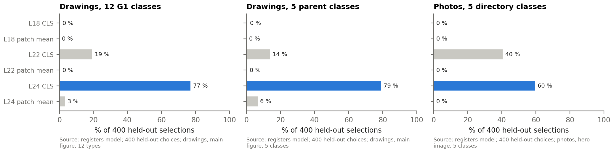{: width="100%" }

*Figure 6 — How often each layer and token is chosen by the split-half rule, per label set (registers model); blue: the matrix carried forward.*

_Takeaway: **Layer 24 CLS is chosen most often on every label set; its runner-up, layer 22 CLS, is chosen most on the photos (40 %, against 14 % to 19 % on the drawings).**_

**Table 6 — The decision over the six registers matrices, averaged over the three label sets.**

| matrix | mean selection frequency | mean held-out score |
|:---|---:|---:|
| L24 CLS | 68.8 % | 0.403 |
| L22 CLS | 28.5 % | 0.378 |
| L24 patch mean | 2.4 % | 0.280 |
| L18 CLS | 0.2 % | 0.245 |
| L22 patch mean | 0.1 % | 0.249 |
| L18 patch mean | 0.0 % | 0.232 |

_Takeaway: **Layer 24 CLS is chosen in 69 % of the choices and layer 22 CLS in 28 %; the patch-token mean is almost never chosen.**_

- **Each source's own pick.** Drawings alone pick L24 CLS in 78 % of the choices; photos alone pick L24 CLS in 60 % and L22 CLS in 40 %, a tie: on the same halves L24 CLS minus L22 CLS averages +0.005, positive in 60 %. One readout for both sources is the author's ruling; the photos lose nothing measurable by it.
- **Stable.** Seeds 7 and 123 keep the same winner; the best-score criterion picks the same setup at every step; the protocol's in-sample layer rule picks layer 24 CLS on 96 % of 200 subsets of 80 % of the drawing aircraft.

### 2.3 — Should the drawings or the photographs be transformed before the model reads them?

#### Method

**Objective.** Whether changing how the strokes of a drawing reach the model, or removing the colour of a photograph, helps the model read the architecture, and which part of a change does the work.

**Data and unit of analysis.** The 663 drawing aircraft (main figure) and the 1 157 photo aircraft (hero image), registers model, layer 24 CLS. 210 of the 1 545 whole-aircraft drawings carry colour (the 1 545 are the 1 541 figures of the 663 aircraft and the 4 of the 2 unclassifiable aircraft).

**Procedure.** **thick1** and **thick2** widen every stroke with a minimum filter on the original drawing, by about 1 and 2 input pixels per side (radius in original pixels: median 4 and 7); they also make the drawing grey and darken faint strokes. Two controls separate these three changes: **grey** removes the colour only; **contrast** turns the darker half of each image's ink solid black at the model input, so the strokes darken without widening. Figure 7 shows the five inputs; Table 7 their scores and the split-half choice over the five; the paired differences are rows of the contrast figure of 2.4.

**Scientific grounds.** Paired differences with makers resampled and the per-half sign, as in the methods box. The ink mass (mean darkness of the input) measures how much black each preparation adds.

**Assumptions and limits.** The grey and contrast controls were added after the review of the first results (post hoc). contrast is a hard threshold, so it also removes the anti-aliasing of the darker strokes: it tests strokes rendered differently at the same footprint, not darkness alone. A gentler change was not tested.

#### Results and discussion

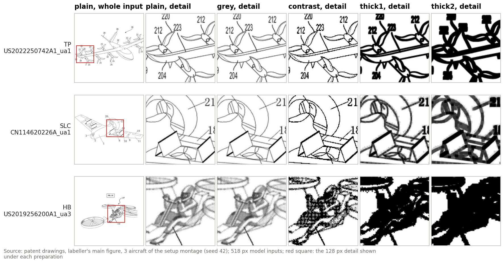{: width="100%" }

*Figure 7 — The plain input with its detail window (left), and the same detail under the five preparations.*

_Takeaway: **grey is indistinguishable from plain; contrast keeps the footprint but turns half of each stroke solid and jagged; thick1 and thick2 merge thin propeller blades and numerals and fill hatching.**_

**Table 7 — The five drawing preparations (registers, layer 24 CLS, maker held out); the split-half rule chooses among the five, frequencies and held-out scores averaged over the two drawing label sets.**

| preparation | what changes | kNN-5, 12 types | kNN-5, 5 classes | chosen (held out) | mean held-out score |
|:---|:---|---:|---:|---:|---:|
| plain | nothing | 0.235 | 0.445 | 37.4 % | 0.262 |
| grey | colour removed | 0.235 | 0.447 | 23.1 % | 0.261 |
| contrast | strokes darkened in place | 0.193 | 0.347 | 11.9 % | 0.231 |
| thick1 | strokes widened about 1 px per side | 0.201 | 0.402 | 24.8 % | 0.248 |
| thick2 | strokes widened about 2 px per side | 0.184 | 0.346 | 2.9 % | 0.211 |

*Takeaway: **Greyscale alone equals plain: the predictions are identical for 98 % to 99 % of the aircraft. Darkening the strokes in place lowers the score about as much as thick2, so the loss comes from changing how the strokes are rendered, not from dilation or from colour.** Plain is chosen in 37.4 % of the choices and plain or grey, which predict alike, in 60.5 %.*

- **How firm.** With makers resampled, thick2 minus plain is −0.051 [−0.098, +0.001] and −0.099 [−0.196, +0.001], contrast minus plain −0.042 [−0.089, +0.002] and −0.098 [−0.179, −0.021]; the intervals of thick2 on the 12 types, thick2 on the 5 classes and contrast on the 12 types include 0, so the per-half shares carry the evidence: thick2 is lower than plain in 88 % to 91 % of the halves, contrast in 81 %.
- **Recipe.** Keep the lines as drawn: no rendering change tested improves the score; a gentler change is untested.
- **Photos.** Greyscale minus colour is +0.006 [−0.013, +0.026] (no difference detected), same sign in 43 % of the halves; the rule picks colour in 57 % of the choices and grey in 43 %: a tie, so colour is kept as the default, not as a better choice.

### 2.4 — How much do the label-selected choices flatter the scores, and how firm is every paired contrast?

#### Method

**Objective.** How much of each score is owed to having chosen the setup on the same labels, and how firm each paired contrast of the document is once whole makers are resampled.

**Data and unit of analysis.** The 400 held-out choices of each label set, for three pools of candidates: the six registers matrices; all 12 matrices of both models; and the joint grid of the six matrices with each source's preparations (18 candidates on the drawings, 12 on the photos). The 25 paired contrasts of chapters 2 to 5.

**Procedure.** Figure 8 sets, per label set and pool, the in-sample score of the winner of a half, its score on the other half, the held-out score of layer 24 CLS kept fixed, and the full-sample score. Figure 9 draws every paired contrast: its difference, its interval with aircraft resampled (thin line) and with makers resampled (pale bar), and the share of halves with the same sign; three rows compare the two sources, whose aircraft differ (chapter 5).

**Scientific grounds.** gap = in-sample score of the winner − its held-out score: the amount by which choosing on the labels inflates a score. Maker bootstrap and Holm correction as in the methods box.

**Assumptions and limits.** A held-out score uses about half the neighbour pool, so it sits below the full-sample score for a reason that has nothing to do with optimism.

#### Results and discussion

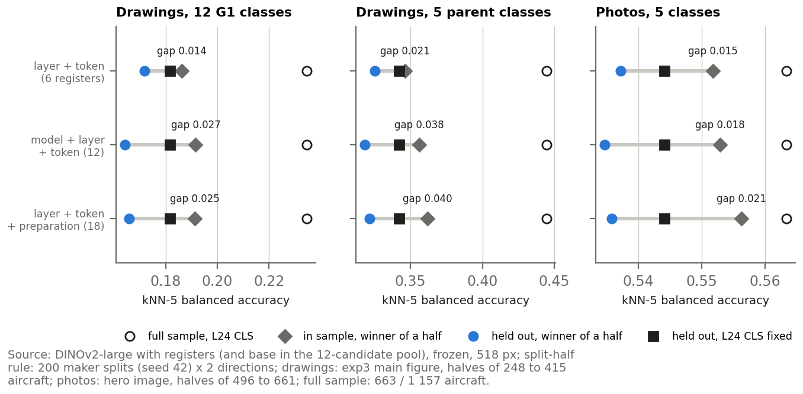{: width="100%" }

*Figure 8 — The optimism of the label-selected choices, per label set and pool of candidates.*

*Takeaway: **The drawing headline is 0.235 on the full sample, about 0.21 after the selection optimism, and 0.178 for the base model, the model planned before any score was read.** The joint-grid optimism is 0.025, 0.040 and 0.021 on the three label sets (0.018 to 0.038 when both models compete), and layer 24 CLS kept fixed scores 0.182, 0.342 and 0.544 held out.*

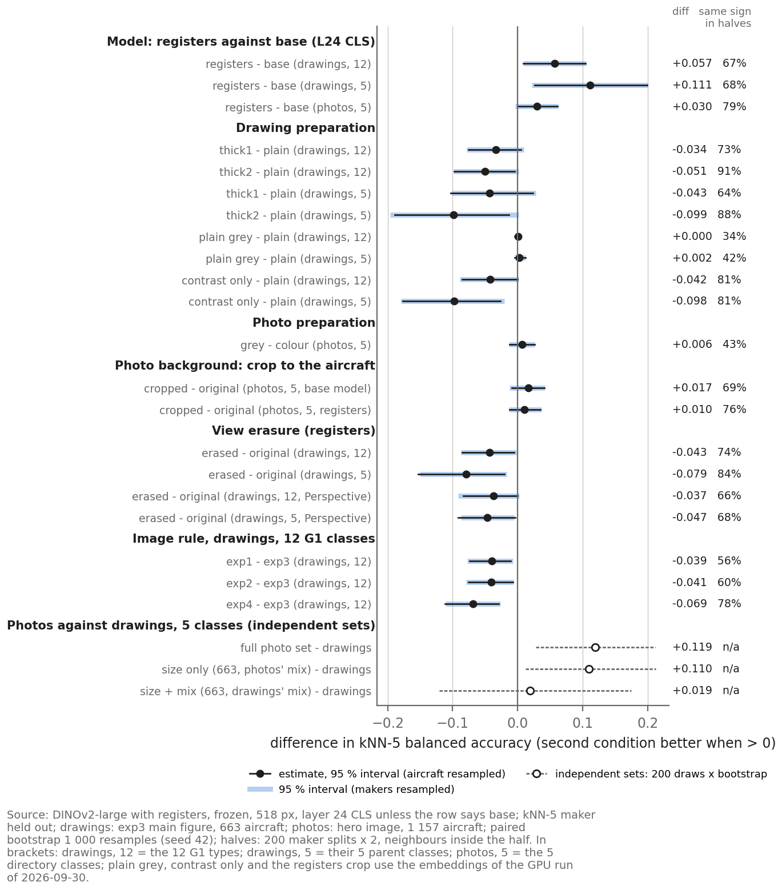{: width="100%" }

*Figure 9 — Every paired contrast of the document, with the aircraft and the maker intervals and the share of halves with the same sign.*

_Takeaway: **Resampling whole makers widens the intervals a little and moves 4 readings to no difference detected (thick2 on the 12 types, thick2 on the 5 classes, contrast on the 12 types and the view erasure (Perspective only) on the 12 types); none of the 25 survives a Holm correction, so the contrasts are read together, by their direction and their consistency across halves.**_

#### Answer

**DINOv2 with registers, at 518 px, read at layer 24 through the CLS token, on the images as they come: the checkpoint because its base twin collapses onto the blank pad, the rest by a held-out rule whose optimism is a few hundredths.**

- **Registers.** A label-free diagnostic (the largest patch in the pad for 85.6 % of the base model's drawings, 0.0 % with registers), adopted after the scores were seen, confirmed held out (67.8 % to 89.5 % of the choices).
- **Layer 24 CLS.** Chosen in 69 % of the held-out choices; on the photos alone layer 22 CLS ties with it.
- **Plain drawings, colour photos.** Every rendering change tested lowers the drawing score or leaves it unchanged; greyscale changes nothing on either source.
- **Three numbers for the drawings.** 0.235 measured, about 0.21 after the optimism, 0.178 for the model planned first.

## 3 — The drawings: do patent drawings carry the architecture, and what else does the model read in them?

Chapters 1 and 2 fixed the images and the setup. This chapter reads the 663 drawing aircraft with them: how well they predict the type (3.1), what organises the embedding (3.2), whether the choice of drawing matters (3.3) and where the model looks (3.4).

### 3.1 — How well do the drawings predict the architecture type?

#### Method

**Objective.** Whether the drawing vectors carry the architecture: whether aircraft of the same type sit closer than aircraft of different types, and how often a type is recovered from the nearest aircraft.

**Data and unit of analysis.** The 663 drawing aircraft, one main figure each, labelled with the 12 types and, folded, with the 5 parent classes; all six matrices, layer 24 CLS being the one carried forward.

**Procedure.** Soundness (T1, T2) and separation (T3) first. Figure 10 gives, per matrix, the kNN-5 balanced accuracy, the shuffled level and the probe; Figure 11 the recall per type with its Wilson interval, and the same recall when every type weighs the same in the pool: 20 aircraft per type (all of a smaller type), 200 draws, neighbours inside the draw, against the same draws with shuffled labels; Figure 12 which types are confused with which. k = 3 and k = 10 are rerun as a sensitivity check.

**Scientific grounds.** As in the methods box; Wilson (1927) for a recall on n aircraft; guessing scores 1/12 on the types.

**Assumptions and limits.** DS 5, SRW 9, RC 9, PFV 10 aircraft: these recalls rest on a handful of aircraft, and their types are greyed. PTC is also the type whose label most often disagrees with the whole-patent reading (9 of 26).

#### Results and discussion

- **Soundness.** No matrix has an invalid row. On its first principal component every matrix carries 27 to 56 times the variance of a random matrix, and the Hopkins statistic lies between 0.70 and 0.74: the vectors clump, as a continuum rather than as separate islands.
- **Separation.** Same-type aircraft sit closer than different-type ones in all 6 matrices (p ≤ 0.027), but by little: at layer 24 CLS the ratio is 1.073 and d 0.28 [0.20, 0.35].

{: width="80%" }

*Figure 10 — The architecture read from the drawings, per layer and token (12 types); blue: the matrix carried forward.*

*Takeaway: **At layer 24 CLS the drawings recover the 12 types at 0.23 [0.19, 0.28] against a shuffled level of 0.10, and the 5 classes at 0.44 [0.36, 0.53] against 0.22: the architecture is present, and weak.** The probe reads 0.36 [0.29, 0.43] (makers resampled; shuffled 0.12), +0.13 [+0.06, +0.20] above the neighbours: the architecture is in the vector, but it does not decide which aircraft are nearest. k = 3 and k = 10 give 0.226 and 0.223 (no difference detected against k = 5).*

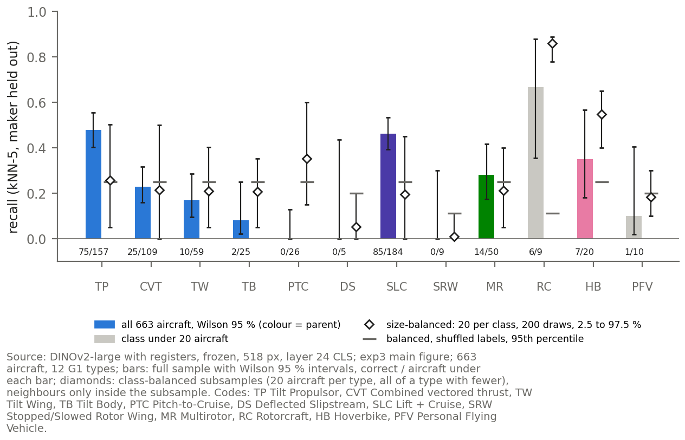{: width="88%" }

*Figure 11 — Recall per type: full sample with its Wilson interval (bars, under 20 aircraft greyed), and with every type weighing the same in the pool (diamonds).*

*Takeaway: **Three types are never recovered in the full sample (PTC 0 of 26, DS 0 of 5, SRW 0 of 9), but with class size equalised PTC rises to 0.35 [0.15, 0.60], above its shuffled level of 0.25: its zero was an effect of class size.** DS and SRW stay at or below chance, on 5 and 9 aircraft. Among the types with 20 aircraft or more, TP (0.48) and Lift + Cruise (0.46) are read best.*

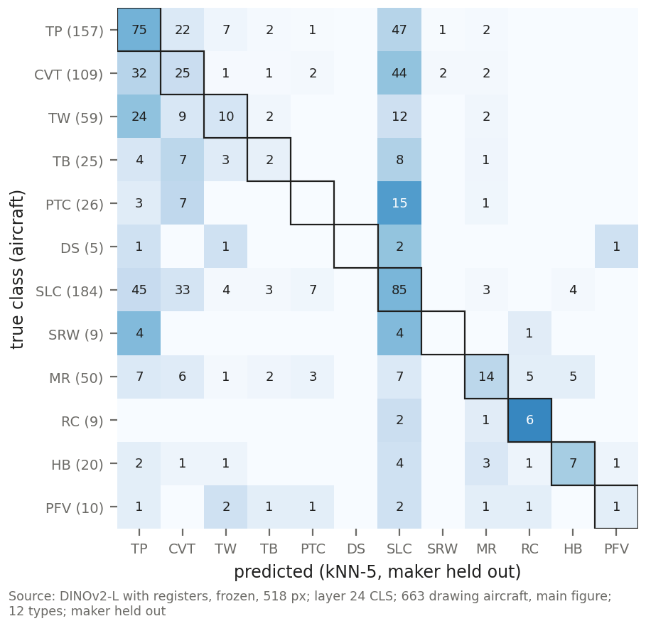{: width="60%" }

*Figure 12 — Which types are confused with which: rows are the true type (aircraft in brackets), columns the type kNN-5 predicts; the framed diagonal is correct.*

_Takeaway: **61.6 % of the 438 wrong predictions (270) name Lift + Cruise or TP, which hold 51.4 % of the pool: the two largest types draw the errors, somewhat more than their share.**_

### 3.2 — What organises the drawing embedding: the architecture, or the way the aircraft is drawn?

#### Method

**Objective.** Whether the types form clusters of their own, whether the view of the drawing moves the vectors more than the architecture, and whether the architecture survives when the view is removed.

**Data and unit of analysis.** The 663 aircraft for clusters and scores; all 1 541 whole-aircraft figures for the view, the unit at which a view exists; the view group of each figure (Perspective, Plan, Side, Front/Rear).

**Procedure.** k-means with 12 clusters against the types (T5); the figures mapped and coloured by view (Figure 13); T3's d for the view and for the architecture on the figures (T6, Figure 14), the d ratio with a maker bootstrap; then a linear erasure: the three directions that separate the four view means are fitted on the figures and projected out. It is checked in sample, and fitted on half of the makers and tested on the other half (200 splits). A **variance-matched control** removes three random directions of the same variance, over 200 draws (Figure 15).

**Scientific grounds.** The erasure is x ↦ (I − Q Qᵀ) x, then renormalised, with Q an orthonormal basis of the differences between the view means (the author's own implementation). A loss inside the control's range is not specific to the view.

**Assumptions and limits.** The erasure is linear only; a non-linear view signal survives it.

#### Results and discussion

- **No clusters of their own.** k-means with 12 clusters matches the types with an ARI of 0.026 at layer 24 CLS, and no matrix exceeds 0.033.

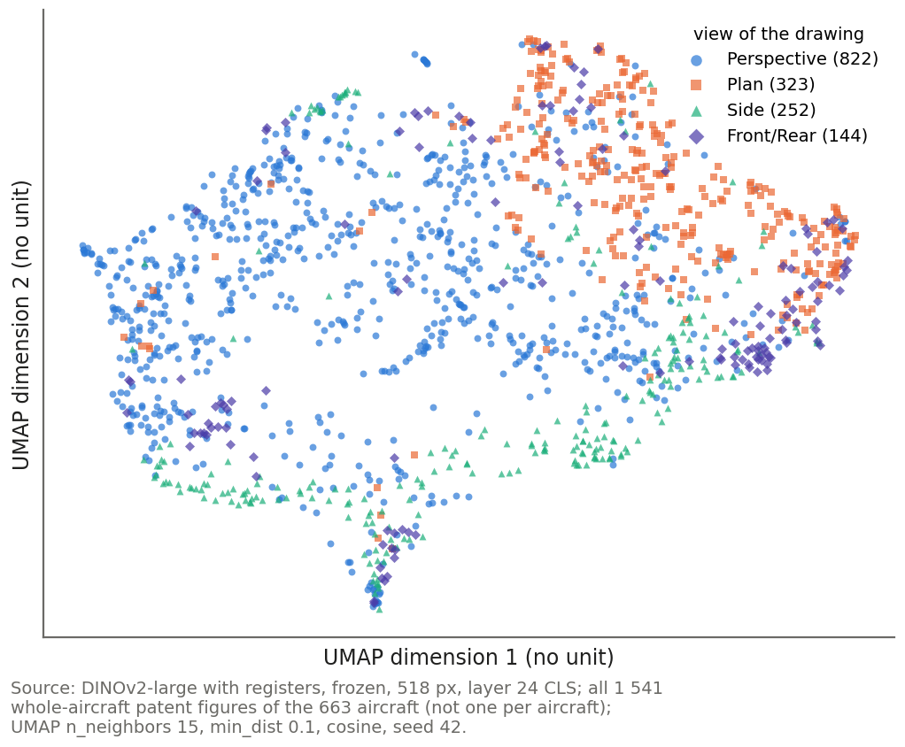{: width="62%" }

*Figure 13 — The 1 541 figure embeddings in two dimensions, coloured by the view of the drawing.*

_Takeaway: **The figures group by view: a view is recovered from the five nearest figures of other makers at 0.73 [0.70, 0.75] against a shuffled level of 0.27.**_

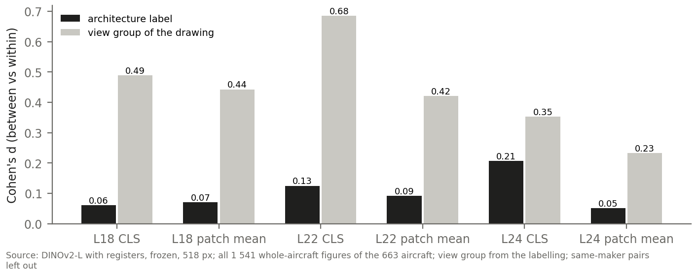{: width="80%" }

*Figure 14 — How far the view and the architecture move the vectors, per matrix: d, in standard deviations.*

*Takeaway: **The view moves the vectors more than the architecture in all 6 matrices: at layer 24 CLS the d ratio is 1.70 [1.18, 2.44].** The architecture d is 0.21 here, per figure, against 0.28 per aircraft: the figures add the non-main ones (d 0.18) and pairs in different views; within one view it is 0.29 (Perspective), 0.28 (Plan), 0.14 (Side) and 0.03 (Front/Rear).*

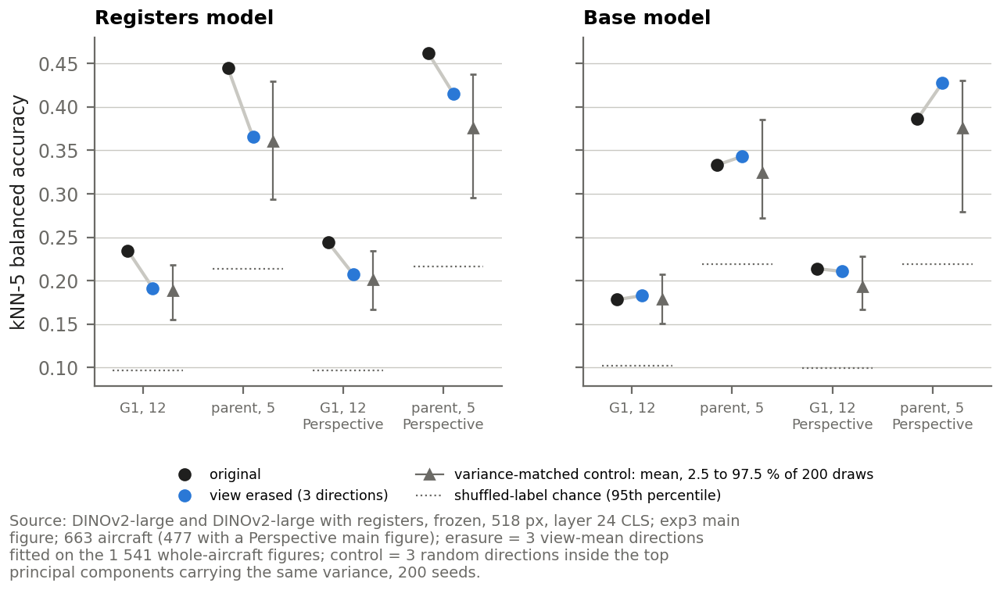{: width="86%" }

*Figure 15 — The architecture score before and after the view erasure, both models, with the variance-matched control over 200 draws.*

*Takeaway: **Removing the view costs 0.043 on the 12 types and 0.079 on the 5 classes, and a random removal of the same variance costs −0.046 [−0.080, −0.017] and −0.084 [−0.151, −0.015]: the loss is not specific to the view.** The erased scores, 0.191 [0.15, 0.23] and 0.365 [0.29, 0.44], stay above chance (0.10 and 0.21).*

- **In sample and held out.** Fitted and tested on the same figures, the erasure takes the linear view probe on the main figures from 0.79 to 0.22 (chance 0.25). Fitted on half of the makers, it takes the probe on the other half from 0.82 to 0.46: 64 % of the above-chance view signal removed (base model 56 %). The view kNN still reaches 0.55.
- **Why the view dominates yet its removal costs no more than chance.** Removing any three high-variance directions costs about as much as removing the view's three, so the view directions carry no more architecture than random ones: the reading consistent with this is an architecture spread through the dominant directions that the view also uses.
- **Base model.** The same erasure leaves it unchanged, and after it the two models score alike (12 types: registers 0.191, base 0.183; 5 classes: 0.365 against 0.343): part of the registers advantage sits in the directions the view also uses.

### 3.3 — Does the choice of drawing change the result?

#### Method

**Objective.** Whether the image rule of 1.2 changes the architecture score, and whether averaging several views adds architecture.

**Data and unit of analysis.** The 663 aircraft under each of the four rules; for the averaging, the 247 aircraft whose exp4 vector averages two or three views.

**Procedure.** Table 8 gives the score under each rule (T7), each rule minus the main figure with makers resampled and its per-half sign, and how often the split-half rule would choose each rule.

**Scientific grounds.** Intervals and split-half rule as in the methods box.

**Assumptions and limits.** The main figure was fixed as the rule before the setup round; the exp4 subset comparison was run after the rule scores had been seen (post hoc).

#### Results and discussion

**Table 8 — The architecture score under each image rule (registers, layer 24 CLS, maker held out).**

| image rule | kNN-5, 12 types | minus exp3 [makers] | same sign in halves | chosen, 12 types | chosen, 5 classes |
|:---|---:|:---|---:|---:|---:|
| exp1 view-first | 0.195 [0.16, 0.24] | −0.039 [−0.078, −0.008] | 56 % | 22 % | 14 % |
| exp2 state-first | 0.194 [0.16, 0.23] | −0.041 [−0.079, −0.007] | 60 % | 19 % | 25 % |
| exp3 main figure | 0.235 [0.19, 0.28] | reference | n/a | 48 % | 44 % |
| exp4 view average | 0.166 [0.14, 0.19] | −0.069 [−0.111, −0.027] | 78 % | 10 % | 16 % |

*Takeaway: **The main figure scores highest and the other rules are lower with intervals that exclude zero, but the split-half rule would pick it in only 48 % and 44 % of the choices: its lead is not stable across makers.** The rules span 0.17 to 0.23. On the 247 aircraft with two or three views, exp4 minus view-first is +0.020 [−0.049, +0.089], no difference detected: averaging views adds no measurable architecture.*

### 3.4 — Where does the model look on a drawing?

#### Method

**Objective.** Which parts of a drawing the CLS token of the chosen model reads: a qualitative check on what the scores measure.

**Data and unit of analysis.** Two drawing aircraft per parent class drawn at random (seed 42) from the main figures of the 663 aircraft.

**Procedure.** Figure 16 overlays the CLS attention at layers 18 and 24 on each drawing, read by eye. Layer 24 is the readout scored; layer 18, the layer the plan first named, scores 0.118 on the 12 types against 0.235 and is chosen in 0 % of the held-out choices against 69 %, so its maps show what the model sees, not what it scores.

**Scientific grounds.** Each map is scaled to its own 99th percentile, so brightness compares places within a map, never across maps.

**Assumptions and limits.** Ten aircraft read by eye are an illustration, not a measurement.

#### Results and discussion

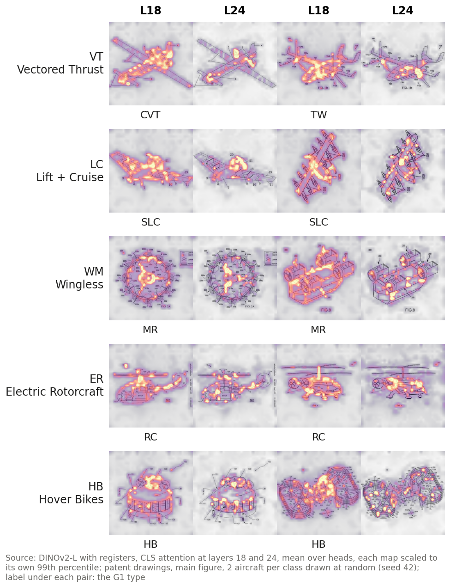{: width="66%" }

*Figure 16 — CLS attention of the registers model on drawings, layers 18 and 24, two aircraft per parent class; bright = attention within each map.*

*Takeaway: **Layer 18 traces the line-work almost everywhere; layer 24 gathers in spots on the aircraft, often on propulsors, hubs and the fuselage, parts every type has, so no map singles out the part that decides the type.** The register tokens take 0.32 to 0.44 of the attention, and the median share on the single largest patch stays at or below 0.015.*

#### Answer

**Patent drawings carry the architecture, weakly: a frozen model recovers the 12 types at 0.23 against a shuffled level of 0.10, but the embedding is organised first by how an aircraft is drawn, not by what it is.**

- **Present and weak.** 12 types at 0.23 [0.19, 0.28], 5 classes at 0.44; the probe reads 0.36.
- **The large types are read best; a zero can be class size.** PTC 0 of 26, DS 0 of 5, SRW 0 of 9 in the full sample, but PTC is recovered above chance once class size is equalised.
- **The view comes first.** The d ratio is 1.70 [1.18, 2.44], the view is recovered at 0.73, and the types form no clusters (ARI 0.026).
- **The architecture survives the view's removal.** The erasure costs no more than a random removal of the same variance, and every erased score stays above chance.
- **No single decisive part.** The image rules span 0.17 to 0.23, and the late CLS token spreads over parts every type has.

## 4 — The photographs: do photographs of the aircraft carry the architecture, and does the choice of image matter?

The same setup and protocol, on the 1 157 directory aircraft and their 5 classes: prediction (4.1), what organises the embedding (4.2), the choice of image (4.3) and where the model looks (4.4). Whether the scene around the aircraft matters is a fairness question, answered with the other controls in chapter 5.

### 4.1 — How well do photographs predict the directory class?

#### Method

**Objective.** Whether the photo vectors carry the architecture, read the same way as the drawings in 3.1.

**Data and unit of analysis.** The 1 157 photo aircraft, hero image, labelled with the directory class; all six matrices.

**Procedure.** Soundness and separation first; Figure 17 gives, per matrix, the kNN-5 balanced accuracy, the shuffled level and the probe; Figure 18 which classes are confused with which.

**Scientific grounds.** As in the methods box; guessing scores 1/5.

**Assumptions and limits.** The classes range from 83 (ER) to 410 (VT) aircraft.

#### Results and discussion

- **Soundness and separation.** No invalid row, and the first principal component carries 23 to 54 times the random variance. Same-class photos sit closer in all 6 matrices, with a larger effect than on the drawings: ratio 1.120 and d 0.44 at layer 24 CLS (drawings: d 0.28).

{: width="80%" }

*Figure 17 — The architecture read from the photographs, per layer and token (5 classes); blue: the matrix carried forward.*

*Takeaway: **At layer 24 CLS the photos recover the 5 classes at 0.56 [0.53, 0.60] against a shuffled level of 0.22, and the probe at 0.66 [0.63, 0.70] (shuffled 0.23).** Layer 22 CLS scores within that interval (0.57), which is why the split-half rule chose it in 40 % of the photo choices.*

{: width="50%" }

*Figure 18 — Which directory classes are confused with which: rows are the true class (aircraft in brackets), columns the predicted one.*

_Takeaway: **Wingless (Multicopter) is read best, 0.74 [0.69, 0.79], and Hover Bikes / PFD worst, 0.39 [0.31, 0.49].**_

### 4.2 — What organises the photo embedding: the architecture, or the maturity of the aircraft?

#### Method

**Objective.** Whether the classes form clusters, and whether the maturity of the aircraft, built or concept, moves the vectors more than its class.

**Data and unit of analysis.** The 1 157 aircraft for clusters; the 651 aircraft whose page states built or concept for the maturity label.

**Procedure.** k-means with 5 clusters against the classes (T5), with the map of Figure 19; T3's d for the maturity and for the class, per matrix (T6).

**Scientific grounds.** ARI and d as in the methods box.

**Assumptions and limits.** The maturity is the page's own statement.

#### Results and discussion

{: width="60%" }

*Figure 19 — The photo embeddings in two dimensions, one point per aircraft, coloured by the directory class.*

_Takeaway: **The classes form weak clusters: k-means matches them with an ARI of 0.141 at layer 24 CLS, 4.5 times the drawings' 0.031 on the same 5 classes.**_

At layer 24 CLS the maturity moves the vectors less than the class (d 0.12 against 0.46, a ratio of 0.27), but in 4 of the 6 matrices the maturity dominates: the order depends on the layer, and the matrix carried forward is one where the class leads.

### 4.3 — Does the choice of photograph change the result?

#### Method

**Objective.** Whether another image of the page would change the photo score.

**Data and unit of analysis.** The 1 157 photo aircraft under three rules: the hero image (the fixed rule), one random other kept image of the page, and the mean of the vectors of all kept images.

**Procedure.** Table 9 gives the score under each rule, each rule minus the hero image with makers resampled and its per-half sign, and how often the split-half rule would choose each.

**Scientific grounds.** As in the methods box.

#### Results and discussion

**Table 9 — The photo score under each image rule (registers, layer 24 CLS, maker held out).**

| image rule | kNN-5, 5 classes | minus hero [makers] | same sign in halves | chosen (held out) |
|:---|---:|:---|---:|---:|
| hero image | 0.563 [0.53, 0.60] | reference | n/a | 36 % |
| random other image | 0.521 [0.49, 0.55] | −0.042 [−0.074, −0.011] | 96 % | 0 % |
| mean of all images | 0.578 [0.55, 0.61] | +0.014 [−0.016, +0.050] | 63 % | 63 % |

*Takeaway: **The mean of all images would be chosen in 63 % of the held-out choices against 36 % for the hero image, but its gain, +0.014 [−0.016, +0.050], is no difference detected; a random other image scores lower.** The hero image is kept: one representative image per aircraft on both sides.*

### 4.4 — Where does the model look on a photograph?

#### Method

**Objective.** The same qualitative check as 3.4, on photographs, where the aircraft sits in a scene.

**Data and unit of analysis.** Two photo aircraft per class drawn at random (seed 42) from the 1 157 hero images.

**Procedure.** Figure 20 overlays the CLS attention at layers 18 and 24 on each photograph, read by eye.

**Scientific grounds.** As in 3.4: each map scaled on its own.

**Assumptions and limits.** Ten aircraft read by eye are an illustration, not a measurement.

#### Results and discussion

{: width="66%" }

*Figure 20 — CLS attention of the registers model on photographs, layers 18 and 24, two aircraft per class; bright = attention within each map. Photo: evtol.news directory, © owners.*

_Takeaway: **Layer 18 covers the airframe; layer 24 gathers in spots on the aircraft, with weak spots in the sky. In one wingless photo the people in front of the aircraft draw as much attention as the aircraft itself: a kept hero image can still be a scene.**_

#### Answer

**Photographs carry the architecture moderately: the 5 classes at 0.56 against a shuffled level of 0.22, a result the choice of image does not change.**

- **Moderate.** kNN-5 0.56 [0.53, 0.60], probe 0.66; Wingless (Multicopter) is read best, Hover Bikes / PFD worst.
- **Weak clusters, stronger than on drawings.** ARI 0.141 against 0.031 on the same 5 classes; separation d 0.44 against 0.28.
- **The class leads the maturity only in some matrices**, the one carried forward among them; in 4 of 6 whether the aircraft was built moves the vectors more.
- **The image rule does not decide it.** The mean of all images scores +0.014 [−0.016, +0.050] against the hero image, no difference detected.

## 5 — Drawings against photographs: is the comparison fair, which source carries more of the architecture, and can one aircraft be found in both?

The two sources are read with the same model, readout and protocol on the 5 classes they share, each drawing type folded into its parent. Before the scores are compared, the comparison itself must be fair. Three things differ besides the medium:

- **The labels.** The photo class is the directory's, the drawing class the codebook parent: they agree for 83 of the 99 aircraft present in both (84 %), the floor below which no source comparison can be read.
- **The pool.** 1 157 photo aircraft against 663 drawings, with different class mixes (chapter 1).
- **The image.** Colour and scenery on the photos, line-work on white for the drawings; the photos also carry the aircraft's maturity, which moves the photo vectors more than the class in 4 of 6 matrices (4.2), a signal a patent drawing does not have.

### 5.1 — Once pool, class mix, colour and background are controlled, do photographs carry more architecture than drawings?

#### Method

**Objective.** Whether the medium, drawing or photograph, carries more of the architecture on the shared 5 classes, once each difference other than the medium has been controlled.

**Data and unit of analysis.** The 663 drawing aircraft with their type folded to its parent, and the 1 157 photo aircraft; the two sets hold different aircraft.

**Procedure.** Table 10 compares the sources on the full sets, then controls one difference at a time: **size**, 200 random photo subsets of 663 at the photos' own class mix; **size and mix**, 200 subsets with exactly the drawings' class counts; **colour**, both sources in greyscale; **background**, each hero image cropped to the aircraft by a zero-shot OWLv2 detector and re-embedded, against the uncropped image. Figure 21 sets each class's recall against its share of the neighbour pool.

**Scientific grounds.** The difference of two independent sets resamples each on its own (1 000 draws); a subset score combines the 200 draws with a bootstrap of each draw's aircraft. A neighbour vote depends on its pool: a class that is thin in the pool is hard to recover whatever the medium.

**Assumptions and limits.** The size and mix controls were designed after the full-set comparison had been seen, the greyscale and registers crop checks after the review (post hoc).

#### Results and discussion

**Table 10 — Photographs against drawings on the shared 5 classes, one control at a time (registers, layer 24 CLS, kNN-5, maker held out). The difference is photos minus drawings unless the row says otherwise.**

| comparison | drawings | photos | difference [95 % CI] | reading |
|:---|---:|---:|:---|:---|
| full sets (photos in colour, drawings plain) | 0.445 | 0.563 | +0.119 [+0.027, +0.211] | above zero |
| same size (663 photos), photos' own class mix | 0.445 | 0.554 | +0.110 [+0.012, +0.212] | above zero |
| same size and the drawings' class mix | 0.445 | 0.463 | +0.019 [−0.121, +0.174] | no difference detected |
| the class mix alone, at fixed size (photos only) | n/a | n/a | +0.091 [−0.050, +0.214] | no difference detected |
| both sources in greyscale | 0.447 | 0.570 | +0.123 [+0.031, +0.216] | above zero |
| photos cropped to the aircraft, minus uncropped (paired, makers) | n/a | 0.574 | +0.010 [−0.014, +0.037] | no difference detected |

*Takeaway: **Photographs score higher at equal pool size (+0.110); once the photo pool also has the drawings' class mix, no difference is detected (+0.019), though the comparison is too imprecise to rule out a medium effect of the size found at full scale.** The class mix alone moves the photo score by +0.091, no difference detected, so it is the remaining candidate, not a demonstrated cause. Colour is not the cause (the lead survives with both sources in grey), and neither is the background (cropping moves the photo score by +0.010; on the base model +0.017).*

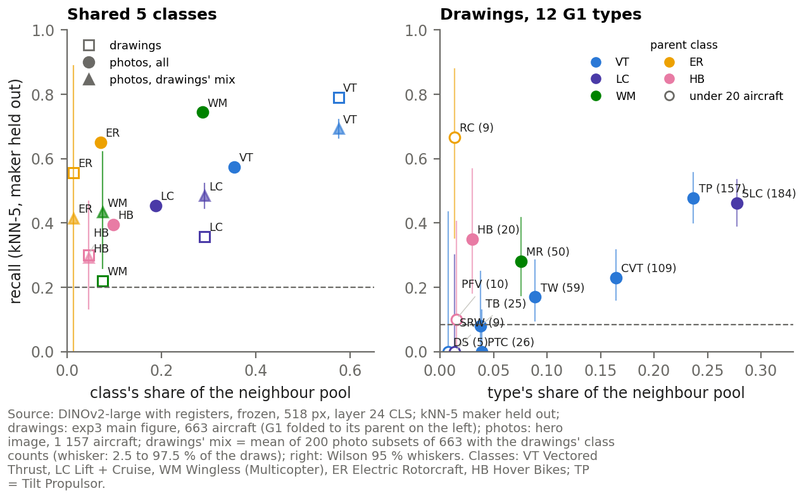{: width="92%" }

*Figure 21 — Recall per class against the class's share of the neighbour pool: the shared 5 classes in both sources (left), the 12 G1 types of the drawings (right).*

*Takeaway: **A class is read well largely when it fills the pool.** Wingless multicopters, 8 % of the drawing pool and 29 % of the photo pool, are read at 0.22 from drawings and 0.74 from photos, and at 0.43 once the photos have the drawings' mix; Vectored Thrust goes the other way (0.79 drawings, 0.57 photos, 0.69 matched).*

### 5.2 — Can the same aircraft be found in both sources?

#### Method

**Objective.** Whether the model links a patent drawing to a photograph of the same aircraft, and the reverse: the strictest form of the fairness question, one aircraft in two media.

**Data and unit of analysis.** The 94 patent aircraft that have a directory page, as queries against the 1 141 photo aircraft whose hero image is not a line drawing, and those photo aircraft against the 665 aircraft of the patent main set. Of the 99 linked aircraft of 1.1, 4 leave through the domain gate (similar to a UAV) and 1 whose page shows only a line drawing.

**Procedure.** Each query ranks the gallery by cosine distance. Table 11 gives the share of queries whose own page is in the top 10 and the top 50, with bootstrap intervals over the queries, by page status and for the base model, and the median rank; Figure 22 the share within the top k for every k. Line drawings leave the gallery because some pages reproduce the patent figure itself.

**Scientific grounds.** Against a random ranking: P(own page in the top k) = 1 − Π_{i<k} (G − n₊ − i) / (G − i), averaged over the queries, with G the gallery size and n₊ the query's own pages (the author's own baseline).

**Assumptions and limits.** The 94 linked aircraft are well-known programmes with a public product, which a directory page exists for: a biased subset of the patent aircraft.

#### Results and discussion

**Table 11 — Same-aircraft matching (layer 24 CLS, no line drawings in the gallery); at random the top 10 and top 50 hold the own page for 1.6 % and 7.6 % of the patent queries.**

| direction | queries | top 10, % [95 % CI] | top 50, % [95 % CI] | median rank |
|:---|---:|---:|---:|---:|
| patent → photo, registers | 94 | 22.3 % [13.8, 30.9] | 47.9 % [37.2, 58.5] | 55 |
| patent → photo, built aircraft | 40 | 15.0 % [5.0, 27.5] | 37.5 % [22.5, 55.0] | 109.5 |
| patent → photo, concept aircraft | 30 | 23.3 % [10.0, 40.0] | 60.0 % [43.3, 76.7] | 34.5 |
| photo → patent, registers | 94 | 17.0 % [9.6, 25.5] | 47.9 % [38.3, 58.5] | 63.5 |
| patent → photo, base model | 94 | 20.2 % [12.8, 27.7] | 37.2 % [27.7, 46.8] | 88.5 |

*Takeaway: **The own page is in the top 50 for 47.9 % of the patent queries [37.2, 58.5], against 7.6 % at random and 37.2 % with the base model.** Concept aircraft find their page in 60.0 % of the queries and built ones in 37.5 %; the two intervals overlap, so no difference is claimed.*

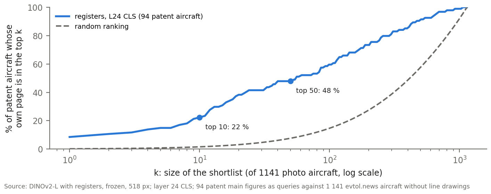{: width="70%" }

*Figure 22 — How often a patent aircraft finds its own directory page within the top k photographs, against a random ranking.*

_Takeaway: **The link is well above chance at every shortlist size but far from a retrieval tool: the median rank is 55.**_

#### Answer

**Photographs score higher at equal pool size; once the photo pool also has the drawings' class mix, no difference is detected, though the comparison is too imprecise to rule out a medium effect of the size found at full scale.**

- **Full sets.** Photos 0.563 against drawings 0.445, +0.119 [+0.027, +0.211].
- **Not the pool size, not the colour, not the background.** Equal size +0.110, both grey +0.123, cropping +0.010 (no difference detected).
- **The class mix is the remaining candidate.** With the drawings' mix +0.019 [−0.121, +0.174], no difference detected; the mix alone +0.091, no difference detected.
- **One aircraft in two media.** 48 % of the linked patent aircraft find their own page in the top 50 (random 7.6 %), on a subset of well-known programmes.

## The answer to RQ4, what it rests on, and what is still open

#### Answer to RQ4

**The figure alone carries the architecture: weakly in patent drawings, moderately in photographs as they come, and no difference between the two media is detected once the photo pool has the drawings' size and class mix.**

- **Drawings.** A frozen general-purpose model, never trained on aircraft or on the codebook, recovers the 12 types from one drawing per aircraft at 0.235 (shuffled level 0.10), about 0.21 after the selection optimism and 0.178 with the base model planned first; the 5 classes at 0.44.
- **Photographs.** 0.56 on the 5 classes; the lead over the drawings survives equal pool size and greyscale, cropping to the aircraft changes nothing detectable, and the lead is no longer detected with the drawings' class mix.
- **It holds** with the maker held out, under every image rule, without the photo backgrounds, in greyscale, and after the view of the drawing is linearly removed; these contrasts are read together, none of them surviving a correction for their number.
- **The drawing embedding is organised first by how the aircraft is drawn**, second by what it is: the d ratio is 1.70, and the types form no clusters of their own.
- **The human reading stays the reference.** The architecture is in the vector (the probe reads more than the neighbours) but does not decide which aircraft are nearest.

**What DINOv2 contributes to the thesis.**

- **A test of the taxonomy by an observer that has never seen it.** The types it recovers best are the large ones; PTC, never recovered in the full sample, is recovered above chance once class size is equalised, while DS and SRW rest on too few aircraft to say.
- **A link from the patent record to the directory** of built and proposed aircraft, above chance.
- **A labelled benchmark of whole-aircraft drawings with a fixed protocol**, on which a fine-tuned or aircraft-specific model can be measured.

**A reusable recipe for patent-drawing studies.**

1. Test the checkpoint before reading any score: if a late layer puts more than about 0.1 of the CLS attention on one patch, or its largest patch in the pad, use a registers checkpoint (base model: in the pad for 85.6 % of the drawings; registers: 0.0 %).
2. Feed the largest native input size (518 px) on a white pad, and keep the lines as drawn: no rendering change tested improves the score; a gentler change is untested.
3. Choose the layer and token with the split-half rule over makers, and report the optimism gap beside the score.
4. Hold the maker out of every neighbour, resample makers for every interval, and test the view as a confound before reading any class result.

**What the results rest on.**

- **One labeller.** The G1 labels and the whole-patent reading are the author's (κ 0.94; 0.866 for the frozen labels); no second labeller is recorded.
- **Small and unbalanced classes.** DS 5, SRW 9, RC 9, PFV 10 aircraft; the two sources differ in class mix, and the matched comparison is wide.
- **A linear view erasure only.** Held out it removes 64 % of the view signal, and the view kNN stays at 0.55 after it.
- **Post-hoc steps.** The registers switch after its scores were seen; the size and mix controls after the photo lead was seen; the grey and contrast drawing controls, the grey-with-grey comparison and the registers crop after the review; the exp4 subset after the rule scores.
- **Many contrasts.** 25 paired contrasts, none surviving a Holm correction: the evidence is their agreement, not any one of them.
- **A photo filter audit that is not blind**, judged by the pipeline's AI assistant; the 239 review-band images were never decided by hand.
- **A biased matching subset.** The 94 linked aircraft are well-known programmes.
- **One frozen model.** A fine-tuned model, or one trained on technical drawings, is outside the scope.

**Questions still open.** Each is a choice for the chapter and can be settled with the results already held.

- **Does same-aircraft matching earn its own section?** It is above chance (48 % in the top 50) but far from reliable; it could shrink to one paragraph.
- **Does the exp4 question stay?** Averaging views is a null; it may leave the chapter.
- **A second labeller?** A blind second reading of a sample of drawings would give an independent κ.

**References**

Brodersen, K. H., Ong, C. S., Stephan, K. E. and Buhmann, J. M. (2010). The balanced accuracy and its posterior distribution. In *Proceedings of the 20th International Conference on Pattern Recognition*, 3121-3124.

Cohen, J. (1960). A coefficient of agreement for nominal scales. *Educational and Psychological Measurement*, 20(1), 37-46.

Cover, T. M. and Hart, P. E. (1967). Nearest neighbor pattern classification. *IEEE Transactions on Information Theory*, 13(1), 21-27.

Darcet, T., Oquab, M., Mairal, J. and Bojanowski, P. (2024). Vision transformers need registers. In *International Conference on Learning Representations (ICLR 2024)*.

Efron, B. (1979). Bootstrap methods: another look at the jackknife. *The Annals of Statistics*, 7(1), 1-26.

Holm, S. (1979). A simple sequentially rejective multiple test procedure. *Scandinavian Journal of Statistics*, 6(2), 65-70.

Hubert, L. and Arabie, P. (1985). Comparing partitions. *Journal of Classification*, 2(1), 193-218.

McInnes, L., Healy, J. and Melville, J. (2018). UMAP: Uniform manifold approximation and projection for dimension reduction. arXiv:1802.03426.

Oquab, M., Darcet, T., Moutakanni, T. et al. (2023). DINOv2: Learning robust visual features without supervision. arXiv:2304.07193.

Wilson, E. B. (1927). Probable inference, the law of succession, and statistical inference. *Journal of the American Statistical Association*, 22(158), 209-212.

## Appendix A — Every layer and token under both models

Every matrix under both models, maker held out: kNN-5 balanced accuracy with the registers model's interval and shuffled level, and the linear probe. Base appears here only as the comparison; every chapter uses the registers model.

**Table 12 — Patent drawings, 12 types (663 aircraft, main figure).**

| matrix | kNN-5 base | kNN-5 registers | 95 % interval | shuffled level | probe base | probe registers |
|:---|---:|---:|---:|---:|---:|---:|
| L18 CLS | 0.097 | 0.118 | [0.10, 0.14] | 0.101 | 0.162 | 0.210 |
| L18 patch mean | 0.091 | 0.106 | [0.09, 0.12] | 0.098 | 0.241 | 0.238 |
| L22 CLS | 0.163 | 0.176 | [0.14, 0.22] | 0.098 | 0.307 | 0.351 |
| L22 patch mean | 0.119 | 0.140 | [0.11, 0.17] | 0.098 | 0.287 | 0.292 |
| L24 CLS | 0.178 | 0.235 | [0.19, 0.28] | 0.096 | 0.319 | 0.362 |
| L24 patch mean | 0.183 | 0.166 | [0.13, 0.20] | 0.096 | 0.258 | 0.302 |

_Takeaway: **Registers score higher than base in 5 of the 6 matrices, and L24 CLS is the best matrix under registers.**_

**Table 13 — Patent drawings, 5 parent classes (663 aircraft, main figure).**

| matrix | kNN-5 base | kNN-5 registers | 95 % interval | shuffled level | probe base | probe registers |
|:---|---:|---:|---:|---:|---:|---:|
| L18 CLS | 0.198 | 0.221 | [0.20, 0.25] | 0.215 | 0.377 | 0.424 |
| L18 patch mean | 0.215 | 0.216 | [0.20, 0.23] | 0.219 | 0.408 | 0.458 |
| L22 CLS | 0.260 | 0.287 | [0.25, 0.33] | 0.216 | 0.540 | 0.597 |
| L22 patch mean | 0.224 | 0.236 | [0.20, 0.29] | 0.216 | 0.507 | 0.488 |
| L24 CLS | 0.333 | 0.445 | [0.36, 0.53] | 0.217 | 0.568 | 0.606 |
| L24 patch mean | 0.339 | 0.339 | [0.27, 0.41] | 0.219 | 0.531 | 0.501 |

_Takeaway: **Registers score higher than base in 5 of the 6 matrices, and L24 CLS is the best matrix under registers.**_

**Table 14 — Photographs, 5 directory classes (1 157 aircraft, hero image).**

| matrix | kNN-5 base | kNN-5 registers | 95 % interval | shuffled level | probe base | probe registers |
|:---|---:|---:|---:|---:|---:|---:|
| L18 CLS | 0.290 | 0.352 | [0.32, 0.38] | 0.220 | 0.435 | 0.503 |
| L18 patch mean | 0.311 | 0.334 | [0.31, 0.36] | 0.218 | 0.446 | 0.471 |
| L22 CLS | 0.479 | 0.571 | [0.54, 0.60] | 0.218 | 0.628 | 0.650 |
| L22 patch mean | 0.377 | 0.345 | [0.32, 0.37] | 0.217 | 0.566 | 0.564 |
| L24 CLS | 0.534 | 0.563 | [0.53, 0.60] | 0.218 | 0.648 | 0.662 |
| L24 patch mean | 0.394 | 0.385 | [0.35, 0.42] | 0.218 | 0.583 | 0.571 |

_Takeaway: **Registers score higher than base in 4 of the 6 matrices, and L22 CLS is the best matrix under registers.**_

