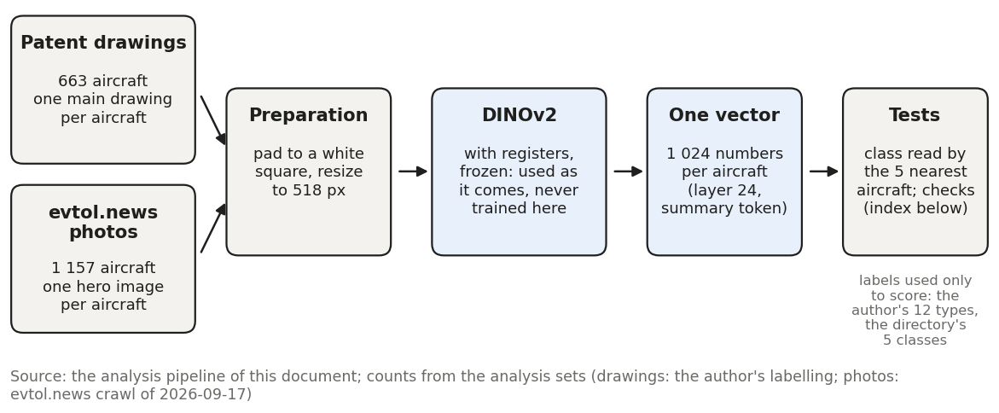
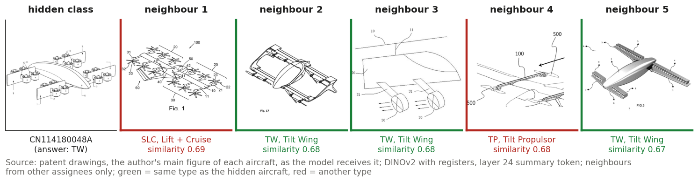
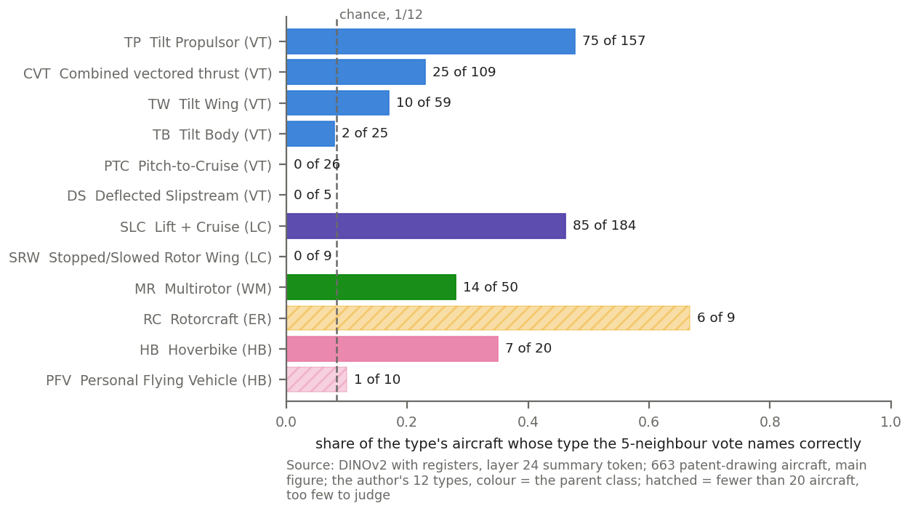
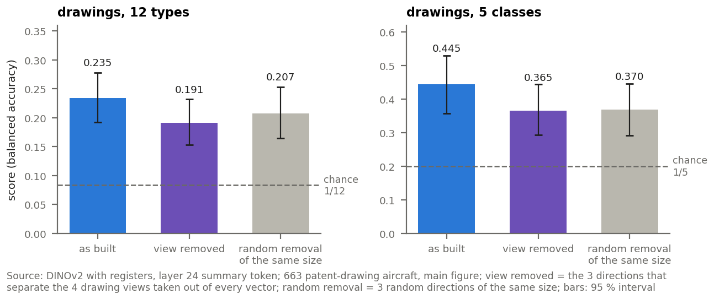
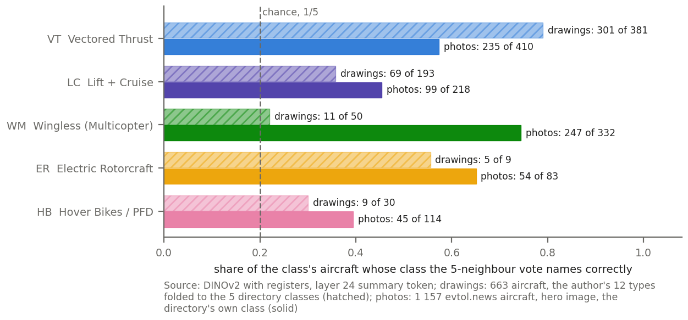
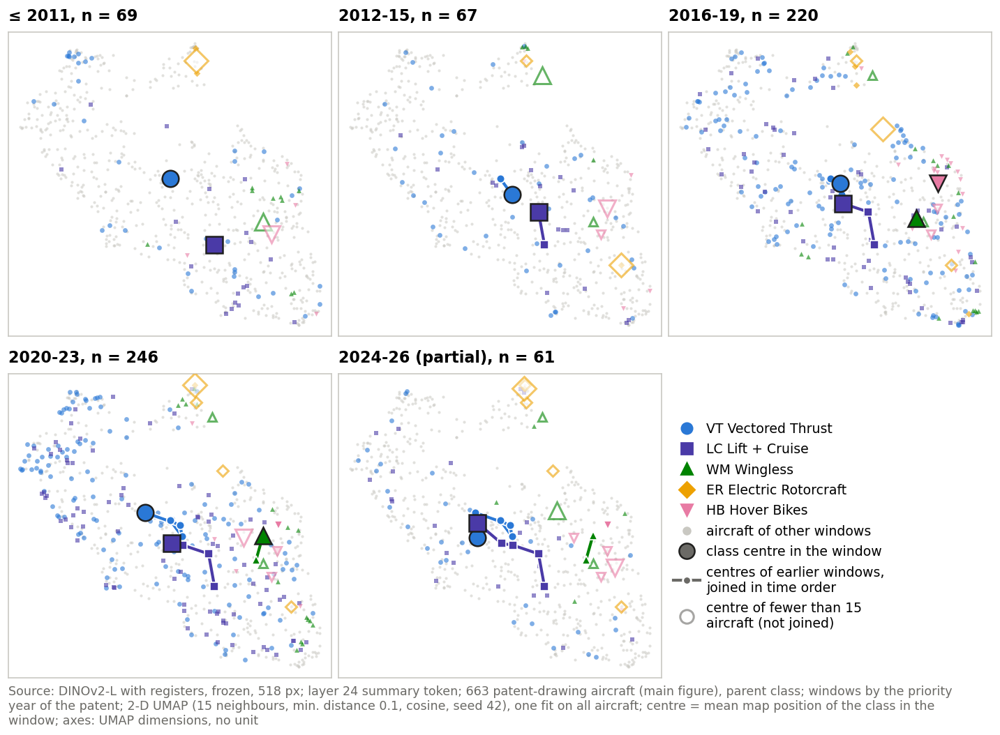
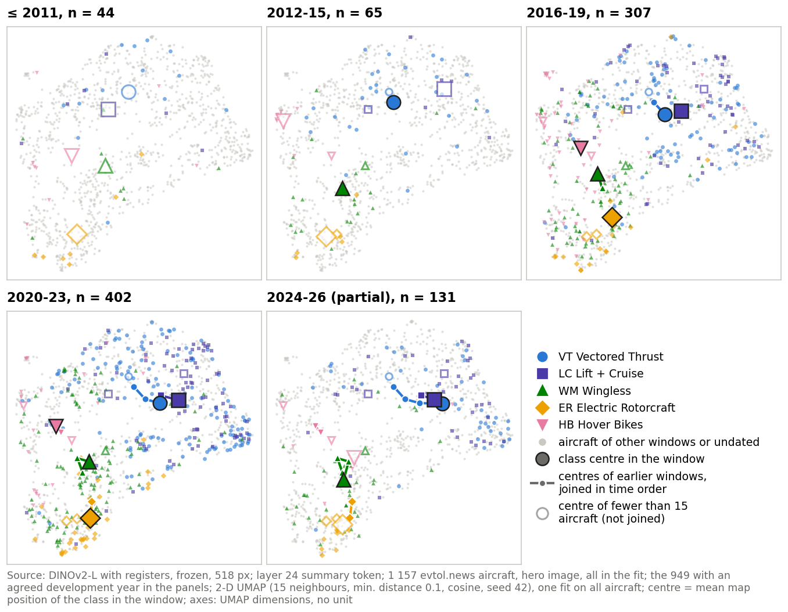
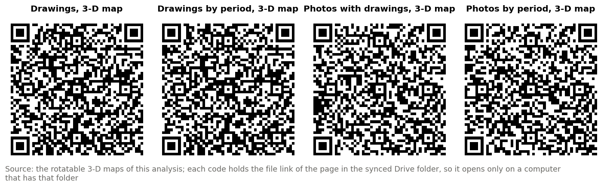

# Visual Learning: DINOv2 embeddings of patent drawings and photographs

<!-- Date: 2026-10-01 -->

Short version for using DINOv2 as a tool: what was done, what was found, and how robust it is. Private: contains evtol.news photographs, © their owners.

---

## 1 — The pipeline on one page

**The question.** Does a picture alone carry the architecture of an aircraft? A general-purpose vision model, DINOv2, that has never seen the codebook or been trained on aircraft, turns each image into a list of numbers. If aircraft of the same class get similar numbers, the class can be read back from the picture. The same model and the same tests are applied to two image sources: the patent drawings of the author's labelling, and the photographs of the evtol.news directory.

{: width="100%" }

*Figure 1 — The pipeline: from one image per aircraft to one vector per aircraft, then the tests.*

*Takeaway: **Every test reads the same vectors: one per aircraft, from one frozen model.** The labels are never shown to the model; they are used only to score what the model did.*

**The index of the tests.** The setup checks come first, because they fix the settings every later test uses; then the tests on each source, the comparison of the two, and the change over time.

**Table 1 — The tests of this document, in the order they are run.**

| phase | test | what it asks | section |
|:---|:---|:---|---:|
| Setup | S1 attention check | Does the model waste its attention on blank background? | 4 |
| Setup | S2 layer and token | Which internal reading of the model holds the class best? | 4 |
| Setup | S3 image preparation | Should drawings or photos be changed before the model reads them? | 4 |
| Setup | S4 image per aircraft | Which image should stand for each aircraft? | 3, 4 |
| Drawings | T1 valid vectors | Is every vector usable (no empty, broken or duplicate rows)? | 5 |
| Drawings | T2 class read | Do the 5 most similar aircraft of other assignees name the right class? | 5 |
| Drawings | T3 class by class | Which classes are read well, and which rest on too few aircraft? | 5 |
| Drawings | T4 what else | Does the drawing view shape the vectors more than the class does? | 5 |
| Drawings | T5 view removed | Is the class still read once the view is taken out of the vectors? | 5 |
| Photos | T1 to T3, T6 | The same tests; does the background or the colour matter? | 6 |
| Both | T7 fair comparison | Do photos carry more of the class than drawings, at equal pool size and class mix? | 7 |
| Both | T8 over time | Do the classes change their appearance across the years? | 8 |
| All | robustness | Does any single choice decide the result? | 9 |

## 2 — The words used in this document

The terms below carry the whole document. Each is explained once here.

**Embedding (vector).** The model turns an image into a list of 1 024 numbers, its embedding or vector. Two images that look alike to the model get similar lists. The model is **frozen**: it is used exactly as published and never trained on these images.

**Layer and token.** The model reads an image in 24 steps, called layers. It cuts the image into small square tiles of 14 by 14 pixels, called patches (a 518-pixel image has 37 by 37 of them), and keeps one extra summary token (called CLS) that gathers the whole image. The vector used here is the summary token after the last layer, layer 24 (why: section 4).

**Similarity.** How alike two vectors are, measured by the angle between them (cosine similarity): 1 means they point the same way, 0 that they have nothing in common. Only the direction counts, not the size of the numbers.

**The 5-neighbour vote, the main test.** Take one aircraft and hide its class. Find the 5 aircraft whose vectors are most similar to it, taking them only from other assignees. Each of the 5 votes for its own class; the class with most votes is the answer (a tie goes to the class of the most similar one). The answer is right or wrong. This is repeated for every aircraft. 5 is a small, common number of voters, fixed before any result was seen; 3 or 10 voters give the same score within its interval (section 9). Figure 2 is a real case: the hidden aircraft is a Tilt Wing (TW) of patent CN114180048A; its 5 nearest aircraft vote 3 TW, 1 SLC, 1 TP, so the vote says Tilt Wing: right. The class is not always one of the 12 types: the same vote is also run on the 5 broader classes, which group the types (section 3).

{: width="100%" }

*Figure 2 — The 5-neighbour vote on one drawing: the hidden aircraft and its 5 most similar aircraft of other assignees, with their types and similarities.*

*Takeaway: **3 of the 5 neighbours share the hidden type, so the vote names it correctly.** The model never saw a label: it only placed similar drawings close together.*

**The score (balanced accuracy).** For each class, the share of its aircraft whose class the vote names correctly; then the average of these shares over the classes. Every class counts the same, so a large class cannot hide a class that is never read.

**Chance level, and how to read a score.** A blind guess is right once in 12 on the 12 types (0.083) and once in 5 on the 5 classes (0.20). A score is read against that level: 0.235 on 12 types is about 2.8 times chance. As a check, the same vote with the class labels shuffled at random stays at or below 0.10 in 95 of 100 shuffles.

**The same-company rule.** Aircraft of the same company are never compared with each other: the neighbours of a patent aircraft always come from other assignees, those of a photographed aircraft from other developers. A company's drawing style or photo studio therefore cannot pass for architecture.

**The 95 % interval.** The score is recomputed on 1 000 random resamples of the aircraft, and the middle 95 % of those scores is the interval, written [low, high]. When two settings are compared, whole companies are resampled, so the interval allows for one company's aircraft being alike. A difference whose interval includes zero is read as **no difference detected**.

**The map (UMAP).** A drawing of the 1 024-number vectors on a flat page (or in 3-D), placing similar aircraft close together. Its axes have no unit. A map is a picture to look at, never a test.

## 3 — The data

Two sources, each reduced to one image and one vector per aircraft.

#### 3.1 Patent drawings

The drawings come from the author's labelling of the eVTOL patents. Of the 5 823 figures on file, the author approved 1 913; 277 more leave because their aircraft is similar to a drone or not electric, 74 because their patent duplicates another, 1 because it repeats an image file of another figure row, and 16 because they show a part. **1 541 whole-aircraft drawings of 663 aircraft from 572 patents remain.** Every aircraft carries the author's type, one of the codebook's 12, and its parent class, one of 5 (Table 2).

**Table 2 — The 5 classes, the 12 types they group, and the aircraft of each source.**

| class (directory) | codebook types under it (drawing aircraft) | drawing aircraft | photo aircraft |
|:---|:---|---:|---:|
| VT Vectored Thrust | TP Tilt Propulsor (157), CVT Combined vectored thrust (109), TW Tilt Wing (59), TB Tilt Body (25), PTC Pitch-to-Cruise (26), DS Deflected Slipstream (5) | 381 | 410 |
| LC Lift + Cruise | SLC Lift + Cruise (184), SRW Stopped/Slowed Rotor Wing (9) | 193 | 218 |
| WM Wingless (Multicopter) | MR Multirotor (50) | 50 | 332 |
| ER Electric Rotorcraft | RC Rotorcraft (9) | 9 | 83 |
| HB Hover Bikes / PFD | HB Hoverbike (20), PFV Personal Flying Vehicle (10) | 30 | 114 |

*Takeaway: **Two types, Lift + Cruise (SLC) and Tilt Propulsor (TP), hold 51 % of the drawing aircraft, while 4 types have fewer than 20 (DS, SRW, RC, PFV).** TP is printed for the wizard's TR (Tilt Propulsor).*

**One drawing per aircraft, by fixed priorities.** An aircraft has a median of two whole-aircraft drawings, so one must be chosen. (1) The figure the author marked as **main** in the wizard; this decides for 662 of the 663 aircraft. (2) If no single whole-aircraft main exists (1 aircraft), the best **view**, in the order Perspective > Plan (top or bottom) > Side > Front or Rear; within the same view, the best **flight state**, in the order Both > Cruise > Hover > Other > Missing; then the lowest figure number. Both, the moving part drawn in both positions, is the best state and comes first (author ruling of 2026-10-01). The flight state only matters for the 5 convertible types (TP, CVT, TW, DS, SRW); every other type has one state. The other ways of choosing (view first, flight state first, an average of views) are compared in section 4.

**What the model receives.** The chosen drawing is rotated by the angle recorded in the labelling, padded to a white square and resized to 518 by 518 pixels, black lines on white, numerals left in (Figure 3).

{: width="100%" }

*Figure 3 — One main drawing per type, as the model receives it (518 px, padded white square).*

_Takeaway: **The model sees black line-work on white; nothing in the image names the type.**_

#### 3.2 evtol.news photos, step by step

The photos come from the World eVTOL Aircraft Directory of the Vertical Flight Society (evtol.news). Table 3 lists each step, who or what did it, and whether the author still has to review it.

**Table 3 — The evtol.news photo pipeline: each step, who or what did it, and what is left to review.**

| step | what | done by | author review needed |
|:---|:---|:---|:---|
| 1 crawl | 1 229 aircraft pages and 3 679 images downloaded (2026-09-17) | script | no |
| 2 class | the class is the directory list the page is on (5 lists) | script | no |
| 3 fixed rules | drop 6 images under 200 px, 65 files shared with another page, 65 images of another aircraft | script | no |
| 4 whole-aircraft filter | an AI image model (SigLIP) scores whether each image shows a whole aircraft: keep at 0.80 or more (3 063), drop under 0.35 (241), the 239 in between held back, never decided | SigLIP + script | optional: the 239 held-back images |
| 5 filter audit | a sample of 100 hero images, 40 dropped and 40 held-back images judged by eye: 96 of 100 heroes show the whole aircraft | Claude, from contact sheets that showed the score | **yes**: not blind, not yet checked |
| 6 hero image | the page's first kept image stands for the aircraft: 1 157 aircraft | script | no (covered by 5) |
| 7 style guess | photo, render or drawing; used only to leave line drawings out of one check | SigLIP | no (unreliable, kept as a score) |
| 8 crop to the aircraft | the aircraft cut out of its background, for the background check only | AI detector (OWLv2) | no |
| 9 development year | two independent Claude readers pick the earliest dated sentence about the aircraft on its page; a script checks it: agreed for 1 000, no date for 166, disagreement for 63 of the 1 229 pages | Claude (2 readers) + script | **yes**: the 63 disagreements, and a spot check of agreed years |

*Takeaway: **1 157 aircraft enter, one hero image each; only the filter audit and the years wait for the author.** No image was decided by hand (0 manual rulings).*

{: width="100%" }

*Figure 4 — One hero image per directory class, as the model receives it before padding. Photo: evtol.news directory, © owners.*

_Takeaway: **A hero image shows the whole aircraft, a photograph or a rendering, often in a scene.**_

## 4 — The few settings that change the result

A frozen model leaves few choices. Table 4 lists the ones that can move the score: what each is, the value chosen, why, and one check of how much it matters. Everything else was fixed in advance. A choice made on the scores was made on half of the assignees and confirmed on the other half: the assignees were split at random into two halves 200 times, the best value was picked on one half and checked on the other, and the halves were swapped, giving 400 choices. A choice that wins most of the 400 does not depend on which companies happened to be in the data.

**Table 4 — The settings that change the result.**

| setting | what it is | chosen | why | check (score on the 12 types unless stated) |
|:---|:---|:---|:---|:---|
| model | DINOv2-large as published, or its version with 4 extra 'register' tokens | with registers | the base model parks about a third of its attention on one blank patch (Figure 5) | base 0.178, registers 0.235 on the 12 types: +0.057 [+0.009, +0.105]; photos +0.030, no difference detected |
| layer and token | which of the 24 steps is read, and the summary token or the average of the patches | layer 24, summary token | chosen most often on half of the assignees and confirmed on the other half | chosen in 69 % of 400 choices; runner-up layer 22 summary 28 %; on photos the two tie (+0.005) |
| image size | pixels per side given to the model | 518 px | the model's largest training size; keeps thin lines | not tested: fixed in advance |
| image per aircraft | which drawing or photo stands for the aircraft | drawings: the main figure; photos: the hero image | one representative image per aircraft, chosen by the source, fixed in advance | drawings: view first 0.194, flight state first 0.191, view average 0.166, all below the main figure's 0.235; photos: average of all images +0.014, no difference detected |
| drawing preparation | the lines as filed, or changed: made about 1 or 2 pixels thicker per side, made solid black (darker), or turned grey | as filed | no change tested helps | greyscale 0.235 (same as 0.235); thicker 0.201 and 0.184; darker 0.193 |

_Takeaway: **Every chosen value scores best or ties; the model and the image per aircraft matter most, and no change to the drawings helps.**_

**The attention problem, in plain words.** Inside the model, the summary token decides how much to look at each patch. In the base model, at layers 22 and 24, one single patch, usually a blank one in the white padding at the corner, takes about 0.30 of all the attention on drawings (0.28 on photos): the pale square in the top-left corner of Figure 5. That patch lies in the blank padding for 86 % of the drawings and 98 % of the photos. The model uses it as a scratch pad, a known defect of this model family. The registers version adds 4 extra tokens that take this role, so at layer 24 no patch takes more than 0.011 and the blank padding is never the focus (0 %). The switch was decided after seeing the scores of both models; it was then confirmed on half of the assignees.

{: width="100%" }

*Figure 5 — Where the summary token looks: base model (columns 2 to 4) against the registers version (columns 5 to 7), layers 18, 22 and 24, on the same images; bright = more attention.*

_Takeaway: **Base layers 22 and 24 put a large share of attention on one pale corner patch of the blank pad; with registers the attention stays on the aircraft.**_

## 5 — Drawings: can the class be read?

All 663 aircraft have a valid vector (no empty, broken or duplicate rows). The vote reads the 12 types at **0.235 [0.19, 0.28]**, about 2.8 times chance (0.083), and the 5 classes at **0.445 [0.36, 0.53]**, about 2.2 times chance (0.20). The class is in the drawings, weakly.

{: width="88%" }

*Figure 6 — How often each type is read correctly, with its number of aircraft.*

*Takeaway: **The large types are read best: TP 0.48 and SLC 0.46. PTC, DS, SRW are never read; DS, SRW, RC, PFV have fewer than 20 aircraft, too few to judge.** PTC: the zero is partly the type's small share of the pool; with every type equally present it is read above chance.*

**What else the model sees: the view.** The drawing view (Perspective, Plan, Side, Front or Rear) is the strongest other signal. The same vote names the view of a drawing at 0.73, against 0.25 by chance with 4 views: the model sorts drawings by how they are drawn before what they show. When the computer is asked to split the aircraft into 12 groups on its own, the groups barely match the types (agreement 0.03, where 0 is chance and 1 a perfect match).

**The class survives the removal of the view.** The 3 directions of the vectors that separate the 4 views were taken out of every vector. The score falls to 0.191 on the 12 types and 0.365 on the 5 classes, still well above chance (Figure 7). Removing 3 random directions of the same size costs about as much (−0.046 on average over 200 tries, against −0.043 for the view): the class information is spread through the vectors, not hidden in the view.

{: width="88%" }

*Figure 7 — The score before and after the view is removed, and after a random removal of the same size.*

_Takeaway: **The class is still read well above chance without the view.**_

#### In short

**Patent drawings carry the class, weakly: 0.235 on 12 types and 0.445 on 5 classes, 2 to 3 times chance, and it survives the removal of the view.**

## 6 — Photos: can the class be read?

All 1 157 aircraft have a valid vector. The vote reads the directory's 5 classes at **0.563 [0.53, 0.60]**, about 2.8 times chance (0.20).

**Table 5 — How often each directory class is read correctly from its hero photo.**

| class | aircraft | read correctly (share) |
|:---|---:|---:|
| VT Vectored Thrust | 410 | 235 (0.57) |
| LC Lift + Cruise | 218 | 99 (0.45) |
| WM Wingless (Multicopter) | 332 | 247 (0.74) |
| ER Electric Rotorcraft | 83 | 54 (0.65) |
| HB Hover Bikes / PFD | 114 | 45 (0.39) |

_Takeaway: **Wingless (Multicopter) is read best (0.74), Hover Bikes / PFD worst (0.39); every class is above chance.**_

**Background and colour do not drive the score.** Cutting each aircraft out of its background (AI detector OWLv2) changes the score by +0.010 [−0.014, +0.037], and greyscale photos by +0.006 [−0.013, +0.026]: no difference detected in either, so the photos are used as they come, in colour and uncropped. Using the average of all of an aircraft's photos instead of the hero image gives +0.014, no difference detected; a random other photo of the page scores −0.042 lower.

#### In short

**Photos carry the class moderately: 0.563 on the 5 classes, about 2.8 times chance, whatever the background or colour.**

## 7 — Drawings against photos

The two sources are compared on the 5 classes they share: the author's 12 types folded to their parent class (Table 2) against the directory's own class. The sources hold different aircraft and a different mix of classes, so the comparison is repeated with the photo pool made like the drawing pool: the same size (663 aircraft), then also the same number of aircraft per class.

**Table 6 — Drawings against photos on the 5 shared classes.**

| comparison | drawings | photos | photos minus drawings | reading |
|:---|---:|---:|---:|:---|
| full sets | 0.445 | 0.563 | +0.119 [+0.027, +0.211] | higher |
| photos cut to 663 aircraft, their own class mix | 0.445 | 0.554 | +0.110 [+0.012, +0.212] | higher |
| photos cut to 663 aircraft with the drawings' class mix (fair pool) | 0.445 | 0.463 | +0.019 [−0.121, +0.174] | no difference detected |

*Takeaway: **Photos score higher on the full sets (+0.119); in a fair pool the difference shrinks to +0.019, no difference detected.** The photo lead comes mostly from the class mix: Wingless multicopters are 8 % of the drawings and 29 % of the photos.*

{: width="88%" }

*Figure 8 — How often each class is read correctly from drawings (hatched) and from photos (solid).*

*Takeaway: **A class is read well when it is common in its pool:** Vectored Thrust, 57 % of the drawings, is read better from drawings (0.79 against 0.57); Wingless, common among the photos, better from photos (0.74 against 0.22).*

#### In short

**In a fair pool, drawings and photos read the 5 classes alike (+0.019, no difference detected); the photos' lead on the full sets comes from their class mix.**

## 8 — Change over time

Each drawing is dated by its patent's priority year, each photographed aircraft by its development year (step 9 of Table 3; only the 949 agreed years of the 1 157 aircraft, 152 with no date and 56 disagreements left out). The years are grouped in windows: up to 2011, 2012-15, 2016-19, 2020-23 and 2024-26 (partial).

**The classes keep their appearance.** The 533 photographed aircraft of 2020-26 are read as well from neighbours of 2019 or earlier (0.50) as from neighbours of their own period (0.53): +0.031 [−0.041, +0.104], no difference detected. Recent designs look like the earlier ones of their class.

**One class moves: Vectored Thrust.** The centre of each class (the average of its vectors) was compared between 2016-19 and 2020-23 against the moves that random reshuffles of the years produce. Vectored Thrust's centre moves beyond that range in both sources (only 0.3 % of the reshuffles in the photos and 0.1 % of the reshuffles in the drawings move it as far), a move strong enough to stand even allowing for the 8 class tests made. Wingless also moves in the drawings (3.7 % of the reshuffles move it as far), but not beyond that allowance. Vectored Thrust groups the most different machines (tilting rotors, wings, ducts), so a change in which of them are proposed would move its centre. Pooled over the classes, photographed designs sit slightly closer to their class the later they are (correlation −0.12 [−0.22, −0.03]); the drawings show no such trend (−0.02 [−0.11, +0.07]).

{: width="90%" }

*Figure 9 — The drawing map, one panel per period: each period's aircraft in class colour, all others in grey; the large marker is the class centre in that period, the line its earlier centres.*

{: width="90%" }

*Figure 10 — The photo map, one panel per period: each period's aircraft in class colour, all others in grey; the large marker is the class centre in that period, the line its earlier centres.*

#### In short

**The classes keep their appearance across the years; only Vectored Thrust's centre moves, in both sources.**

**The 3-D maps.** The maps can be turned and zoomed in 3-D, with a slider for the periods. The links below open the pages on a computer that has the synced Drive folder; the codes in Figure 11 hold the same links. They are file links: to open them on a phone, the pages must first be shared from Drive.

- [Drawings, 3-D map](file:///mnt/storage_11tb/Drive_files_to_syncronize/3%20-%20Images%20DataSets%20%26%20Labelling%20Outputs/1639_LABELLED/3_embedding_evaluation/umap_3d/PATENT_UMAP_3D_REGISTERS.html)
- [Drawings by period, 3-D map](file:///mnt/storage_11tb/Drive_files_to_syncronize/3%20-%20Images%20DataSets%20%26%20Labelling%20Outputs/1639_LABELLED/3_embedding_evaluation/umap_3d/PATENT_UMAP_3D_BY_WINDOW.html)
- [Photos with drawings, 3-D map](file:///mnt/storage_11tb/Drive_files_to_syncronize/3%20-%20Images%20DataSets%20%26%20Labelling%20Outputs/EVTOLNEWS_DS/3_embedding_evaluation/advisor_report/EVTOLNEWS_UMAP_3D.html)
- [Photos by period, 3-D map](file:///mnt/storage_11tb/Drive_files_to_syncronize/3%20-%20Images%20DataSets%20%26%20Labelling%20Outputs/EVTOLNEWS_DS/3_embedding_evaluation/umap_3d/EVTOLNEWS_UMAP_3D_BY_WINDOW.html)

{: width="100%" }

*Figure 11 — Codes for the four 3-D maps.*

## 9 — Conclusions, robustness and what is left to review

- **A frozen general-purpose model reads the architecture from one picture.** Drawings: 0.235 on 12 types and 0.445 on 5 classes; photos: 0.563 on 5 classes; all 2 to 3 times chance.
- **Drawings are first sorted by how they are drawn (the view), then by what they show**; the class survives the removal of the view.
- **No medium difference is detected once the pools are made alike**: the photo lead (+0.119) shrinks to +0.019 with the drawings' class mix.
- **Large classes are read best**; types with fewer than 20 aircraft cannot be judged.
- **The classes keep their appearance over time**; only Vectored Thrust's centre moves, in both sources.

**Table 7 — Robustness: each check, its result and the verdict.**

| check | result | verdict |
|:---|:---|:---|
| registers against base model | +0.057 [+0.009, +0.105] on 12 types; photos +0.030 | registers better on drawings; no difference detected on photos |
| layer choice made on other assignees | layer 24 summary chosen in 69 % of 400 choices | stable |
| number of voters (3 or 10 instead of 5) | 0.226 and 0.223 against 0.235 | no difference detected |
| image per aircraft | other drawing rules 0.166 to 0.194; photo average +0.014 | main figure best; the hero photo is enough |
| photo background cut away | +0.010 [−0.014, +0.037] | no difference detected |
| colour removed | photos +0.006; drawings +0.000 | no difference detected |
| view removed from the drawings | 0.191 on 12 types, chance 0.083 | class survives |
| fair pool (same size and class mix) | +0.019 [−0.121, +0.174] | no medium difference detected |
| same-company rule switched off | 0.294 against 0.235 on 12 types; photos 0.609 against 0.563; 10 % of drawing neighbours then come from the same assignee | the rule is needed: a company's aircraft look alike |

_Takeaway: **No single choice decides the result.**_

**What the author still needs to review.**

- **Photo filter audit.** The audit (Table 3, step 5) was judged by Claude from sheets that showed the filter score, so it is not blind; the author should re-check it, and may decide the 239 held-back images.
- **Development years.** The 63 pages where the two Claude readers disagree wait for the author's ruling, and a spot check of agreed years is advised; section 8 uses agreed years only.
- **Rotated drawings.** Some drawings may reach the model rotated by 90°, because the rotation labels of the wizard are not reliable. This is a known limitation of every drawing result here; it is not yet fixed.
- **One duplicate drawing file.** The author plans to delete one image so the drawing set goes from 1 562 to 1 561 figure rows; the pipeline already leaves that repeated file out.

**References.** Oquab et al. (2023), DINOv2, arXiv:2304.07193. Darcet et al. (2024), Vision transformers need registers, ICLR 2024. Zhai et al. (2023), Sigmoid loss for language image pre-training (SigLIP), ICCV 2023. Minderer et al. (2023), Scaling open-vocabulary object detection (OWLv2), NeurIPS 2023. Cover and Hart (1967), Nearest neighbor pattern classification. Brodersen et al. (2010), The balanced accuracy and its posterior distribution. Efron (1979), Bootstrap methods. McInnes et al. (2018), UMAP, arXiv:1802.03426.
