# Visual Learning: DINOv2 embeddings of patent drawings and photographs

<<SECTION>>
# 0. Summary

**Research question (RQ4, method).** Does the figure alone carry the architecture? The figure is read by a frozen vision model, DINOv2 with registers, on patent drawings and on real photographs, and the reading is judged against the human labels.

The drawings are 1 541 whole-aircraft patent figures of 663 aircraft, labelled with the codebook's 12 G1 architecture types. The photographs are the hero images of 1 157 aircraft of the evtol.news directory, labelled with the directory's 5 classes. One vector per aircraft, the maker held out of every comparison, and a kNN-5 balanced accuracy as the primary score make the two sources directly comparable on the 5 classes they share.

::: {custom-style="Table Title"}
**Table 1.** The questions and their short answers (registers model, 518 px, layer 24 CLS, maker held out).
:::

| question | short answer | where |
|------------------------------------|------------------------------------|---------|
| Do the drawings carry the architecture? | Yes, weakly. 12 classes: kNN-5 0.23 [0.19, 0.28] against a shuffled level of 0.10; probe 0.36 | §4 |
| Do the photos carry it? | Yes, moderately. 5 classes: kNN-5 0.56 [0.53, 0.60], shuffled 0.22; probe 0.66 | §5 |
| Which source carries more? | Photos score higher on the same 5 classes (0.56 against 0.44, also in greyscale), but with the drawings' class mix the photos score 0.46: the gap is mostly the pool | §6 |
| What dominates the drawing embedding? | The view of the drawing (d ratio 1.70); the architecture signal stays above chance once the view is removed | §4 |
| Do the classes form clusters on their own? | No. k-means ARI 0.026 (drawings), 0.141 (photos) | §4, §5 |
| Does the choice of image matter? | Little. Rules span 0.17 to 0.23 (drawings); cropping the photos changes nothing measurable | §4, §5 |
| Can one aircraft be matched across sources? | Above chance, not reliably: own page in the top 50 for 48 % of patent aircraft (random 7.6 %) | §6 |

::: {custom-style="Table Title"}
**Table 2.** The chosen setup (§2 gives the reason for each row).
:::

| choice | value | type |
|-------------------|------------------------------------|--------------|
| model | DINOv2 with registers (large), frozen | image type |
| resolution | 518 px, white-padded square | image type |
| layer and token | layer 24, CLS | label-selected |
| drawing preparation | plain (no line thickening) | label-selected |
| photo preparation | colour | label-selected |

<<SECTION>>
# 1. Data and images

Two image sources enter the analysis, and both reduce to **one vector per aircraft**. The patent drawings come from the labelled corpus, the photographs from the evtol.news directory. The funnels in Figure 1 show how each source shrinks from the files on disk to the analysis set.

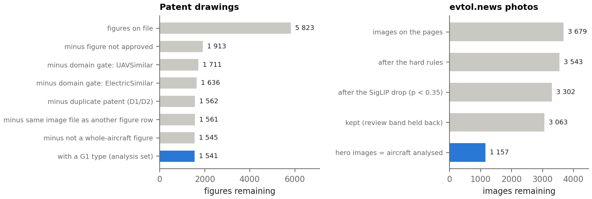{width=100%}

::: {custom-style="Figure Source"}
Source: patent drawings: notebook 20 funnel (selection/funnel.csv) and notebook 23 figure table; photos: 1_filter/image_decisions.csv of the evtol.news crawl of 2026-09-17; each image counted under the first rule that removed it.

How to read: each bar is the number of images left after the step on its left; the blue bar is the analysis set.
:::

## 1.1 Patent drawings

The analysis set holds **663 aircraft from 572 patents** and 1 541 whole-aircraft figures. A figure enters when the labeller approved it, its aircraft passes the domain gate (UAV-similar, not electric or STOL-only aircraft leave) and its patent is not a D1/D2 duplicate. Part and detail figures leave (16 figures), and so do the 2 aircraft marked unclassifiable. The label is the human G1 type of the codebook (Table 3). It agrees with the independent whole-patent reading for 627 of 662 aircraft (κ 0.94).

::: {custom-style="Table Title"}
**Table 3.** The 12 G1 types, their 5-class parent and the aircraft per type (663 aircraft). TP is the wizard's TR, printed under the display name Tilt Propulsor.
:::

| G1 | architecture type | parent (5-class) | aircraft |
|---------|-------------------------|----------------|--------:|
| TP | Tilt Propulsor | VT | 157 |
| CVT | Combined vectored thrust | VT | 109 |
| TW | Tilt Wing | VT | 59 |
| TB | Tilt Body | VT | 25 |
| PTC | Pitch-to-Cruise | VT | 26 |
| DS | Deflected Slipstream | VT | 5 |
| SLC | Lift + Cruise | LC | 184 |
| SRW | Stopped/Slowed Rotor Wing | LC | 9 |
| MR | Multirotor | WM | 50 |
| RC | Rotorcraft | ER | 9 |
| HB | Hoverbike | HB | 20 |
| PFV | Personal Flying Vehicle | HB | 10 |

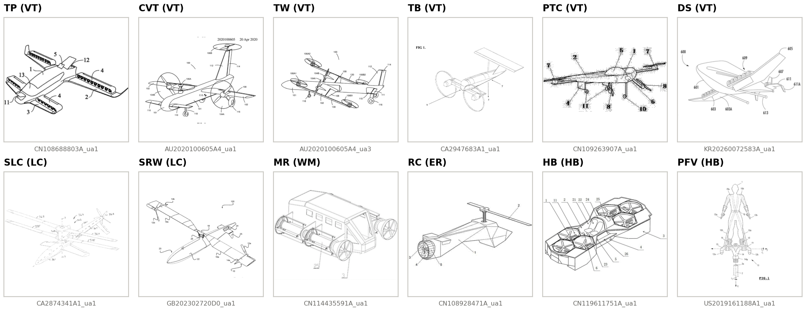{width=100%}

::: {custom-style="Figure Source"}
Source: patent drawings, rule exp3 main figure; the alphabetically first aircraft of each type whose main figure is a Perspective view; label: G1 type (its 5-class parent); n = 12 of 663 aircraft.

How to read: the label above each drawing is the human G1 type and its parent class; the code below is the aircraft.
:::

## 1.2 One vector per aircraft, and the flight state

An aircraft has a median of two whole-aircraft figures, so a rule must decide which figure becomes its vector. Four rules were fixed before any score was read (notebook 23). Two of them sort on the **view** (Perspective > Plan > Side > Front/Rear) and on the **flight state**. The flight state matters only for the 5 convertible types (TP, CVT, TW, DS, SRW), whose shape changes between hover and cruise. The wizard records it per figure as Cruise, Hover, or **Both** when the moving part is drawn in both positions (label added on 2026-09-19). The state-first rule prefers Cruise as the canonical state, because more convertible aircraft have a Perspective figure in Cruise (220) than in Hover (212) among the 339.

::: {custom-style="Table Title"}
**Table 4.** The four image rules. exp1 and exp2 pick the same figure for 96.1 % of the aircraft; exp4 averages 2 slots for 197 aircraft and 3 for 50, and equals one figure for the other 416.
:::

| rule | which figure | same figure as exp3 |
|-----------------|------------------------------------|------------------:|
| exp1 view-first | best view, then best flight state | 83.9 % |
| exp2 state-first | best flight state (Cruise > Both > Hover > Other), then best view | 83.4 % |
| exp3 main figure | the figure the labeller marked as main (primary rule) | 100.0 % |
| exp4 view average | mean of the best figure in each of Perspective, Plan and Side | n/a |

::: {custom-style="Table Title"}
**Table 5.** Flight state of the whole-aircraft figures of the convertible types.
:::

| G1 | Cruise | Hover | Both | Other |
|---------|--------:|--------:|--------:|--------:|
| TP | 189 | 197 | 11 | 32 |
| CVT | 128 | 133 | 10 | 14 |
| TW | 77 | 79 | 4 | 7 |
| DS | 9 | 3 | 0 | 2 |
| SRW | 11 | 4 | 6 | 1 |

The flight state barely moves the vector choice: exp1 and exp2 differ on 26 aircraft only. The labeller's main figure differs from the view-first pick on 107.

## 1.3 Photographs

The directory lists 1 229 aircraft pages carrying 3 679 images. Fixed rules drop small files and files shared with another page. A zero-shot SigLIP score p(whole aircraft) then keeps an image at p ≥ 0.80 and drops it below 0.35. The 239 images in between (the review band) are held back. 3 063 images survive, and the page's first kept image, its **hero image**, represents the aircraft: **1 157 aircraft**. The label is the directory class of the page (VT 410, LC 218, WM 332, ER 83, HB 114). On the 99 patent aircraft that have a directory page, the parent of the human G1 type matches the directory class for 83.

The filter was audited on a random sample: 96 of 100 hero images show the whole aircraft, 3 of 40 dropped images were a whole vehicle, and 18 of 40 review-band images would have been usable. The audit judge was the AI assistant used for the pipeline, working from contact sheets that showed the filter score, so the audit is neither blind nor yet re-checked by the author (§9).

{width=100%}

::: {custom-style="Figure Source"}
Source: evtol.news photos, hero images; 5 of 1 157 aircraft (figure of the registers photo report). Photo: evtol.news directory, © owners.

How to read: the heading is the directory class; the caption under each photo is the directory page title.
:::

## 1.4 Processing, and whether the selection decides the result

Both sources pass through the same processing code (notebook 21). A drawing is rotated by its labelled angle. Every image is padded to a white square and resized to 518 px, which gives 37 × 37 patches of 14 px. The white pad matches the paper background of a drawing, so the square format adds no new content to it.

Each selection step was then made stricter, or its measured errors removed, and the primary score recomputed (Table 6). Every variant stays inside the interval of the set as built, so no selection step decides the result.

::: {custom-style="Table Title"}
**Table 6.** Sensitivity of the primary score to the selection (registers, L24 CLS, maker held out).
:::

| source | variant | aircraft | kNN-5 | 95 % interval |
|---------|------------------------------------|--------:|--------:|------------:|
| drawings | as built | 663 | 0.235 | [0.19, 0.28] |
| drawings | only aircraft whose drawing label matches the whole-patent reading | 627 | 0.241 | [0.20, 0.28] |
| drawings | only aircraft whose main figure is a Perspective view | 477 | 0.244 | [0.18, 0.31] |
| drawings | without the main-figure fallbacks | 662 | 0.235 | [0.19, 0.28] |
| photos | as built | 1157 | 0.563 | [0.53, 0.60] |
| photos | stricter filter: first image with SigLIP p(aircraft) of at least 0.95 | 1113 | 0.564 | [0.53, 0.60] |
| photos | no line drawings: first image the style guess does not call a drawing | 1141 | 0.563 | [0.53, 0.60] |
| photos | without the aircraft that share a near-duplicate hero image | 1124 | 0.570 | [0.54, 0.60] |
| photos | without the 4 hero images the audit found unusable | 1153 | 0.563 | [0.53, 0.59] |

<<SECTION>>
# 2. Setup selection

A frozen model leaves few choices, but each one can move the score: which checkpoint, which input size, which layer and token, and how each source's images are prepared. The choices fall into two kinds. **Image-type choices** follow from what patent drawings are (thin black lines on a large white field), so they transfer to any other patent-drawing study. **Label-selected choices** are made on the labels, and a choice made on labels must not be scored on the aircraft that made it.

::: {custom-style="Table Title"}
**Table 7.** The candidate grid.
:::

| choice | candidates, fixed in advance | type | how chosen |
|-------------------|------------------------------------|--------------|------------------------------------|
| model | dinov2-large; dinov2-with-registers-large | image type | fixed on the attention artifact; held-out rule confirms |
| resolution | 518 px | image type | the model's largest training size; not selected |
| layer | 18, 22, 24 | label-selected | split-half rule |
| token | CLS; mean of the patch tokens | label-selected | split-half rule |
| drawing preparation | plain; thick1; thick2 | label-selected | split-half rule |
| photo preparation | colour; greyscale | label-selected | split-half rule |

## 2.1 The split-half rule

Every label-selected choice uses one rule. The makers are split at random into two halves, 200 times (seed 42), and every aircraft follows its maker. Each candidate is scored on half A with neighbours from half A only. The best candidate on A is then scored on half B, and the same is done with the halves swapped. This gives 400 choices per label set. The rule reports how often each candidate is chosen, its held-out score, and the **optimism gap**: how much the winner's in-sample score exceeds its held-out score. The decision is the highest mean selection frequency, averaged over the label sets within a source and then over the two sources.

A half holds 248 to 415 drawing aircraft and 496 to 661 photo aircraft, so the neighbour pool is about half the full one. Held-out scores therefore sit below the full-sample scores of §4 to §6, and only scores in the same column compare.

## 2.2 Model: registers against base

DINOv2 without registers parks high-norm artifact tokens in low-information background patches (Darcet et al., 2024). A patent drawing is mostly white background, and in the base model the late-layer CLS attention collapsed onto a single padding patch (Table 8, Figure 4). The registers checkpoint adds four register tokens that absorb this mass, and was run on the same processed images with the same code.

::: {custom-style="Table Title"}
**Table 8.** Median share of the CLS attention that falls on the single largest patch (the collapse measure). Registers: 665 drawings, 1157 photos.
:::

| layer | drawings, base | drawings, registers | photos, base | photos, registers |
|---------|-------------:|------------------:|-----------:|----------------:|
| L18 | 0.007 | 0.005 | 0.008 | 0.006 |
| L22 | 0.286 | 0.014 | 0.255 | 0.015 |
| L24 | 0.295 | 0.009 | 0.280 | 0.011 |

{width=100%}

::: {custom-style="Figure Source"}
Source: DINOv2-large and DINOv2-large with registers, frozen, 518 px; CLS query against every patch key, mean over heads, each map scaled to its own 99th percentile; 2 patent drawings and 2 photos, the first aircraft of each wanted class in both runs (as in registers_attention_figure.py). Photo: evtol.news directory, © owners.

How to read: bright = where the CLS token looks. In base L22 and L24 the pale square in the top-left corner is the padding patch that collects the attention (clipped at the 99th percentile), and the dots on the white field are further background patches; with registers the late layers stay on the aircraft.
:::

::: {custom-style="Table Title"}
**Table 9.** Registers against base on the same aircraft: kNN-5 balanced accuracy, L24 CLS, maker held out; the last column is the share of the 400 held-out selections that pick a registers candidate when all 12 compete.
:::

| label set | base | registers | paired difference [95 % CI] | registers chosen (held out) |
|--------------------|--------:|--------:|--------------------------:|--------------------------:|
| drawings, 12 classes | 0.178 | 0.235 | +0.057 [+0.008, +0.103] | 70.0 % |
| drawings, 5 classes | 0.333 | 0.445 | +0.111 [+0.026, +0.199] | 67.8 % |
| photos, 5 classes | 0.534 | 0.563 | +0.030 [−0.001, +0.063] | 89.5 % |

The registers model scores higher on all three label sets. The paired interval excludes zero on the drawings and touches it on the photos. Held out, a registers candidate wins 67.8 % to 89.5 % of the selections, and on the same halves registers minus base at L24 CLS averages +0.016 (drawings, 12 classes) to +0.030 (drawings, 5 classes). Patent-to-photo matching improves too (own page in the top 50: 37 % base, 48 % registers). The model choice was fixed in advance on the attention artifact, and the held-out rule confirms it. One qualification comes from §4.4: once the view of the drawing is removed, the two models score alike.

## 2.3 Layer and token

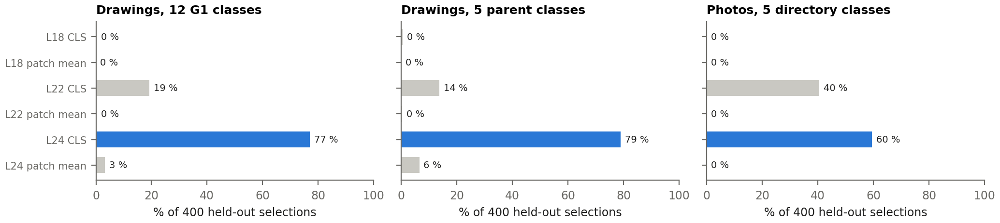{width=100%}

::: {custom-style="Figure Source"}
Source: DINOv2-large with registers, frozen, 518 px; 6 matrices (layers 18/22/24 × CLS / patch mean); 200 maker splits × 2 directions; drawings: exp3 main figure, halves of 248 to 415 aircraft; photos: hero image, halves of 496 to 661 aircraft.

How to read: each bar is the share of the 400 choices that picked this matrix as best on one half; blue = the matrix carried forward.
:::

::: {custom-style="Table Title"}
**Table 10.** Decision over the 6 registers matrices (frequencies averaged over the three label sets).
:::

| matrix | mean selection frequency | mean held-out score |
|--------------|-----------------------:|------------------:|
| L24 CLS | 68.8 % | 0.403 |
| L22 CLS | 28.5 % | 0.378 |
| L24 patch mean | 2.4 % | 0.280 |
| L18 CLS | 0.2 % | 0.245 |
| L22 patch mean | 0.1 % | 0.249 |
| L18 patch mean | 0.0 % | 0.232 |

Layer 24 CLS is chosen in 69 % of the selections. The runner-up, layer 22 CLS, in 28 %, most often on the photos (40 %, against 14 % to 19 % on the drawings). The patch-token mean is almost never chosen. The last layer's CLS token is the one DINOv2 is trained to make a global summary of the image, so the choice is also the expected one.

## 2.4 Drawing preparation

Patent lines are thin, and after the resize to 518 px a fine stroke can shrink to a grey pixel. Line thickening was therefore a candidate: a minimum filter on the original drawing whose radius is chosen so that **thick1 grows each side of a stroke by about 1 px at the model input, about 2 px of width**, and thick2 by about 2 px per side (radius in original pixels: thick1 median 4, thick2 median 7). A gentler variant, below 1 px per side, was not in the candidate set fixed in advance.

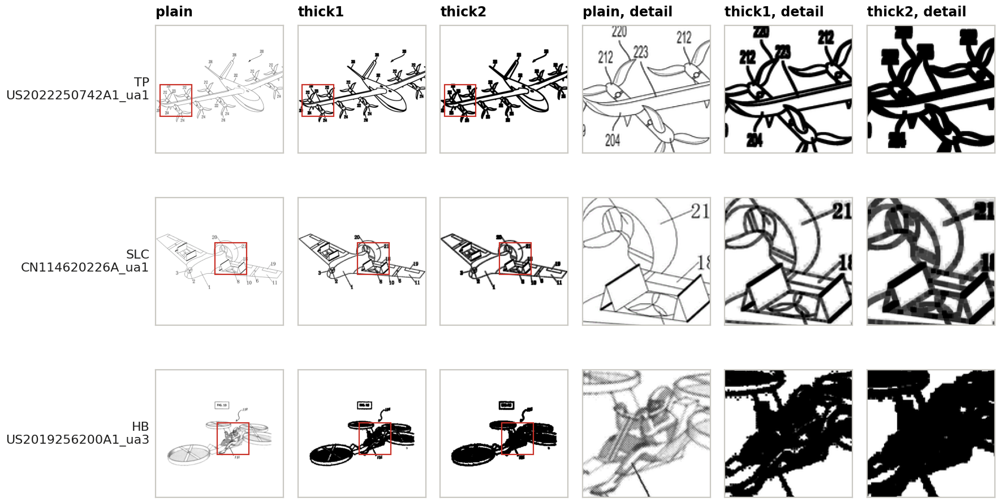{width=100%}

::: {custom-style="Figure Source"}
Source: patent drawings, exp3 main figures of the aircraft in the setup montage (seed 42), 3 of the 8 rows; 518 px model inputs; the red square marks the detail window.

How to read: compare each row from left to right: thickening merges thin propeller blades and reference numerals, and turns hatching and shading into solid black.
:::

::: {custom-style="Table Title"}
**Table 11.** Line thickening against the plain drawing, paired on the same aircraft (registers, L24 CLS, main figure).
:::

| label set | variant | plain | variant score | difference [95 % CI] | chosen (held out) |
|--------------------|---------|--------:|------------:|----------------------:|----------------:|
| drawings, 12 classes | thick1 | 0.235 | 0.201 | −0.034 [−0.076, +0.005] | 26 % |
| drawings, 12 classes | thick2 | 0.235 | 0.184 | −0.051 [−0.098, −0.005] | 3 % |
| drawings, 5 classes | thick1 | 0.445 | 0.402 | −0.043 [−0.103, +0.024] | 34 % |
| drawings, 5 classes | thick2 | 0.445 | 0.346 | −0.099 [−0.189, −0.013] | 5 % |

Thickening lowers the score in every row, and the thick2 interval excludes zero on both label sets. The split-half rule keeps the plain drawing in 66 % of the selections. The montage shows why: thickening fills the fine detail that separates the types. 210 of the 1545 source drawings carry colour, which the thick variants also remove.

## 2.5 Photo preparation

Greyscale photos score 0.570 against 0.563 in colour, a paired difference of +0.006 [−0.012, +0.026], and the rule keeps colour in 57 % of the selections. Colour is kept as the untransformed image, not as a better one. The greyscale run doubles as the fairness check of §6.

## 2.6 Optimism gap and the chosen setup

::: {custom-style="Table Title"}
**Table 12.** Optimism of each label-selected choice (registers candidates only).
:::

| label set | held-out score of the chosen | in-sample score of the winner | gap, layer+token | gap, preparation |
|--------------------|----------------------------|----------------------------:|---------------:|----------------|
| drawings, 12 classes | L24 CLS: 0.172 | 0.186 | 0.014 | plain: 0.012 |
| drawings, 5 classes | L24 CLS: 0.325 | 0.346 | 0.021 | plain: 0.024 |
| photos, 5 classes | L24 CLS: 0.537 | 0.552 | 0.015 | colour: 0.006 |

The gap is 0.014 to 0.021 for the layer and token, and 0.018 to 0.038 when both models compete. Choosing on the labels therefore inflates the scores by a few hundredths at most. That is small against the intervals of §4 to §6, and it is the honest size of the selection optimism.

::: {custom-style="Table Title"}
**Table 13.** The chosen setup.
:::

| choice | value | reason | type |
|-------------|---------------------|------------------------------------|--------------|
| model | DINOv2 with registers | no attention collapse on blank drawing background; registers chosen in 67.8 % to 89.5 % of held-out selections | image type |
| resolution | 518 px | the largest size the model was trained on; keeps thin lines | image type |
| layer + token | layer 24, CLS | chosen in 69 % of held-out selections (next: layer 22 CLS, 28 %) | label-selected |
| drawings | plain | thickening fills fine detail and lowers the score (thick2: interval below zero) | label-selected |
| photos | colour | greyscale scores the same (+0.006, inside the interval) | label-selected |

<<SECTION>>
# 3. Evaluation method

The unit of analysis is the **aircraft**: one patent can disclose several aircraft, and one directory page shows one. Every test that compares aircraft leaves out pairs and neighbours of the **same maker**, so a company's house style can never count as architecture. The maker is the applicant's company group for patents (the first applicant for individual inventors) and the maker named on the directory page for photos.

The **primary score** is the kNN-5 balanced accuracy: the class of each aircraft is predicted by the majority class of its five nearest aircraft by cosine distance, and balanced accuracy is the mean recall over the classes, so a large class cannot carry it. Its 95 % interval is a bootstrap over the aircraft (1 000 resamples). The chance level actually reached by the same neighbours is the 95th percentile of 200 label shuffles. A **linear probe** (logistic regression, 5 folds grouped by maker) reads the same vectors with every dimension weighted, and bounds what the neighbours miss. Paired differences use 1 000 paired bootstrap resamples of the same aircraft.

The same code (embedding_protocol.py) runs on both sources with the same parameters, so a number in one source means what the same number means in the other.

::: {custom-style="Table Title"}
**Table 14.** The seven tests of the protocol.
:::

| test | what it measures |
|---------------|------------------------------------|
| T1 integrity | no NaN, infinite, all-zero or duplicate rows |
| T2 structure | variance on PC1 against a random matrix; effective dimensions; Hopkins clustering tendency |
| T3 separation | mean distance between classes ÷ within classes, Cohen's d, p from 999 label permutations |
| T4 prediction | kNN-5 balanced accuracy (primary), bootstrap interval, shuffled chance; probe |
| T5 clusters | k-means with as many clusters as classes against the labels (ARI, NMI) |
| T6 what else | T3's d for a non-architecture label ÷ T3's d for the architecture |
| T7 image choice | T4 under every image rule of the source |

<<SECTION>>
# 4. Results: patent drawings

**Soundness (T1, T2).** No matrix has an invalid row. On its first principal component every matrix carries 27 to 56 times the variance of a random matrix of the same shape, and Hopkins lies between 0.70 and 0.74: the vectors clump, but as a continuum and not as separate islands.

**Separation (T3).** Same-class aircraft sit closer than different-class aircraft in all 6 matrices (p ≤ 0.027), but by little: at L24 CLS the between/within ratio is 1.073 and Cohen's d 0.28. On average the classes overlap heavily.

## 4.1 Reading the architecture (T4)

::: {custom-style="Table Title"}
**Table 15.** Prediction of the architecture from the drawings (663 aircraft, exp3 main figure, maker held out). 12 = G1 types (chance 1/12); 5 = parent classes (chance 1/5).
:::

| matrix | kNN-5, 12 | 95 % interval | shuffled p95 | probe, 12 | kNN-5, 5 | probe, 5 |
|--------------|--------:|------------:|-----------:|--------:|--------:|--------:|
| L18 CLS | 0.118 | [0.10, 0.14] | 0.101 | 0.210 | 0.221 | 0.424 |
| L18 patch mean | 0.106 | [0.09, 0.12] | 0.098 | 0.238 | 0.216 | 0.458 |
| L22 CLS | 0.176 | [0.14, 0.22] | 0.098 | 0.351 | 0.287 | 0.597 |
| L22 patch mean | 0.140 | [0.11, 0.17] | 0.098 | 0.292 | 0.236 | 0.488 |
| L24 CLS | 0.235 | [0.19, 0.28] | 0.096 | 0.362 | 0.445 | 0.606 |
| L24 patch mean | 0.166 | [0.13, 0.20] | 0.096 | 0.302 | 0.339 | 0.501 |

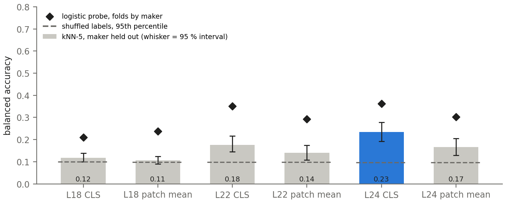{width=80%}

::: {custom-style="Figure Source"}
Source: DINOv2-large with registers, frozen, 518 px; layers 18/22/24 × CLS / patch mean; exp3 main figure; 663 aircraft; label: G1 type, 12 classes.

How to read: bars = kNN-5 balanced accuracy with 95 % interval; diamonds = linear probe; dashed line = shuffled-label chance (95th percentile). Balanced accuracy is the mean recall over the classes.
:::

At L24 CLS the drawings reach 0.23 [0.19, 0.28] on 12 classes against a shuffled level of 0.10, and 0.44 [0.36, 0.53] on the 5 parent classes against 0.22. The architecture is present, and weakly: on 12 classes a type is recovered for 0.23 of its aircraft on average, fewer than one in four. The probe reaches 0.36, well above the neighbours, so the architecture is in the vector but it is not what decides which aircraft are nearest. The reports' own layer rule, run in-sample on 200 random 80 % subsets, picks L24 CLS in 96 % of them, in line with the split-half rule.

::: {custom-style="Table Title"}
**Table 16.** Recall per G1 type (L24 CLS, kNN-5, maker held out).
:::

| class | aircraft | recall | class  | aircraft  | recall  |
|---------|--------:|--------:|---------|--------:|--------:|
| TP | 157 | 0.48 | SLC | 184 | 0.46 |
| CVT | 109 | 0.23 | SRW | 9 | 0.00 |
| TW | 59 | 0.17 | MR | 50 | 0.28 |
| TB | 25 | 0.08 | RC | 9 | 0.67 |
| PTC | 26 | 0.00 | HB | 20 | 0.35 |
| DS | 5 | 0.00 | PFV | 10 | 0.10 |

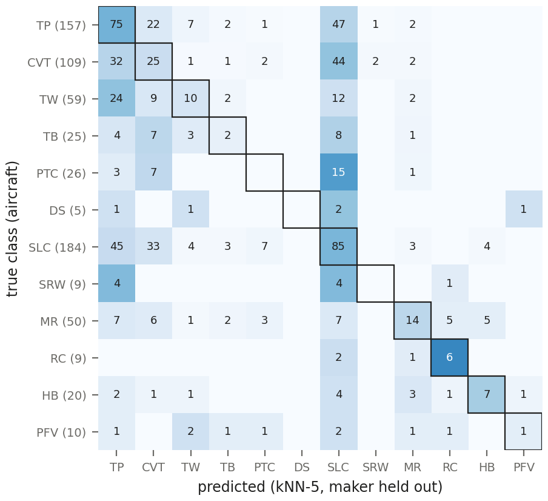{width=72%}

::: {custom-style="Figure Source"}
Source: DINOv2-large with registers, frozen, 518 px; layer 24, CLS; exp3 main figure; 663 aircraft; 12 G1 types.

How to read: rows = true class (aircraft in brackets); columns = the class kNN-5 predicts; numbers = aircraft; the framed diagonal is correct; darker = larger share of the row.
:::

Among the types with 20 or more aircraft, TP (0.48) and SLC (0.46) are read best. RC (0.67 on 9 aircraft) scores high, but on very few aircraft. PTC, DS, SRW are never recovered. 62 % of the wrong predictions fall into SLC or TP, the two largest classes, which is what a neighbour vote does when a class is thin in the pool.

## 4.2 Clusters without labels (T5)

A k-means partition with 12 clusters matches the G1 types with an ARI of 0.026 (0 = chance) at L24 CLS, and no matrix exceeds 0.033. The space is not organised by architecture first: whatever structure it has, the classes do not form their own clusters.

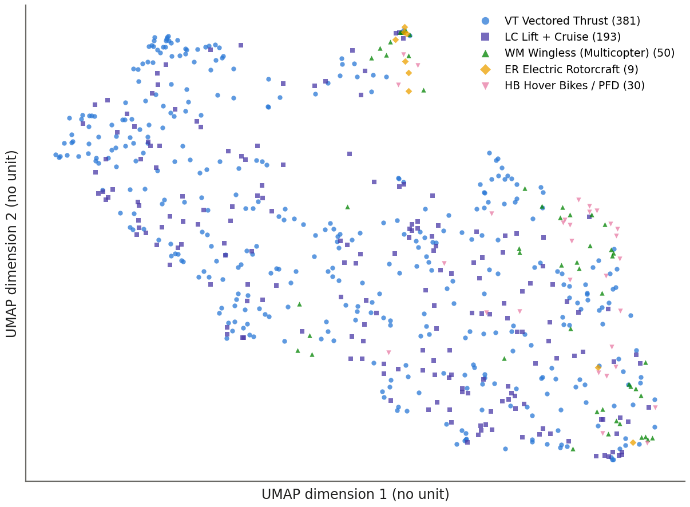{width=72%}

::: {custom-style="Figure Source"}
Source: DINOv2-large with registers, frozen, 518 px; layer 24, CLS; exp3 main figure; 663 aircraft; UMAP n_neighbors 15, min_dist 0.1, cosine, seed 42.

How to read: each point is one aircraft; only closeness is meaningful, the axes have no unit. The rotatable 3-D version is linked in the appendix.
:::

## 4.3 What else the embedding encodes: the view (T6)

The same separation test, run once with the architecture and once with the **view group** of the drawing (Perspective, Plan, Side, Front/Rear) on all 1 541 whole-aircraft figures, shows the view moving the vectors more than the architecture in all 6 matrices. At L24 CLS the view d is 0.35 against 0.21 for the architecture, a ratio of 1.70; at the earlier layers the ratio reaches 8.0. What the drawing's viewpoint is, the model encodes first.

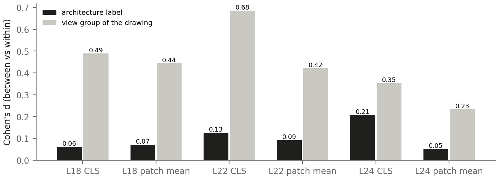{width=85%}

::: {custom-style="Figure Source"}
Source: DINOv2-large with registers, frozen, 518 px; 6 matrices; all 1 541 whole-aircraft figures of the 663 aircraft; same-maker pairs left out.

How to read: d = how much further apart two figures of different labels sit than two of the same label, in standard deviations; a grey bar taller than the black one means the view moves the vectors more than the architecture.
:::

## 4.4 Does the architecture survive removing the view?

A linear erasure answers whether the architecture signal only rides on the view. The three directions that separate the four view means are fitted on the 1 541 figures and projected out, and the aircraft vectors are rebuilt. The linear view probe on the main figures falls from 0.79 to 0.22 (chance 0.25). A **variance-matched control** removes three random directions of the same variance, so a loss that is not view-specific shows up there too. The Perspective-only rows hold the view constant by design.

::: {custom-style="Table Title"}
**Table 17.** Architecture before and after the view erasure (registers, L24 CLS, kNN-5, maker held out).
:::

| label set | aircraft | original | view erased | paired Δ [95 % CI] | variance-matched Δ |
|---------------------------------|--------:|--------:|----------:|----------------------:|----------------------:|
| G1, 12 classes | 663 | 0.235 | 0.191 | −0.043 [−0.086, −0.006] | −0.027 [−0.068, +0.010] |
| parent, 5 classes | 663 | 0.445 | 0.365 | −0.079 [−0.153, −0.020] | −0.075 [−0.152, −0.014] |
| G1, Perspective main figures only | 477 | 0.244 | 0.207 | −0.037 [−0.083, −0.000] | −0.029 [−0.056, −0.006] |
| parent, Perspective only | 477 | 0.462 | 0.415 | −0.047 [−0.092, −0.004] | −0.050 [−0.091, −0.013] |

With the registers model the erasure costs 0.043 (12 classes) and 0.079 (5 classes), and both intervals lie below zero. The loss is not specific to the view: the variance-matched removal costs about as much, and the same loss appears when every aircraft is drawn in Perspective, where view cannot be what the neighbours match on. Every erased score stays far above chance. The **base model is unchanged** by the same erasure (+0.005 [−0.022, +0.032] and +0.010 [−0.017, +0.034]).

After erasure the two models score alike (12 classes: registers 0.191, base 0.183; 5 classes: 0.365 against 0.343). Part of the registers advantage therefore sits in the dominant, high-variance directions the view also uses. The erasure is linear only: a non-linear view signal survives, since the view kNN falls from 0.73 to 0.55 and stays well above its chance of 0.27.

## 4.5 Does the choice of image matter? (T7)

::: {custom-style="Table Title"}
**Table 18.** The architecture score under each image rule (registers, L24 CLS, 12 classes, maker held out).
:::

| image rule | kNN-5 | 95 % interval |
|-----------------|--------:|------------:|
| exp1 view-first | 0.195 | [0.16, 0.24] |
| exp2 state-first | 0.194 | [0.16, 0.23] |
| exp3 main figure | 0.235 | [0.19, 0.28] |
| exp4 view average | 0.166 | [0.14, 0.19] |

The rules span 0.17 to 0.23, and every interval overlaps the others. The labeller's main figure scores highest, and the rule does not change the conclusion. Averaging the view slots (exp4) matters only for the 247 aircraft with two or three slots. On those aircraft, read from the full neighbour pool, exp4 is right for 32 % against 30 % for the view-first figure and 32 % for the main figure, a paired difference to view-first of +0.020 [−0.049, +0.089]. Averaging several views does not add a measurable architecture signal; the slots sub-question stays a null.

<<SECTION>>
# 5. Results: photographs

**Soundness and separation (T1 to T3).** No invalid row, and PC1 carries 23 to 54 times the random variance. Same-class photos sit closer in all 6 matrices, with a larger effect than on the drawings: ratio 1.120 and d 0.44 at L24 CLS (drawings: d 0.28).

## 5.1 Reading the architecture (T4)

::: {custom-style="Table Title"}
**Table 19.** Prediction of the directory class from the photos (1 157 aircraft, hero image, maker held out, chance 1/5).
:::

| matrix | kNN-5 | 95 % interval | shuffled p95 | probe |
|--------------|--------:|------------:|-----------:|--------:|
| L18 CLS | 0.352 | [0.32, 0.38] | 0.220 | 0.503 |
| L18 patch mean | 0.334 | [0.31, 0.36] | 0.218 | 0.471 |
| L22 CLS | 0.571 | [0.54, 0.60] | 0.218 | 0.650 |
| L22 patch mean | 0.345 | [0.32, 0.37] | 0.217 | 0.564 |
| L24 CLS | 0.563 | [0.53, 0.60] | 0.218 | 0.662 |
| L24 patch mean | 0.385 | [0.35, 0.42] | 0.218 | 0.571 |

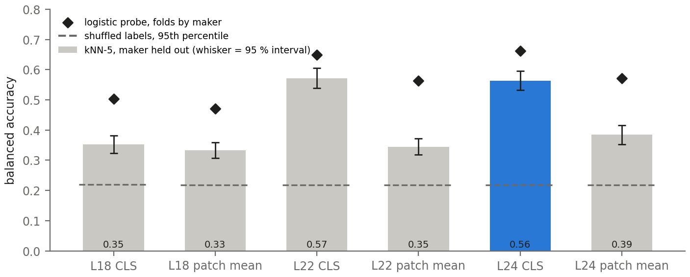{width=80%}

::: {custom-style="Figure Source"}
Source: DINOv2-large with registers, frozen, 518 px; layers 18/22/24 × CLS / patch mean; hero image; 1 157 aircraft; label: directory class, 5 classes.

How to read: bars = kNN-5 balanced accuracy with 95 % interval; diamonds = linear probe; dashed line = shuffled-label chance.
:::

At L24 CLS the photos reach 0.56 [0.53, 0.60] against a shuffled level of 0.22, and the probe 0.66. L22 CLS scores within the interval (0.57), which is why the split-half rule chose it for the photos in 40 % of the selections. Wingless (Multicopter) is read best (recall 0.74) and Hover Bikes / PFD worst (0.39).

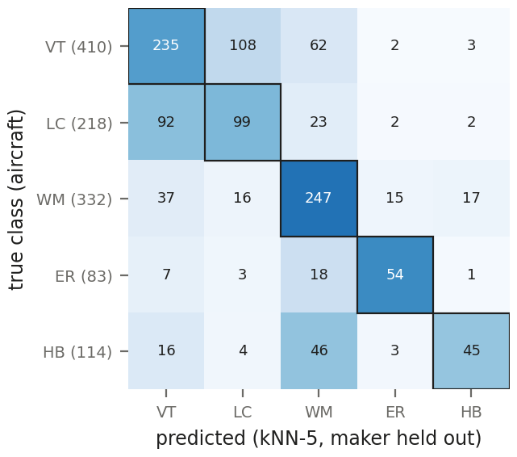{width=55%}

::: {custom-style="Figure Source"}
Source: DINOv2-large with registers, frozen, 518 px; layer 24, CLS; hero image; 1 157 aircraft.

How to read: rows = true class (aircraft in brackets); columns = the predicted class; numbers = aircraft; darker = larger share of the row.
:::

## 5.2 Clusters and what else is encoded (T5, T6)

k-means with 5 clusters matches the directory classes with an ARI of 0.141 at L24 CLS: weak, but 5 times the drawings' 0.026. For T6 the non-architecture label is the **maturity status** given on the page (built or concept, 651 aircraft). At L24 CLS the status d is 0.12 against 0.46 for the architecture, a ratio of 0.27: in the selected matrix the architecture moves the photo vectors more than whether the aircraft was built. In 4 of the 6 matrices the status dominates, so the order depends on the layer.

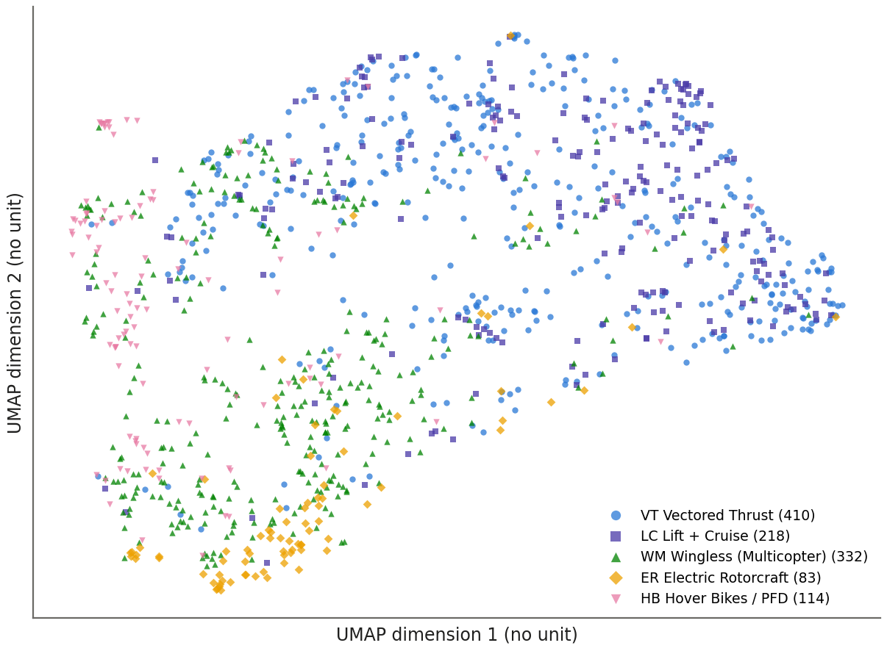{width=72%}

::: {custom-style="Figure Source"}
Source: DINOv2-large with registers, frozen, 518 px; layer 24, CLS; hero image; 1 157 aircraft; UMAP n_neighbors 15, min_dist 0.1, cosine, seed 42.

How to read: each point is one aircraft; only closeness is meaningful, the axes have no unit.
:::

## 5.3 Background and image choice

Photographs carry broad backgrounds (sky, city, hangar) that drawings do not. Each hero image was cropped to the aircraft with a zero-shot OWLv2 detector (43 of 1157 images, 3.7 %, kept whole because the box was weak or tiny), re-processed and re-embedded. **This test ran on the base model** (dinov2-large), before the registers model was adopted; it is the one result of this document on base.

::: {custom-style="Table Title"}
**Table 20.** Cropping the photos to the aircraft (base model, 1 157 aircraft, kNN-5, maker held out).
:::

| matrix | original | cropped | paired difference [95 % CI] |
|--------------|--------:|--------:|--------------------------:|
| L24 CLS | 0.534 | 0.550 | +0.017 [−0.008, +0.043] |
| L24 patch mean | 0.394 | 0.428 | +0.034 [+0.004, +0.063] |

At L24 CLS cropping moves the score by +0.017, inside its interval: the photo result measures the aircraft and not the scenery. Only the patch mean, which averages over background patches, gains a little from the crop.

The image rule matters as little as on the drawings: hero image 0.563, one random other image 0.521, the mean of all kept images 0.578, against an interval about 0.06 wide for one rule.

<<SECTION>>
# 6. Drawings against photographs

The comparison uses the same model, the same readout, the same protocol and the 5 classes the two sources share: each G1 type folds into its parent. The aircraft are different in the two sets, so the interval of a difference comes from independent bootstrap resamples of each set.

::: {custom-style="Table Title"}
**Table 21.** Photos against drawings on the shared 5 classes (registers, L24 CLS, kNN-5; 663 drawing aircraft, 1 157 photo aircraft).
:::

| comparison | drawings (plain) | photos | photos − drawings [95 % CI] |
|-------------|---------------:|--------:|--------------------------:|
| photos colour | 0.445 | 0.563 | +0.119 [+0.027, +0.211] |
| photos grey | 0.445 | 0.570 | +0.125 [+0.032, +0.215] |

The photos lead by +0.12, and by +0.13 in greyscale: whatever the photo advantage is, it is not colour. The probes point the same way (0.61 for drawings, 0.66 for photos).

The two sets differ in size and in class mix, and a neighbour vote depends on its pool: a class that is thin in the pool is hard to recover, whatever the medium. Balanced accuracy weights every class equally, but it cannot make a thin class easy. To size this, the photo score was recomputed on 200 random photo subsets with exactly the drawings' class counts (663 aircraft each; the probe on the first 200), so that pool size and class mix match (Table 22).

::: {custom-style="Table Title"}
**Table 22.** Recall per class on the shared 5 classes: drawings, all photos, and photo subsets with the drawings' class counts (registers, L24 CLS, kNN-5, maker held out; last column: mean over the draws, [2.5, 97.5] percentiles of the draws).
:::

| class | drawings | recall | photos | recall  | photos, drawings' mix |
|-----------------|--------:|--------:|--------:|--------:|--------------------:|
| VT | 381 | 0.79 | 410 | 0.57 | 0.69 |
| LC | 193 | 0.36 | 218 | 0.45 | 0.48 |
| WM | 50 | 0.22 | 332 | 0.74 | 0.43 |
| ER | 9 | 0.56 | 83 | 0.65 | 0.41 |
| HB | 30 | 0.30 | 114 | 0.39 | 0.29 |
| balanced accuracy | 663 | 0.445 | 1157 | 0.563 | 0.463 [0.367, 0.557] |
| probe | 663 | 0.606 | 1157 | 0.662 | 0.597 [0.508, 0.674] |

Matched in size and class mix, the photos score 0.463, and the drawings' 0.445 lies inside the range of the draws (0.367 to 0.557). Most of the +0.12 advantage of the full photo set therefore comes from its larger and more balanced pool, and on this evidence the medium itself is not shown to carry more architecture. The probe tells the same story (0.597 matched against 0.606).

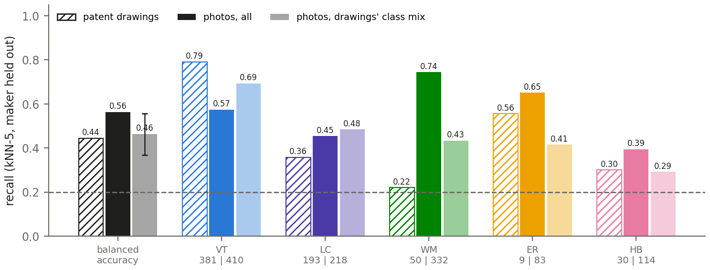{width=85%}

::: {custom-style="Figure Source"}
Source: DINOv2-large with registers, frozen, 518 px; layer 24, CLS; kNN-5, maker held out; drawings: exp3 main figure, 663 aircraft, G1 folded to its parent; photos: hero image, 1 157 aircraft; matched: 200 photo subsets of 663 aircraft with the drawings' class counts.

How to read: hatched = patent drawings, solid = all photos, pale = photos with the drawings' class mix (whisker: range of the draws); class colours as in the maps; under each class the aircraft in drawings | photos; dashed line = chance 1/5.
:::

The per-class view shows where the pool matters. Wingless multicopters are 50 drawings but 332 photos. The photos read them at 0.74 and the drawings at 0.22, and with the drawings' mix the photos fall to 0.43. Vectored thrust, the dominant drawing class (381 of 663), goes the other way: the drawings read it at 0.79 against 0.57 for all photos, and the matched photos rise to 0.69. In both sources a class is read well largely when it dominates the pool.

## 6.1 The same aircraft in both sources

For the 94 patent aircraft that have a directory page, the main figure queried all 1 141 photo aircraft. Line drawings were removed from the gallery because some directory pages reproduce the patent figure itself.

::: {custom-style="Table Title"}
**Table 23.** Same-aircraft matching (registers, L24 CLS, no line drawings in the gallery).
:::

| direction | queries | gallery | top 1 | top 10 | top 50 | random top 10 / 50 | median rank |
|--------------|--------:|--------:|--------:|--------:|--------:|------------------|----------:|
| patent → photo | 94 | 1141 | 8.5 % | 22.3 % | 47.9 % | 1.6 % / 7.6 % | 55 |
| photo → patent | 94 | 665 | 9.6 % | 17.0 % | 47.9 % | 2.7 % / 12.7 % | 63.5 |

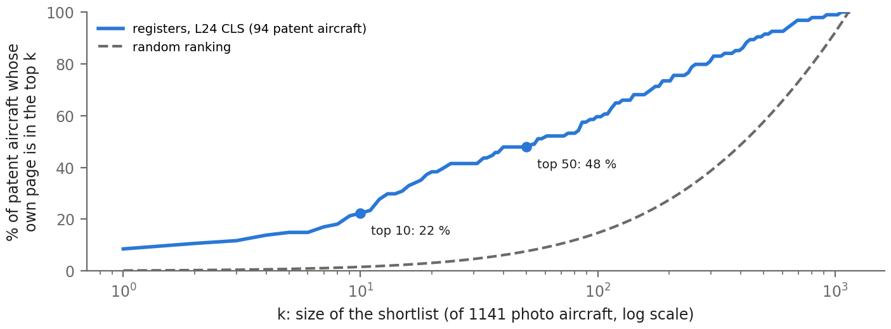{width=80%}

::: {custom-style="Figure Source"}
Source: DINOv2-large with registers, frozen, 518 px; layer 24, CLS; 94 patent main figures as queries against 1 141 photo aircraft without line drawings.

How to read: the blue curve is the share of queries whose own page is ranked within the top k; the dashed curve is a random ranking with the same number of own pages per query.
:::

The model links a drawing to a photograph of the same aircraft well above chance: the right page is in the top 10 for 22 % of the queries and in the top 50 for 48 %, against 1.6 % and 7.6 % at random. It is far from a retrieval tool: the median rank is 55, and the medium separates the sources more than the aircraft joins them.

<<SECTION>>
# 7. Where the model looks

The attention maps show where the CLS token of the registers model reads each image. They are a qualitative check, not a test: two aircraft per class and source were drawn at random, and the maps are read by eye. Across all images, the median share of the CLS attention on the single largest patch stays at or below 0.011 at layers 18 and 24, and the register tokens take 0.32 to 0.44 of it, so no single background patch dominates.

{width=100%}

::: {custom-style="Figure Source"}
Source: DINOv2-large with registers, frozen, 518 px; CLS query against every patch key, mean over heads, each map scaled to its own 99th percentile; drawings: main figure of 663 aircraft, photos: hero image of 1 157 aircraft; 2 per class and source drawn at random (seed 42). Photo: evtol.news directory, © owners.

How to read: bright = where the CLS token looks; each drawing is labelled with its G1 type, each photo with its directory class; rows are the 5 parent classes.
:::

Read by eye, layer 18 traces the line-work of the drawings almost everywhere, outline, propulsors and sometimes the figure label alike, and covers the airframe of the photos. Layer 24 is sparser: its weight gathers in spots on the aircraft, often on propulsors, hubs and the fuselage, with a scatter of weak spots on the white pad or the sky. In one wingless photo the people in front of the aircraft draw as much attention as the aircraft itself, a reminder that a kept hero image can still be a scene. On neither source does the attention settle on one part that names the architecture. That is consistent with the modest kNN scores: the late CLS token summarises the whole shape and the way it is drawn, not the arrangement of lift and thrust. These readings rest on 20 aircraft and are not a measurement.

<<SECTION>>
# 8. Conclusions

**RQ4.** The figure alone carries the architecture: weakly in patent drawings, and moderately in the photographs as they come, an advantage that shrinks to nothing measurable once the photo pool has the drawings' size and class mix. A frozen general-purpose vision model, never trained on aircraft or on the codebook, recovers the 12 G1 types from one drawing per aircraft at 0.23 against a chance level of 0.10, and the 5 parent classes at 0.44 from drawings and 0.56 from photographs. The result holds with the maker held out, under every image rule, without the photo backgrounds, in greyscale, and after the view of the drawing is linearly removed.

The drawing embedding is organised first by **how** the aircraft is drawn and only second by **what** it is: the view separates the vectors 1.70 times more than the architecture, and the classes form no clusters of their own. The architecture is present in the vector (the probe reads more than the neighbours) but it does not decide which aircraft are nearest. The codebook's human reading therefore stays the reference for the architecture; the embedding offers a second, independent and label-free view of the same corpus.

**What DINOv2 contributes to the thesis.** It tests the taxonomy against an observer that has never seen it: the types the model recovers best are the large ones, and the types it never recovers (PTC, DS, SRW) are defined by how the propulsion moves or acts, which a single silhouette need not show. It links the patent record to the directory of built and proposed aircraft above chance. And it delivers a labelled benchmark of whole-aircraft drawings with a fixed protocol, on which a fine-tuned or aircraft-specific model can be measured.

**A reusable recipe for patent-drawing studies.** Use a registers checkpoint, because drawings are mostly blank background and a model without registers parks its artifact tokens there. Feed the largest native input size (518 px) on a white pad, and leave the lines as drawn. Choose the layer and token with the split-half rule over makers and report the optimism gap beside the score. Hold the maker out of every neighbour, and test the view as a confound before reading any class result.

<<SECTION>>
# 9. Limitations

- **Linear view erasure only.** The erasure removes the linear view signal. The view kNN stays at 0.55 after it, so a non-linear view component survives. The Perspective-only rows hold the view constant, but only for one view.
- **Small and unbalanced classes.** DS 5, SRW 9, RC 9, PFV 10 aircraft: these G1 recalls rest on a handful of aircraft. The photo classes range from 83 (ER) to 410 (VT), and the two sources differ in class mix (§6).
- **The photo filter audit is not blind.** The sheets showed the filter score, the judge was the AI assistant of the pipeline, and the author has not yet re-checked the 180 verdicts. The 239 review-band images were never decided by hand.
- **A gentler line thickening is untested.** The smallest candidate grew each stroke side by about 1 px. A sub-pixel variant was not in the candidate set fixed in advance.
- **Labels.** The photo label is the directory's own class, which agrees with the codebook parent for 83 of 99 linked aircraft. The drawing labels are human labels from the wizard, checked against the whole-patent reading (κ 0.94); the embedding reports record no second-labeller agreement.
- **One frozen model.** The analysis measures what a general-purpose model sees without training. A fine-tuned model, or a model trained on technical drawings, is outside the scope of this chapter.

<<SECTION>>
# 10. Open questions for the author

- **Matching depth (N5).** The matching result is above chance (48 % in the top 50) but far from reliable. Keep §6.1 as a section of the chapter, or reduce it to one paragraph?
- **Which registers number is the headline?** The drawings' 12-class score is 0.235, but 0.043 of it does not survive the view erasure, where the two models tie. Quote 0.235 with the erasure as a qualification (as here), or lead with the erased score?
- **The exp4 slots sub-question.** It stays a null (§4.5). The chapter plan keeps it for now. Drop it from the chapter?
- **Attention layer for the chapter figure (N4).** The plan named layer 18. With the registers model layer 24 is readable too. Figure 16 shows both: keep both, or one?
- **The photo advantage and the class mix.** With the drawings' size and class mix the photos score 0.463 against the drawings' 0.445 (§6). REVIEW_SUMMARY finding 3 (photos carry the architecture better) needs rewording: keep the full-set comparison as the headline with this as its qualification, or make the matched comparison the headline?
- **Labeller wording.** The reports do not say whether the G1 labels come from one labeller. Should §9 state it, and is a second-labeller check planned?

<<SECTION>>
# Appendix: full grids and the 3-D pages

Every matrix under both models, kNN-5 balanced accuracy and linear probe, maker held out. Base appears here only as the comparison. All text above uses the registers model. Every number in this document is computed by embedding_evaluation/src/analysis_document.py (run by scripts/build_analysis_document.py) from the saved results listed in its docstring.

::: {custom-style="Table Title"}
**Table 24.** Patent drawings, 12 G1 classes (663 aircraft, exp3 main figure).
:::

| matrix | kNN-5 base | kNN-5 registers | probe base | probe registers |
|--------------|---------:|--------------:|---------:|--------------:|
| L18 CLS | 0.097 | 0.118 | 0.162 | 0.210 |
| L18 patch mean | 0.091 | 0.106 | 0.241 | 0.238 |
| L22 CLS | 0.163 | 0.176 | 0.307 | 0.351 |
| L22 patch mean | 0.119 | 0.140 | 0.287 | 0.292 |
| L24 CLS | 0.178 | 0.235 | 0.319 | 0.362 |
| L24 patch mean | 0.183 | 0.166 | 0.258 | 0.302 |

::: {custom-style="Table Title"}
**Table 25.** Patent drawings, 5 parent classes (663 aircraft).
:::

| matrix | kNN-5 base | kNN-5 registers | probe base | probe registers |
|--------------|---------:|--------------:|---------:|--------------:|
| L18 CLS | 0.198 | 0.221 | 0.377 | 0.424 |
| L18 patch mean | 0.215 | 0.216 | 0.408 | 0.458 |
| L22 CLS | 0.260 | 0.287 | 0.540 | 0.597 |
| L22 patch mean | 0.224 | 0.236 | 0.507 | 0.488 |
| L24 CLS | 0.333 | 0.445 | 0.568 | 0.606 |
| L24 patch mean | 0.339 | 0.339 | 0.531 | 0.501 |

::: {custom-style="Table Title"}
**Table 26.** Photos, 5 directory classes (1 157 aircraft, hero image).
:::

| matrix | kNN-5 base | kNN-5 registers | probe base | probe registers |
|--------------|---------:|--------------:|---------:|--------------:|
| L18 CLS | 0.290 | 0.352 | 0.435 | 0.503 |
| L18 patch mean | 0.311 | 0.334 | 0.446 | 0.471 |
| L22 CLS | 0.479 | 0.571 | 0.628 | 0.650 |
| L22 patch mean | 0.377 | 0.345 | 0.566 | 0.564 |
| L24 CLS | 0.534 | 0.563 | 0.648 | 0.662 |
| L24 patch mean | 0.394 | 0.385 | 0.583 | 0.571 |

**Rotatable 3-D maps** (single HTML files; open in a browser):

- Patent drawings, registers model: [PATENT_UMAP_3D_REGISTERS.html](file:///mnt/storage_11tb/Drive_files_to_syncronize/3%20-%20Images%20DataSets%20%26%20Labelling%20Outputs/1639_LABELLED/3_embedding_evaluation/umap_3d/PATENT_UMAP_3D_REGISTERS.html)  
  `/mnt/storage_11tb/Drive_files_to_syncronize/3 - Images DataSets & Labelling Outputs/1639_LABELLED/3_embedding_evaluation/umap_3d/PATENT_UMAP_3D_REGISTERS.html`
- evtol.news photos with the patents in one joint map: [EVTOLNEWS_UMAP_3D.html](file:///mnt/storage_11tb/Drive_files_to_syncronize/3%20-%20Images%20DataSets%20%26%20Labelling%20Outputs/EVTOLNEWS_DS/3_embedding_evaluation/advisor_report/EVTOLNEWS_UMAP_3D.html)  
  `/mnt/storage_11tb/Drive_files_to_syncronize/3 - Images DataSets & Labelling Outputs/EVTOLNEWS_DS/3_embedding_evaluation/advisor_report/EVTOLNEWS_UMAP_3D.html`
