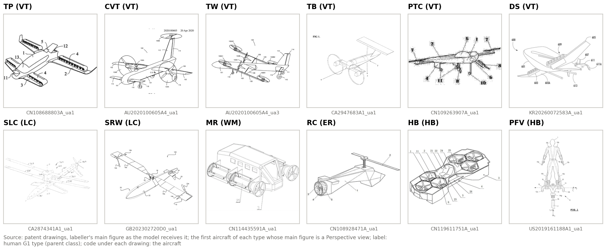
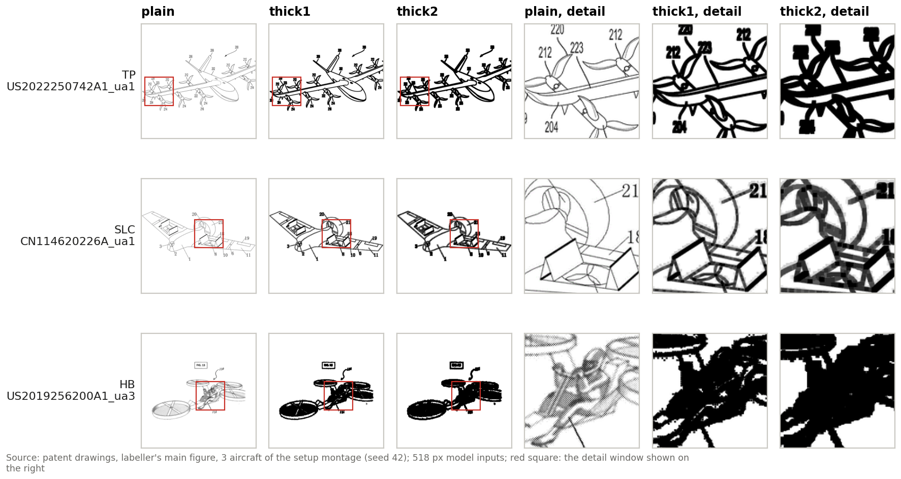
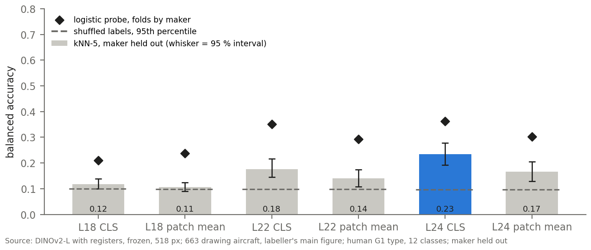
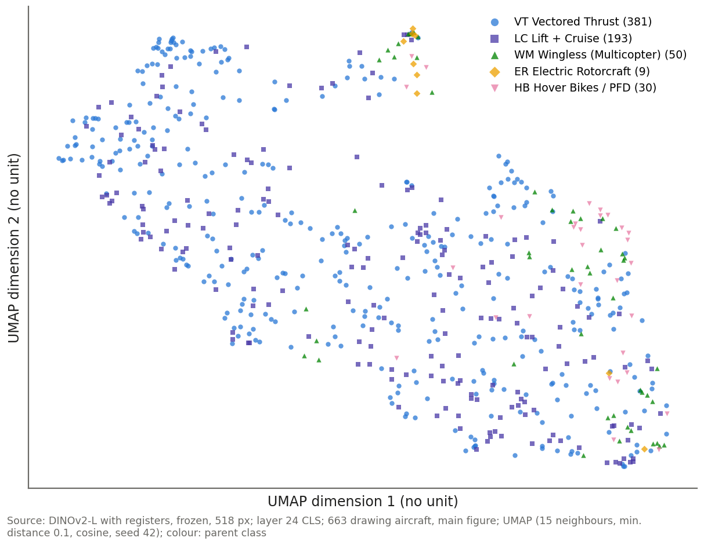
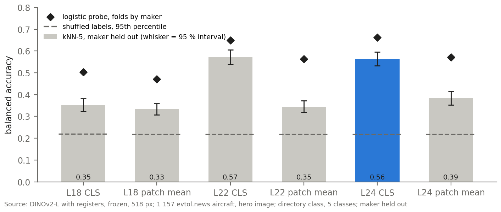
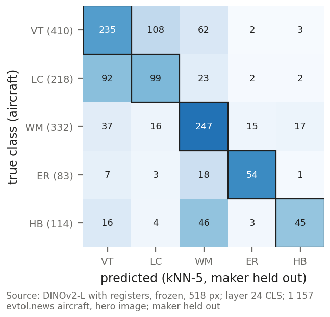
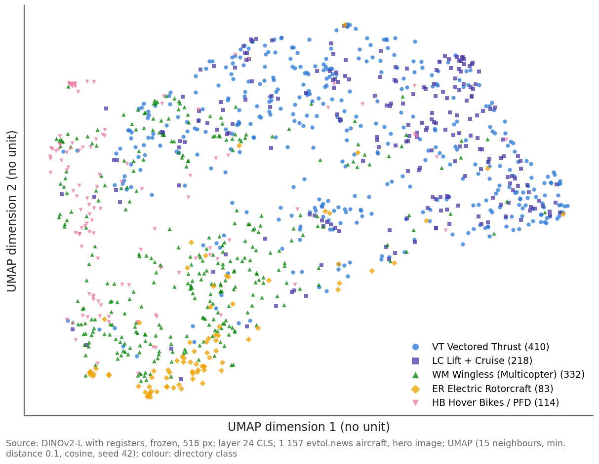
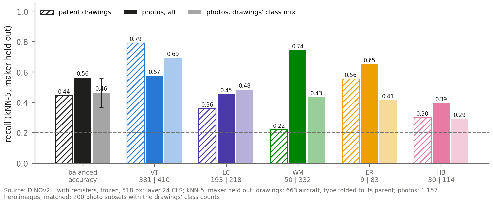

# Visual Learning: DINOv2 embeddings of patent drawings and photographs

<!-- Date: 2026-09-30 -->

The analysis for research question RQ4. Private: contains evtol.news photographs, © their owners.

<!-- TOC -->

Contents

1 — The images and the labels: which drawings and photographs enter the analysis, and does the way they are chosen decide the result?2

1.1 — Which drawings and photographs enter the analysis, and with which labels?3

1.2 — How does each aircraft become one image and one vector, and does the choice of images decide the result?4

2 — The setup: which DINOv2 checkpoint, layer, token and image preparation read the images, and how are they chosen?7

2.1 — Does the registers checkpoint read the images better than the base model?7

2.2 — Which layer and which token carry the architecture?8

2.3 — Should the drawings or the photographs be transformed before the model reads them?9

2.4 — How much do the label-selected choices flatter the scores, and which setup is carried forward?10

3 — The drawings: do patent drawings carry the architecture, and what else does the model read in them?12

3.1 — How well do the drawings predict the architecture type?12

3.2 — What organises the drawing embedding: the architecture, or the way the aircraft is drawn?13

3.3 — Does the choice of drawing change the result?15

3.4 — Where does the model look on a drawing?15

4 — The photographs: do photographs of the aircraft carry the architecture, and does the scene around the aircraft matter?17

4.1 — How well do photographs predict the directory class?17

4.2 — What organises the photo embedding: the architecture, or the maturity of the aircraft?18

4.3 — Do the background and the choice of image change the photo result?19

4.4 — Where does the model look on a photograph?19

5 — Drawings against photographs: which source carries more of the architecture, and can one aircraft be found in both?21

5.1 — Do photographs carry more architecture than drawings on the classes they share?21

5.2 — Can the same aircraft be found in both sources?22

The answer to RQ4, what it rests on, and what is still open23

Appendix A — Every layer and token under both models25

<!-- /TOC -->

---

## 1 — The images and the labels: which drawings and photographs enter the analysis, and does the way they are chosen decide the result?

#### Method common to every chapter

**What is asked (RQ4).** Whether the figure alone carries the architecture: whether a frozen vision model, DINOv2 with registers (Oquab et al., 2023; Darcet et al., 2024), never trained on aircraft or on the codebook, places aircraft of the same architecture class near each other, judged against the human labels. Two image sources are read with the same model and the same protocol: the patent drawings of the labelled dataset, and the images of the World eVTOL Aircraft Directory (evtol.news, Vertical Flight Society), called photographs below.

**Unit of analysis: the aircraft.** One patent can disclose several aircraft and one directory page shows one, so every source is reduced to one vector per aircraft: 663 drawing aircraft and 1 157 photo aircraft. **The maker is held out of every comparison**: the applicant's company group for a patent (the first applicant for an individual inventor), the maker named on the page for a photo. A company's house style can therefore never count as architecture.

**The embedding.** The model turns an image into a vector of 1 024 numbers. It is read at one layer (18, 22 or 24 of the model's 24) and through one token: the CLS token, the summary token the model learns, or the mean of the patch tokens. One layer with one token is called a **matrix**; six are compared, and chapter 2 chooses one.

##### How to read the scores

*Every score, interval and chance level in the document is read as set out here.*

**The primary score: kNN-5 balanced accuracy.** Each aircraft's class is predicted by the vote of its five nearest aircraft, never from its own maker, nearness being the cosine distance d(u, v) = 1 − u·v / (‖u‖ ‖v‖) (nearest-neighbour rule, Cover and Hart, 1967); a tie goes to the class of the nearer neighbour. The score is the **balanced accuracy**, BA = (1/K) Σ_c recall_c, with recall_c = (aircraft of class c predicted as c) / (aircraft of class c), over the K classes (Brodersen et al., 2010). Every class weighs the same, so a large class cannot carry the score, and guessing scores 1/K: 0.083 on 12 classes, 0.20 on 5.

**The 95 % interval.** The aircraft are resampled with replacement 1 000 times and the score recomputed on the same predictions; the interval is the middle 95 % of those scores (bootstrap, Efron, 1979). A difference between two setups on the same aircraft resamples the same aircraft for both (paired); between the two sources, whose aircraft differ, each set is resampled on its own. **A difference whose interval takes in zero is read as no difference detected.**

**Chance, as the same neighbours reach it.** The labels are shuffled 200 times and the vote rerun; the 95th percentile of the shuffled scores is the **shuffled level**. A score above it is one that chance almost never produces with these neighbours.

**The linear probe.** A logistic regression reads every dimension of the vector, trained on four fifths of the makers and tested on the fifth (five folds grouped by maker), scored by the same balanced accuracy. The neighbours use the overall distance only, so a probe above the kNN score means the architecture is in the vector without deciding which aircraft are nearest.

**The split-half selection rule** (the author's own definition). A choice made on the labels must not be scored on the aircraft that made it. The makers are split at random into two halves, 200 times (fixed seed 42, a rerun gives the same numbers), and every aircraft follows its maker. Each candidate is scored on half A with neighbours from A only, the best is scored on half B, and the halves are swapped: 400 choices per label set. Reported: how often each candidate is chosen (its **selection frequency**), its held-out score, and the **optimism gap** = in-sample score of the winner − its held-out score. The candidate with the highest selection frequency, averaged over the label sets of a source and then over the two sources, is chosen.

**Separation, clusters and what else is encoded.** Separation compares the mean cosine distance between aircraft of different classes with that between aircraft of the same class, over pairs of different makers: ratio = mean between / mean within, and d = (mean between − mean within) / pooled standard deviation; p is the share of 999 label shuffles with a ratio as large. The same d for a label that is not the architecture (the view of a drawing, the maturity of a photographed aircraft), divided by the architecture's d, says which label moves the vectors more. Clusters: k-means with as many clusters as classes, compared with the labels by the adjusted Rand index, ARI = (RI − E[RI]) / (max RI − E[RI]), where RI is the share of aircraft pairs on which the two partitions agree; 0 is a chance partition, 1 the labels themselves (Hubert and Arabie, 1985).

**The maps.** UMAP (McInnes, Healy and Melville, 2018) draws each aircraft's 1 024 numbers in two dimensions so that similar vectors sit close. The axes have no unit, and a map is a picture, never a test.

**The seven tests of the protocol**, run with the same code and parameters on both sources, so a number in one source means what the same number means in the other:

| test | what it asks | measure |
|:---|:---|:---|
| T1 integrity | is every vector valid? | no NaN, infinite, all-zero or duplicate rows |
| T2 structure | do the vectors have structure at all? | variance on the first principal component against a random matrix of the same shape; Hopkins statistic (0.5 random, near 1 clumped) |
| T3 separation | are same-class aircraft closer? | ratio, d and p, as above |
| T4 prediction | how often is the class recovered? | kNN-5 balanced accuracy (primary), interval, shuffled level; probe |
| T5 clusters | do the classes form clusters? | k-means against the labels, ARI |
| T6 what else | does another label move the vectors more? | its d ÷ the architecture's d |
| T7 image choice | does the image rule matter? | T4 under every image rule |

### 1.1 — Which drawings and photographs enter the analysis, and with which labels?

#### Method

**Objective.** Which images of each source reach the model, which label each aircraft carries, and how far that label can be trusted.

**Data and unit of analysis.** Drawings: the figures of the labelled dataset of eVTOL patents, counted as figures until each aircraft is reduced to one (1.2). Photographs: the images of the directory pages (crawl of 2026-09-17), counted as images until each page is reduced to one. A drawing aircraft carries its human **G1 type**, one of the codebook's 12 architecture types (Table 1), and the type's parent among 5 classes: **VT** Vectored Thrust, **LC** Lift + Cruise, **WM** Wingless (Multicopter), **ER** Electric Rotorcraft, **HB** Hover Bikes / PFD (personal flying devices). A photo aircraft carries the directory's own class, one of the same 5 (VT 410, LC 218, WM 332, ER 83, HB 114).

**Procedure.** Figure 1 follows each source from the files on disk to the analysis set, each image counted under the first rule that removed it. A drawing enters when the labeller approved it, its aircraft passes the domain gate (aircraft flagged as similar to a UAV, or not electric, leave) and its patent is not a duplicate of another; part and detail figures leave, and so do the 2 aircraft marked unclassifiable. A photo passes fixed rules against small files and files shared with another page, then a zero-shot SigLIP score p(whole aircraft) that keeps an image at p ≥ 0.80, drops it below 0.35 and holds back the review band between. The page's first kept image, its **hero image**, stands for the aircraft. Figures 2 and 3 show one image per class.

**Scientific grounds.** The drawing label is checked against the independent whole-patent reading of the architecture by Cohen's κ = (p_o − p_e) / (1 − p_e), the observed agreement p_o corrected for the agreement p_e two independent readings would reach by chance (Cohen, 1960). The photo filter is checked on a random sample of hero, dropped and review-band images.

**Assumptions and limits.** The audit judge was the AI assistant used for the pipeline, working from contact sheets that showed the filter score, so the audit is neither blind nor yet re-checked by the author. The photo label is the directory's class, not the codebook's.

#### Results and discussion

{: width="100%" }

*Figure 1 — From the files on disk to the analysis sets: (i) patent drawings, (ii) directory photographs; the blue bar is the analysis set.*

*Takeaway: **1 541 whole-aircraft drawings of 663 aircraft from 572 patents, and 1 157 hero images, one per directory aircraft, enter the analysis.** (i) The labeller's approval removes most drawings (3 910 of 5 823 figures on file); the domain gate removes 277 more, the duplicate rule 74 and the part figures 16. (ii) The filter keeps 3 063 of 3 679 images, holding back the 239 of the review band; one per page is read.*

**Table 1 — The 12 architecture types (G1) of the codebook, their parent class and the drawing aircraft per type (663 aircraft). TP, Tilt Propulsor, is the display name of the type the labelling tool records as TR.**

| G1 code | architecture type | parent class | aircraft |
|:---|:---|:---|---:|
| TP | Tilt Propulsor | VT | 157 |
| CVT | Combined vectored thrust | VT | 109 |
| TW | Tilt Wing | VT | 59 |
| TB | Tilt Body | VT | 25 |
| PTC | Pitch-to-Cruise | VT | 26 |
| DS | Deflected Slipstream | VT | 5 |
| SLC | Lift + Cruise | LC | 184 |
| SRW | Stopped/Slowed Rotor Wing | LC | 9 |
| MR | Multirotor | WM | 50 |
| RC | Rotorcraft | ER | 9 |
| HB | Hoverbike | HB | 20 |
| PFV | Personal Flying Vehicle | HB | 10 |

*Takeaway: **Two types hold 51 % of the drawing aircraft, Lift + Cruise (184) and Tilt Propulsor (157), while 4 types have ten aircraft or fewer.** The label agrees with the whole-patent reading for 627 of 662 aircraft (κ 0.94).*

{: width="100%" }

*Figure 2 — One main figure per G1 type, as the model receives it (518 px, padded square).*

*Takeaway: **The model receives the drawing as filed: black line-work on a white square, with reference numerals and figure labels left in.** Nothing in the image names the type; the type is what the labeller read from the drawing and the patent.*

{: width="100%" }

*Figure 3 — One hero image per directory class (built aircraft, highest filter score). Photo: evtol.news directory, © owners.*

*Takeaway: **A hero image shows the whole aircraft, a photograph or a rendering, often in a scene: 96 of 100 audited hero images show the whole aircraft.** Of the images the filter dropped, 3 of 40 audited were a whole vehicle, and 18 of 40 review-band images would have been usable. On the 99 patent aircraft that have a directory page, the directory class agrees with the parent of the human G1 type for 83.*

### 1.2 — How does each aircraft become one image and one vector, and does the choice of images decide the result?

#### Method

**Objective.** An aircraft has a median of two whole-aircraft drawings, so a rule must pick the image that becomes its vector. The question is which rules exist, how often they agree, and whether this or any other selection step moves the primary score.

**Data and unit of analysis.** The 663 drawing aircraft and their 1 541 figures; for the flight state, the figures of the 5 convertible types (TP; CVT, Combined Vectored Thrust; TW, Tilt Wing; DS, Deflected Slipstream; SRW, Stopped/Slowed Rotor Wing), whose shape changes between hover and cruise; the 1 157 photo aircraft for the sensitivity check.

**Procedure.** Four rules were fixed before any score was read (Table 2): **exp1 view-first** sorts on the view (Perspective > Plan > Side > Front/Rear), then on the flight state; **exp2 state-first** sorts on the flight state (Cruise > Both > Hover > Other), then on the view; **exp3 main figure** takes the figure the labeller marked as main, the primary rule; **exp4 view average** averages the vectors of the best figure in each of Perspective, Plan and Side. The flight state is recorded per figure as Cruise, Hover, or Both when the moving part is drawn in both positions (Table 3). The chosen image is rotated by its labelled angle, padded to a white square and resized to 518 px, 37 × 37 patches of 14 px, for drawings and photos alike. Each selection step is then made stricter, or its measured errors removed, and the primary score recomputed (Table 4).

**Scientific grounds.** Cruise is the canonical state because more convertible aircraft have a Perspective figure in Cruise (220) than in Hover (212) among the 339. The white pad matches the paper of a drawing, so the square format adds no content to it. A selection step decides the result only if a variant leaves the interval of the set as built (methods box).

**Assumptions and limits.** The variants are subsets of the set as built, so their intervals are not independent of it.

#### Results and discussion

**Table 2 — The four image rules. exp1 and exp2 pick the same figure for 96.1 % of the aircraft; exp4 averages 2 figures for 197 aircraft and 3 for 50, and is one figure for the other 416.**

| rule | which figure | same figure as exp3 |
|:---|:---|---:|
| exp1 view-first | best view, then best flight state | 83.9 % |
| exp2 state-first | best flight state, then best view | 83.4 % |
| exp3 main figure | the figure the labeller marked as main (primary rule) | 100.0 % |
| exp4 view average | mean of the best figure of each of Perspective, Plan and Side | n/a |

*Takeaway: **The flight state barely moves the choice: exp1 and exp2 differ on 26 aircraft only.** The labeller's main figure differs from the view-first pick on 107.*

**Table 3 — Flight state of the whole-aircraft drawings of the convertible types.**

| type | Cruise | Hover | Both | Other |
|:---|---:|---:|---:|---:|
| TP | 189 | 197 | 11 | 32 |
| CVT | 128 | 133 | 10 | 14 |
| TW | 77 | 79 | 4 | 7 |
| DS | 9 | 3 | 0 | 2 |
| SRW | 11 | 4 | 6 | 1 |

*Takeaway: **In the three large convertible types (TP, CVT, TW) Cruise and Hover are drawn about equally often, and Both is rare everywhere (at most 11 figures per type)**, so the preference for Cruise decides little.*

**Table 4 — Sensitivity of the primary score to the selection (registers, layer 24 CLS, maker held out).**

| source | variant | aircraft | kNN-5 | 95 % interval |
|:---|:---|---:|---:|---:|
| drawings | as built | 663 | 0.235 | [0.19, 0.28] |
| drawings | only aircraft whose drawing label matches the whole-patent reading | 627 | 0.241 | [0.20, 0.28] |
| drawings | only aircraft whose main figure is a Perspective view | 477 | 0.244 | [0.18, 0.31] |
| drawings | without the main-figure fallbacks | 662 | 0.235 | [0.19, 0.28] |
| photos | as built | 1 157 | 0.563 | [0.53, 0.60] |
| photos | stricter filter: first image with SigLIP p(aircraft) of at least 0.95 | 1 113 | 0.564 | [0.53, 0.60] |
| photos | no line drawings: first image the style guess does not call a drawing | 1 141 | 0.563 | [0.53, 0.60] |
| photos | without the aircraft that share a near-duplicate hero image | 1 124 | 0.570 | [0.54, 0.60] |
| photos | without the 4 hero images the audit found unusable | 1 153 | 0.563 | [0.53, 0.59] |

*Takeaway: **Every variant stays inside the interval of the set as built: no selection step decides the result.** The drawing variants span 0.235 to 0.244, the photo variants 0.563 to 0.570.*

#### Answer

**663 drawing aircraft and 1 157 photo aircraft enter, each as one image and one vector, with labels that agree with an independent reading, and no selection step moves the primary score outside its interval.**

- **Two sources, one unit.** 1 541 whole-aircraft drawings from 572 patents, and one hero image per directory page, each reduced to one vector per aircraft.
- **The labels hold up.** The drawing type agrees with the whole-patent reading for 627 of 662 aircraft (κ 0.94); the directory class agrees with the parent type for 83 of 99 aircraft present in both.
- **The image rule is fixed before any score.** The labeller's main figure is the primary rule; the flight state changes the pick for 26 aircraft only.
- **The selection does not decide the result.** Stricter filters, label-checked aircraft and Perspective-only aircraft all score inside the interval of the set as built.
- **The photo filter audit is not blind.** 96 of 100 audited hero images show the whole aircraft, judged by the pipeline's AI assistant from sheets that showed the filter score.

## 2 — The setup: which DINOv2 checkpoint, layer, token and image preparation read the images, and how are they chosen?

A frozen model leaves few choices, but each can move the score. They fall into two kinds:

- **Image-type choices** follow from what patent drawings are, thin black lines on a large white field, so they transfer to any patent-drawing study: the checkpoint and the input size.
- **Label-selected choices** are made on the labels and are therefore chosen by the split-half rule (methods box): the layer, the token and each source's image preparation.

A half holds 248 to 415 drawing aircraft and 496 to 661 photo aircraft, so its neighbour pool is about half the full one: held-out scores sit below the full-sample scores of chapters 3 to 5, and only held-out scores compare with each other.

**Table 5 — The candidate grid.**

| choice | candidates, fixed in advance | kind | how chosen |
|:---|:---|:---|:---|
| model | DINOv2-large; DINOv2-large with registers | image type | the attention artifact (2.1); the held-out rule confirms |
| resolution | 518 px | image type | the model's largest training size; not selected |
| layer | 18, 22, 24 | label-selected | split-half rule (2.2) |
| token | CLS; mean of the patch tokens | label-selected | split-half rule (2.2) |
| drawing preparation | plain; thick1; thick2 | label-selected | split-half rule (2.3) |
| photo preparation | colour; greyscale | label-selected | split-half rule (2.3) |

_Takeaway: **Two choices follow from the images alone; four are chosen on the labels, and are therefore tested on makers that did not choose them.**_

### 2.1 — Does the registers checkpoint read the images better than the base model?

#### Method

**Objective.** Whether DINOv2 with registers should replace the base DINOv2: whether it removes an attention artifact on blank background, and whether it scores higher on the same aircraft.

**Data and unit of analysis.** Attention: every drawing (665) and photo (1 157) under both models, per image, the unit at which attention exists. Scores: the 663 drawing and 1 157 photo aircraft, the same processed images and the same code for both models.

**Procedure.** Table 6 gives the collapse measure per layer: the median share of the CLS token's attention that falls on the single largest patch. Figure 4 shows the maps on four images. Table 7 compares the two models' scores at layer 24 CLS on the same aircraft, and gives the share of the 400 held-out choices that pick a registers candidate when all 12 candidates (2 models × 6 matrices) compete.

**Scientific grounds.** DINOv2 without registers parks high-norm artifact tokens in low-information background patches, and the registers checkpoint adds four register tokens that absorb this mass (Darcet et al., 2024); a patent drawing is mostly white background. The attention map is the CLS query against every patch key, averaged over the heads. Paired differences and the held-out share follow the methods box.

**Assumptions and limits.** The registers checkpoint entered the candidate set after the base model's collapse had been seen, so testing it is a post-hoc step; the held-out rule then confirms it. Part of its advantage does not survive the removal of the view (3.2).

#### Results and discussion

**Table 6 — Median share of the CLS attention that falls on the single largest patch (the collapse measure).**

| layer | drawings, base | drawings, registers | photos, base | photos, registers |
|:---|---:|---:|---:|---:|
| L18 | 0.007 | 0.005 | 0.008 | 0.006 |
| L22 | 0.286 | 0.014 | 0.255 | 0.015 |
| L24 | 0.295 | 0.009 | 0.280 | 0.011 |

_Takeaway: **In the base model the late-layer attention collapses onto one patch, 0.295 of it at layer 24 on drawings and 0.280 on photos; with registers it stays at or below 0.015.**_

{: width="92%" }

*Figure 4 — Where the CLS token looks: base (columns 2 to 4) against registers (columns 5 to 7), layers 18, 22 and 24, on the same images; bright = attention.*

_Takeaway: **In base layers 22 and 24 the attention gathers on the padding patch in the top-left corner and on dots of the white field; with registers the late layers stay on the aircraft.**_

**Table 7 — Registers against base on the same aircraft: kNN-5 balanced accuracy, layer 24 CLS, maker held out; the last column is the share of the 400 held-out choices that pick a registers candidate when all 12 compete.**

| label set | base | registers | paired difference [95 % CI] | registers chosen (held out) |
|:---|---:|---:|---:|---:|
| drawings, 12 types | 0.178 | 0.235 | +0.057 [+0.008, +0.103] | 70.0 % |
| drawings, 5 classes | 0.333 | 0.445 | +0.111 [+0.026, +0.199] | 67.8 % |
| photos, 5 classes | 0.534 | 0.563 | +0.030 [−0.001, +0.063] | 89.5 % |

*Takeaway: **Registers score higher on all three label sets; the gain is detected on the drawings' 12 types and on the drawings' 5 classes, while on the photos' 5 classes no difference is detected.** Held out, a registers candidate wins 67.8 % to 89.5 % of the choices; on the same halves registers minus base averages +0.016 (drawings, 12 types) to +0.030 (drawings, 5 classes). Patent-to-photo matching improves too: own page in the top 50 for 37 % of the queries with base, 48 % with registers (5.2).*

### 2.2 — Which layer and which token carry the architecture?

#### Method

**Objective.** Which of the six matrices (layers 18, 22 and 24, read through the CLS token or the patch mean) is carried forward.

**Data and unit of analysis.** The six matrices of the registers model; the aircraft of each half; three label sets: drawings on the 12 types, drawings on the 5 classes, photos on the 5 classes.

**Procedure.** The split-half rule picks the best matrix on one half and scores it on the other, 400 times per label set; Figure 5 gives how often each matrix is chosen and Table 8 the decision, frequencies averaged over the three label sets. As a check, the protocol's in-sample layer rule (the highest score averaged over the image rules) is rerun on 200 random subsets of 80 % of the drawing aircraft.

**Scientific grounds.** The selection frequency says how stable a choice is across makers; the held-out score, what it reaches on makers that did not choose it. The last layer's CLS token is the one DINOv2 is trained to make a global summary of the image (Oquab et al., 2023), so the choice has an expected answer to be tested against.

#### Results and discussion

{: width="100%" }

*Figure 5 — How often each layer and token is chosen by the split-half rule, per label set (registers model); blue: the matrix carried forward.*

_Takeaway: **Layer 24 CLS is chosen most often on every label set; its runner-up, layer 22 CLS, is chosen most on the photos (40 %, against 14 % to 19 % on the drawings).**_

**Table 8 — The decision over the six registers matrices, frequencies and held-out scores averaged over the three label sets.**

| matrix | mean selection frequency | mean held-out score |
|:---|---:|---:|
| L24 CLS | 68.8 % | 0.403 |
| L22 CLS | 28.5 % | 0.378 |
| L24 patch mean | 2.4 % | 0.280 |
| L18 CLS | 0.2 % | 0.245 |
| L22 patch mean | 0.1 % | 0.249 |
| L18 patch mean | 0.0 % | 0.232 |

*Takeaway: **Layer 24 CLS is chosen in 69 % of the choices and layer 22 CLS in 28 %; the patch-token mean is almost never chosen.** The in-sample layer rule agrees: it picks layer 24 CLS on 96 % of the 80 % subsets.*

### 2.3 — Should the drawings or the photographs be transformed before the model reads them?

#### Method

**Objective.** Whether thickening the thin lines of a drawing, or removing the colour of a photograph, helps the model read the architecture.

**Data and unit of analysis.** The 663 drawing aircraft (main figure) and the 1 157 photo aircraft (hero image), registers model, layer 24 CLS.

**Procedure.** After the resize to 518 px a fine stroke can shrink to a grey pixel, so line thickening is a candidate: a minimum filter on the original drawing whose radius makes **thick1** grow each side of a stroke by about 1 px at the model input (about 2 px of width) and **thick2** by about 2 px per side (radius in original pixels: median 4 and 7). Figure 6 shows the three inputs. Table 9 compares each variant, and greyscale photos, with the untransformed image on the same aircraft, and gives how often the split-half rule chooses the variant.

**Scientific grounds.** Paired bootstrap differences and the held-out share, as in the methods box. Greyscale also tests whether any photo advantage over drawings is colour (5.1).

**Assumptions and limits.** A gentler thickening, below 1 px per side, was not in the candidate set fixed in advance. 210 of the 1 545 source drawings carry colour, which the thick variants also remove.

#### Results and discussion

{: width="88%" }

*Figure 6 — Plain, thick1 and thick2 as the model receives them (left), and the same 128 px detail of each (right).*

_Takeaway: **Thickening merges thin propeller blades and reference numerals, and turns hatching and shading into solid black: it fills the fine detail that separates the types.**_

**Table 9 — Each image preparation against the untransformed image, paired on the same aircraft (registers, layer 24 CLS).**

| label set | variant | untransformed | variant score | difference [95 % CI] | variant chosen (held out) |
|:---|:---|---:|---:|---:|---:|
| drawings, 12 types | thick1 | 0.235 | 0.201 | −0.034 [−0.076, +0.005] | 26 % |
| drawings, 12 types | thick2 | 0.235 | 0.184 | −0.051 [−0.098, −0.005] | 3 % |
| drawings, 5 classes | thick1 | 0.445 | 0.402 | −0.043 [−0.103, +0.024] | 34 % |
| drawings, 5 classes | thick2 | 0.445 | 0.346 | −0.099 [−0.189, −0.013] | 5 % |
| photos, 5 classes | greyscale | 0.563 | 0.570 | +0.006 [−0.012, +0.026] | 43 % |

*Takeaway: **Thickening lowers the score in every row, and thick2's interval lies below zero on both label sets; greyscale photos score as colour ones (+0.006, no difference detected).** The untransformed image is kept on both sources: plain drawings in 66 % of the choices, colour photos in 57 %, colour as the untransformed image, not as a better one.*

### 2.4 — How much do the label-selected choices flatter the scores, and which setup is carried forward?

#### Method

**Objective.** How much of each score is owed to having chosen the setup on the same labels, and which setup every later chapter uses.

**Data and unit of analysis.** The 400 held-out choices of each label set, among the registers candidates and, as a check, among all 12 candidates of both models.

**Procedure.** Table 10 sets the held-out score of the chosen candidate beside the in-sample score of the winner, per label set; Table 11 lists the setup carried forward, with the reason for each choice.

**Scientific grounds.** gap = in-sample score of the winner − its held-out score (methods box): the amount by which choosing on the labels inflates a score.

#### Results and discussion

**Table 10 — The optimism of each label-selected choice.**

| label set | held-out score of the chosen | in-sample score of the winner | gap, layer and token | gap, both models | gap, preparation |
|:---|:---|---:|---:|---:|:---|
| drawings, 12 types | L24 CLS: 0.172 | 0.186 | 0.014 | 0.027 | plain: 0.012 |
| drawings, 5 classes | L24 CLS: 0.325 | 0.346 | 0.021 | 0.038 | plain: 0.024 |
| photos, 5 classes | L24 CLS: 0.537 | 0.552 | 0.015 | 0.018 | colour: 0.006 |

*Takeaway: **Choosing on the labels inflates a score by a few hundredths at most: 0.014 to 0.021 for the layer and token, 0.018 to 0.038 when both models compete.** That is small against the intervals of chapters 3 to 5, which are 0.09 wide on the drawings' 12 types and 0.06 on the photos.*

**Table 11 — The setup carried forward to chapters 3 to 5.**

| choice | value | reason | kind |
|:---|:---|:---|:---|
| model | DINOv2 with registers | no attention collapse on blank background; chosen in 67.8 % to 89.5 % of held-out choices | image type |
| resolution | 518 px | the largest size the model was trained on; keeps thin lines | image type |
| layer and token | layer 24, CLS | chosen in 69 % of held-out choices (next: layer 22 CLS, 28 %) | label-selected |
| drawings | plain | thickening fills fine detail and lowers the score | label-selected |
| photos | colour | greyscale scores the same (+0.006, no difference detected) | label-selected |

_Takeaway: **One model and one readout for both sources, with each source's image left as it comes.**_

#### Answer

**DINOv2 with registers, at 518 px, read at layer 24 through the CLS token, on untransformed images: the checkpoint because it does not collapse onto blank background, the rest by a held-out rule whose optimism is a few hundredths.**

- **Registers.** The base model's late attention collapses onto one padding patch (0.295 of it at layer 24 on drawings); registers remove the collapse and score higher on all three label sets (+0.057 on the drawings' 12 types).
- **Layer 24 CLS.** Chosen in 69 % of the held-out choices; layer 22 CLS is the runner-up, mostly on the photos.
- **Untransformed images.** Thickening lowers the drawing score; greyscale changes nothing on the photos (no difference detected).
- **Small optimism.** Choosing on the labels adds 0.014 to 0.038 to a score.

## 3 — The drawings: do patent drawings carry the architecture, and what else does the model read in them?

Chapters 1 and 2 fixed the images and the setup. This chapter reads the 663 drawing aircraft with them, in four steps:

- **3.1: how well the drawings predict the type** (T1 to T5 of the protocol).
- **3.2: what organises the drawing embedding**: clusters, the view of the drawing, and the architecture once the view is removed (T5, T6).
- **3.3: whether the choice of drawing matters** (T7).
- **3.4: where the model looks on a drawing.**

### 3.1 — How well do the drawings predict the architecture type?

#### Method

**Objective.** Whether the drawing vectors carry the architecture: whether aircraft of the same type sit closer than aircraft of different types, and how often a type is recovered from the nearest aircraft.

**Data and unit of analysis.** The 663 drawing aircraft, one main figure each, labelled with the 12 types and, folded, with the 5 parent classes; all six matrices, layer 24 CLS being the one carried forward.

**Procedure.** Soundness (T1, T2) and separation (T3) are read first. Figure 7 gives, per matrix, the kNN-5 balanced accuracy (bars, with the interval), the shuffled level (dashed) and the probe (diamonds); Table 12 the recall per type; Figure 8 which types are confused with which (rows: the true type, columns: the predicted one).

**Scientific grounds.** Balanced accuracy, bootstrap interval, shuffled level and maker-grouped probe as in the methods box; guessing scores 1/12 on the types and 1/5 on the classes.

**Assumptions and limits.** DS 5, SRW 9, RC 9, PFV 10 aircraft: the recalls of these types rest on a handful of aircraft.

#### Results and discussion

- **Soundness.** No matrix has an invalid row. On its first principal component every matrix carries 27 to 56 times the variance of a random matrix, and the Hopkins statistic lies between 0.70 and 0.74: the vectors clump, as a continuum rather than as separate islands.
- **Separation.** Same-type aircraft sit closer than different-type ones in all 6 matrices (p ≤ 0.027), but by little: at layer 24 CLS the ratio is 1.073 and d 0.28. On average the types overlap heavily.

{: width="80%" }

*Figure 7 — The architecture read from the drawings, per layer and token (12 types); blue: the matrix carried forward.*

*Takeaway: **At layer 24 CLS the drawings recover the 12 types at 0.23 [0.19, 0.28] against a shuffled level of 0.10, and the 5 classes at 0.44 [0.36, 0.53] against 0.22: the architecture is present, and weak.** A type is recovered for 0.23 of its aircraft on average, fewer than one in four. The probe reaches 0.36, well above the neighbours: the architecture is in the vector, but it does not decide which aircraft are nearest.*

**Table 12 — Recall per type (layer 24 CLS, kNN-5, maker held out).**

| type | aircraft | recall | type  | aircraft  | recall  |
|:---|---:|---:|:---|---:|---:|
| TP | 157 | 0.48 | SLC | 184 | 0.46 |
| CVT | 109 | 0.23 | SRW | 9 | 0.00 |
| TW | 59 | 0.17 | MR | 50 | 0.28 |
| TB | 25 | 0.08 | RC | 9 | 0.67 |
| PTC | 26 | 0.00 | HB | 20 | 0.35 |
| DS | 5 | 0.00 | PFV | 10 | 0.10 |

*Takeaway: **Among the types with 20 or more aircraft, TP (0.48) and Lift + Cruise (0.46) are read best; PTC, DS, SRW are never recovered.** RC scores 0.67, but on 9 aircraft.*

{: width="64%" }

*Figure 8 — Which types are confused with which: rows are the true type (aircraft in brackets), columns the type kNN-5 predicts; the framed diagonal is correct.*

_Takeaway: **62 % of the wrong predictions fall into Lift + Cruise or TP, the two largest types, which is what a neighbour vote does when a type is thin in the pool.**_

### 3.2 — What organises the drawing embedding: the architecture, or the way the aircraft is drawn?

#### Method

**Objective.** Whether the types form clusters of their own, whether the view of the drawing moves the vectors more than the architecture, and whether the architecture survives when the view is removed.

**Data and unit of analysis.** The 663 aircraft for clusters and scores; all 1 541 whole-aircraft figures for the view, the unit at which a view exists; the view group of each figure (Perspective, Plan, Side, Front/Rear).

**Procedure.** k-means with 12 clusters against the types (T5), with the map of Figure 9; T3's d for the view and for the architecture on the figures (T6, Figure 10); then a linear erasure: the three directions that separate the four view means are fitted on the figures and projected out, and the aircraft vectors rebuilt (Table 13). A **variance-matched control** removes three random directions of the same variance, and the Perspective-only rows hold the view constant by design.

**Scientific grounds.** The erasure is the orthogonal projection x ↦ (I − Q Qᵀ) x, then renormalised, with Q an orthonormal basis of the differences between the view means (the author's own implementation). A loss that the random removal also produces is not specific to the view. ARI and d as in the methods box.

**Assumptions and limits.** The erasure is linear only, and exact only on the figures it was fitted on; a non-linear view signal survives it.

#### Results and discussion

{: width="66%" }

*Figure 9 — The drawing embeddings in two dimensions, one point per aircraft, coloured by the parent class.*

*Takeaway: **The types form no clusters of their own: k-means with 12 clusters matches them with an ARI of 0.026 at layer 24 CLS, and no matrix exceeds 0.033.** The classes overlap across most of the map.*

{: width="84%" }

*Figure 10 — How far the view and the architecture move the vectors, per matrix: d, in standard deviations.*

*Takeaway: **The view moves the vectors more than the architecture in all 6 matrices: at layer 24 CLS the view's d is 0.35 against 0.21, a ratio of 1.70, and at the earlier layers the ratio reaches 8.0.** The model encodes first how the aircraft is drawn.*

**Table 13 — The architecture before and after the view erasure (registers, layer 24 CLS, kNN-5, maker held out).**

| label set | aircraft | original | view erased | paired Δ [95 % CI] | variance-matched Δ |
|:---|---:|---:|---:|---:|---:|
| 12 types | 663 | 0.235 | 0.191 | −0.043 [−0.086, −0.006] | −0.027 [−0.068, +0.010] |
| 5 classes | 663 | 0.445 | 0.365 | −0.079 [−0.153, −0.020] | −0.075 [−0.152, −0.014] |
| 12 types, Perspective main figures only | 477 | 0.244 | 0.207 | −0.037 [−0.083, −0.000] | −0.029 [−0.056, −0.006] |
| 5 classes, Perspective only | 477 | 0.462 | 0.415 | −0.047 [−0.092, −0.004] | −0.050 [−0.091, −0.013] |

_Takeaway: **Removing the view costs 0.043 on the 12 types and 0.079 on the 5 classes, but a random removal of the same variance costs about as much, and so does the erasure when every aircraft is drawn in Perspective: the loss is not specific to the view, and every erased score stays far above chance.**_

- **The linear view signal is gone, a non-linear one is not.** The linear view probe on the main figures falls from 0.79 to 0.22 (chance 0.25); the view kNN falls only from 0.73 to 0.55, against its shuffled level of 0.27.
- **The base model is unchanged by the same erasure** (+0.005 [−0.022, +0.032] and +0.010 [−0.017, +0.034], no difference detected), and after it the two models score alike (12 types: registers 0.191, base 0.183; 5 classes: 0.365 against 0.343). Part of the registers advantage of 2.1 sits in the dominant directions the view also uses.

### 3.3 — Does the choice of drawing change the result?

#### Method

**Objective.** Whether the image rule of 1.2 changes the architecture score, and whether averaging several views adds architecture.

**Data and unit of analysis.** The 663 aircraft under each of the four rules; for the averaging, the 247 aircraft whose exp4 vector averages two or three views, the only aircraft on which exp4 differs from one figure.

**Procedure.** Table 14 gives the score under each rule (T7). On the 247 aircraft, the predictions of exp1, exp3 and exp4 are read from the full neighbour pool and compared.

**Scientific grounds.** Intervals as in the methods box; the exp4 comparison is a paired bootstrap of exp4 minus exp1 (1 000 resamples) on the same aircraft.

**Assumptions and limits.** The subset comparison was run after the rule scores had been seen (post hoc).

#### Results and discussion

**Table 14 — The architecture score under each image rule (registers, layer 24 CLS, 12 types, maker held out).**

| image rule | kNN-5 | 95 % interval |
|:---|---:|---:|
| exp1 view-first | 0.195 | [0.16, 0.24] |
| exp2 state-first | 0.194 | [0.16, 0.23] |
| exp3 main figure | 0.235 | [0.19, 0.28] |
| exp4 view average | 0.166 | [0.14, 0.19] |

*Takeaway: **The rules span 0.17 to 0.23 and the labeller's main figure scores highest; the rule does not change the conclusion.** On the 247 aircraft with two or three views, exp4 is right for 32 % against 30 % for the view-first figure and 32 % for the main figure; exp4 minus view-first is +0.020 [−0.049, +0.089], no difference detected: averaging views adds no measurable architecture.*

### 3.4 — Where does the model look on a drawing?

#### Method

**Objective.** Which parts of a drawing the CLS token of the chosen model reads: a qualitative check on what the scores measure.

**Data and unit of analysis.** Two drawing aircraft per parent class drawn at random (seed 42) from the main figures of the 663 aircraft; for the summary shares, the attention of every drawing and photo.

**Procedure.** Figure 11 overlays the CLS attention at layers 18 and 24 on each drawing, read by eye. The median share of the attention on the single largest patch, and the share the register tokens take, say whether any background patch dominates.

**Scientific grounds.** The map is the CLS query against every patch key, averaged over the heads, each map scaled to its own 99th percentile.

**Assumptions and limits.** Ten aircraft read by eye are an illustration, not a measurement.

#### Results and discussion

{: width="68%" }

*Figure 11 — CLS attention of the registers model on drawings, layers 18 and 24, two aircraft per parent class; bright = attention.*

*Takeaway: **Layer 18 traces the line-work almost everywhere, outline, propulsors and sometimes the figure label alike; layer 24 gathers in spots on the aircraft, often on propulsors, hubs and the fuselage, with weak spots on the white pad. No map settles on one part that names the architecture.** Across all images the median share on the single largest patch stays at or below 0.011 at layers 18 and 24, and the register tokens take 0.32 to 0.44 of the attention, so no background patch dominates.*

#### Answer

**Patent drawings carry the architecture, weakly: a frozen model recovers the 12 types at 0.23 against a shuffled level of 0.10, but the embedding is organised first by how an aircraft is drawn, not by what it is.**

- **Present and weak.** 12 types at 0.23 [0.19, 0.28], 5 classes at 0.44; the probe reads 0.36, so the architecture is in the vector without deciding which aircraft are nearest.
- **The large types are read, the rare ones not.** TP and Lift + Cruise lead; PTC, DS, SRW are never recovered, and most errors fall into the two largest types.
- **The view comes first.** The view moves the vectors 1.70 times more than the architecture at layer 24 CLS, and the types form no clusters (ARI 0.026).
- **The architecture survives the view's removal.** The erasure costs a few hundredths, no more than a random removal of the same variance, and every erased score stays far above chance.
- **Neither the image rule nor the attention points to one decisive part.** The rules span 0.17 to 0.23; the late CLS token summarises the whole shape and the way it is drawn, not the arrangement of lift and thrust.

## 4 — The photographs: do photographs of the aircraft carry the architecture, and does the scene around the aircraft matter?

The same setup and protocol, on the 1 157 directory aircraft and their 5 classes:

- **4.1: how well the photographs predict the class.**
- **4.2: what organises the photo embedding**: clusters, and the maturity of the aircraft.
- **4.3: whether the background and the choice of image matter.**
- **4.4: where the model looks on a photograph.**

### 4.1 — How well do photographs predict the directory class?

#### Method

**Objective.** Whether the photo vectors carry the architecture, read the same way as the drawings in 3.1.

**Data and unit of analysis.** The 1 157 photo aircraft, hero image, labelled with the directory class; all six matrices.

**Procedure.** Soundness and separation first; Figure 12 gives, per matrix, the kNN-5 balanced accuracy, the shuffled level and the probe; Figure 13 which classes are confused with which.

**Scientific grounds.** As in the methods box; guessing scores 1/5.

**Assumptions and limits.** The photo label is the directory's class, which agrees with the codebook parent for 83 of 99 linked aircraft. The classes range from 83 (ER) to 410 (VT) aircraft.

#### Results and discussion

- **Soundness and separation.** No invalid row, and the first principal component carries 23 to 54 times the random variance. Same-class photos sit closer in all 6 matrices, with a larger effect than on the drawings: ratio 1.120 and d 0.44 at layer 24 CLS (drawings: d 0.28).

{: width="80%" }

*Figure 12 — The architecture read from the photographs, per layer and token (5 classes); blue: the matrix carried forward.*

*Takeaway: **At layer 24 CLS the photos recover the 5 classes at 0.56 [0.53, 0.60] against a shuffled level of 0.22, and the probe at 0.66.** Layer 22 CLS scores within that interval (0.57), which is why the split-half rule chose it in 40 % of the photo choices.*

{: width="50%" }

*Figure 13 — Which directory classes are confused with which: rows are the true class (aircraft in brackets), columns the predicted one.*

_Takeaway: **Wingless (Multicopter) is read best (recall 0.74) and Hover Bikes / PFD worst (0.39).**_

### 4.2 — What organises the photo embedding: the architecture, or the maturity of the aircraft?

#### Method

**Objective.** Whether the classes form clusters, and whether the maturity of the aircraft, built or concept, moves the vectors more than its class.

**Data and unit of analysis.** The 1 157 aircraft for clusters; the 651 aircraft whose page states built or concept for the maturity label.

**Procedure.** k-means with 5 clusters against the classes (T5), with the map of Figure 14; T3's d for the maturity and for the class, per matrix (T6).

**Scientific grounds.** ARI and d as in the methods box.

**Assumptions and limits.** The maturity is the page's own statement.

#### Results and discussion

{: width="66%" }

*Figure 14 — The photo embeddings in two dimensions, one point per aircraft, coloured by the directory class.*

_Takeaway: **The classes form weak clusters: k-means matches them with an ARI of 0.141 at layer 24 CLS, 5 times the drawings' 0.026.**_

At layer 24 CLS the maturity moves the vectors less than the class (d 0.12 against 0.46, a ratio of 0.27), but in 4 of the 6 matrices the maturity dominates: the order depends on the layer, and the matrix carried forward is one where the class leads.

### 4.3 — Do the background and the choice of image change the photo result?

#### Method

**Objective.** Whether the photo score measures the aircraft or the scenery around it (sky, city, hangar), and whether another image rule would change it.

**Data and unit of analysis.** The 1 157 hero images; for the crop test the base model (DINOv2-large), because the test ran before the registers model was adopted: it is the one result of this document on base.

**Procedure.** Each hero image is cropped to the aircraft with a zero-shot OWLv2 detector (43 of 1 157, 3.7 %, kept whole because the box was weak or tiny), re-processed and re-embedded, and compared with the uncropped image (Table 15). The image rule is varied among the hero image, one random other image of the page and the mean of all kept images.

**Scientific grounds.** Paired bootstrap difference on the same aircraft, as in the methods box.

#### Results and discussion

**Table 15 — Cropping the photos to the aircraft (base model, 1 157 aircraft, kNN-5, maker held out).**

| matrix | original | cropped | paired difference [95 % CI] |
|:---|---:|---:|---:|
| L24 CLS | 0.534 | 0.550 | +0.017 [−0.008, +0.043] |
| L24 patch mean | 0.394 | 0.428 | +0.034 [+0.004, +0.063] |

*Takeaway: **Cropping moves the layer 24 CLS score by +0.017, no difference detected: the photo result measures the aircraft, not the scenery.** Only the patch mean, which averages over background patches, gains (+0.034, interval above zero).*

The image rule matters as little as on the drawings: hero image 0.563, one random other image 0.521, the mean of all kept images 0.578, against an interval about 0.06 wide for one rule.

### 4.4 — Where does the model look on a photograph?

#### Method

**Objective.** The same qualitative check as 3.4, on photographs, where the aircraft sits in a scene.

**Data and unit of analysis.** Two photo aircraft per class drawn at random (seed 42) from the 1 157 hero images.

**Procedure.** Figure 15 overlays the CLS attention at layers 18 and 24 on each photograph, read by eye.

**Scientific grounds.** As in 3.4.

**Assumptions and limits.** Ten aircraft read by eye are an illustration, not a measurement.

#### Results and discussion

{: width="68%" }

*Figure 15 — CLS attention of the registers model on photographs, layers 18 and 24, two aircraft per class; bright = attention. Photo: evtol.news directory, © owners.*

_Takeaway: **Layer 18 covers the airframe; layer 24 gathers in spots on the aircraft, with weak spots in the sky. In one wingless photo the people in front of the aircraft draw as much attention as the aircraft itself: a kept hero image can still be a scene.**_

#### Answer

**Photographs carry the architecture moderately: the 5 classes at 0.56 against a shuffled level of 0.22, a result that depends neither on the background, nor on the colour, nor on the image rule.**

- **Moderate.** kNN-5 0.56 [0.53, 0.60], probe 0.66; Wingless (Multicopter) is read best, Hover Bikes / PFD worst.
- **Weak clusters, stronger than on drawings.** ARI 0.141 against 0.026; separation d 0.44 against 0.28.
- **The class leads the maturity only in the matrix carried forward**; in 4 of 6 matrices whether the aircraft was built moves the vectors more.
- **The aircraft, not the scene.** Cropping to the aircraft changes nothing detectable (+0.017), and the image rule moves the score by a few hundredths.

## 5 — Drawings against photographs: which source carries more of the architecture, and can one aircraft be found in both?

The two sources are compared with the same model, readout and protocol, on the 5 classes they share (each drawing type folds into its parent class): 5.1 compares the scores, 5.2 asks whether the model links a drawing to a photograph of the same aircraft.

### 5.1 — Do photographs carry more architecture than drawings on the classes they share?

#### Method

**Objective.** Whether the medium, drawing or photograph, carries more of the architecture on the shared 5 classes.

**Data and unit of analysis.** The 663 drawing aircraft with their type folded to its parent, and the 1 157 photo aircraft; the two sets hold different aircraft.

**Procedure.** Table 16 compares the sources with the photos in colour and in greyscale, and against 200 random photo subsets drawn with exactly the drawings' class counts (663 aircraft each; the probe on the first 200), so that pool size and class mix match. Figure 16 gives the balanced accuracy and the recall per class of the three.

**Scientific grounds.** The interval of a difference comes from independent bootstrap resamples of each set (methods box); the range of the matched photos is the 2.5th to 97.5th percentile of the draws. A neighbour vote depends on its pool: a class that is thin in the pool is hard to recover whatever the medium, and balanced accuracy weights every class equally but cannot make a thin class easy; the matched subsets remove that difference.

**Assumptions and limits.** The matching was designed after the full-set comparison had been seen (post hoc).

#### Results and discussion

**Table 16 — Photographs against drawings on the shared 5 classes (registers, layer 24 CLS, kNN-5 unless marked probe; 663 drawing aircraft, 1 157 photo aircraft).**

| comparison | drawings | photos | interval |
|:---|---:|---:|:---|
| photos in colour, all | 0.445 | 0.563 | difference +0.119 [+0.027, +0.211] |
| photos in greyscale, all | 0.445 | 0.570 | difference +0.125 [+0.032, +0.215] |
| photos with the drawings' class mix | 0.445 | 0.463 | draws 0.367 to 0.557 |
| probe, photos all | 0.606 | 0.662 | n/a |
| probe, photos with the drawings' class mix | 0.606 | 0.597 | draws 0.508 to 0.674 |

*Takeaway: **On all photos the photos lead by +0.12, in greyscale too; with the drawings' size and class mix they score 0.463, and the drawings' 0.445 lies inside the range of the draws: no difference detected, and most of the photo lead comes from the larger, more balanced pool.** The probe tells the same story (0.597 matched against 0.606).*

{: width="88%" }

*Figure 16 — The shared 5 classes, drawings against photographs: balanced accuracy and recall per class; under each class, the aircraft in drawings | photos; dashed line: guessing, 1/5.*

_Takeaway: **A class is read well largely when it dominates the pool. Wingless multicopters, 50 drawings but 332 photos, are read at 0.22 from drawings and 0.74 from photos, and at 0.43 once the photos have the drawings' mix; Vectored Thrust, 381 of 663 drawings, goes the other way (0.79 drawings, 0.57 photos, 0.69 matched).**_

### 5.2 — Can the same aircraft be found in both sources?

#### Method

**Objective.** Whether the model links a patent drawing to a photograph of the same aircraft, and the reverse.

**Data and unit of analysis.** The 94 patent aircraft that have a directory page, as queries against the 1 141 photo aircraft whose hero image is not a line drawing, and those photo aircraft against the 665 patent aircraft.

**Procedure.** Each query ranks the gallery by cosine distance. Table 17 gives the share of queries whose own page is ranked first, in the top 10 and in the top 50, and the median rank; Figure 17 the share within the top k for every k, beside a random ranking. Line drawings are removed from the gallery because some directory pages reproduce the patent figure itself.

**Scientific grounds.** Random ranking: P(own page in the top k) = 1 − Π_{i<k} (G − n₊ − i) / (G − i), averaged over the queries, with G the gallery size and n₊ the query's own pages (the author's own baseline).

**Assumptions and limits.** 94 queries, all aircraft with a public product.

#### Results and discussion

**Table 17 — Same-aircraft matching (registers, layer 24 CLS, no line drawings in the gallery).**

| direction | queries | gallery | top 1 | top 10 | top 50 | random top 10 / 50 | median rank |
|:---|---:|---:|---:|---:|---:|---:|---:|
| patent → photo | 94 | 1 141 | 8.5 % | 22.3 % | 47.9 % | 1.6 % / 7.6 % | 55 |
| photo → patent | 94 | 665 | 9.6 % | 17.0 % | 47.9 % | 2.7 % / 12.7 % | 63.5 |

_Takeaway: **The right page is in the top 10 for 22 % of the patent queries and in the top 50 for 48 %, against 1.6 % and 7.6 % at random.**_

{: width="78%" }

*Figure 17 — How often a patent aircraft finds its own directory page within the top k photographs, against a random ranking.*

_Takeaway: **The link is well above chance at every shortlist size but far from a retrieval tool: the median rank is 55, and the medium separates the sources more than the aircraft joins them.**_

#### Answer

**The photographs score higher only because their pool is larger and more balanced: with the drawings' size and class mix they score as the drawings do, and one aircraft is linked across the sources above chance but not reliably.**

- **The raw lead.** Photos 0.563 against drawings 0.445 (+0.12), the same in greyscale: whatever the lead is, it is not colour.
- **Matched.** With the drawings' class counts the photos score 0.463 (0.367 to 0.557 over the draws); the probe agrees (0.597 against 0.606). The comparison was designed post hoc.
- **A class is read well when it dominates the pool**, whatever the medium: Vectored Thrust in the drawings, Wingless multicopters in the photos.
- **Matching.** 48 % of patent aircraft find their own page in the top 50 (random 7.6 %); median rank 55.

## The answer to RQ4, what it rests on, and what is still open

#### Answer to RQ4

**The figure alone carries the architecture: weakly in patent drawings, and moderately in photographs as they come, an advantage that shrinks to nothing detectable once the photo pool has the drawings' size and class mix.**

- **Drawings.** A frozen general-purpose model, never trained on aircraft or on the codebook, recovers the 12 types from one drawing per aircraft at 0.23 against a shuffled level of 0.10, and the 5 classes at 0.44; photographs reach 0.56 on the 5 classes.
- **It holds** with the maker held out, under every image rule, without the photo backgrounds, in greyscale, and after the view of the drawing is linearly removed.
- **The drawing embedding is organised first by how the aircraft is drawn**, only second by what it is: the view separates the vectors 1.70 times more than the architecture, and the types form no clusters of their own.
- **The human reading stays the reference.** The architecture is in the vector (the probe reads more than the neighbours) but does not decide which aircraft are nearest; the embedding offers a second, independent and label-free view of the same aircraft.

**What DINOv2 contributes to the thesis.**

- **A test of the taxonomy by an observer that has never seen it.** The types it recovers best are the large ones; the types it never recovers (PTC, DS, SRW) are defined by how the propulsion moves or acts, which a single silhouette need not show.
- **A link from the patent record to the directory** of built and proposed aircraft, above chance.
- **A labelled benchmark of whole-aircraft drawings with a fixed protocol**, on which a fine-tuned or aircraft-specific model can be measured.

**A reusable recipe for patent-drawing studies.**

1. Use a registers checkpoint: drawings are mostly blank background, and a model without registers parks its artifact tokens there.
2. Feed the largest native input size (518 px) on a white pad, and leave the lines as drawn.
3. Choose the layer and token with the split-half rule over makers, and report the optimism gap beside the score.
4. Hold the maker out of every neighbour, and test the view as a confound before reading any class result.

**What the results rest on.**

- **A linear view erasure only.** The view kNN stays at 0.55 after it, so a non-linear view component survives; the Perspective-only rows hold the view constant, but for one view only.
- **Small and unbalanced classes.** DS 5, SRW 9, RC 9, PFV 10 aircraft: these recalls rest on a handful of aircraft. The photo classes range from 83 (ER) to 410 (VT), and the two sources differ in class mix.
- **A photo filter audit that is not blind.** The sheets showed the filter score, the judge was the pipeline's AI assistant, and the author has not yet re-checked the 180 verdicts; the 239 review-band images were never decided by hand.
- **An untested gentler thickening.** The smallest candidate grew each side of a stroke by about 1 px; a sub-pixel variant was not in the candidate set fixed in advance.
- **The labels.** The photo label is the directory's own class (83 of 99 agree with the codebook parent). The drawing labels are human labels, checked against the whole-patent reading (κ 0.94); no second-labeller agreement is recorded.
- **Post-hoc steps.** The registers checkpoint was brought in after the base model's attention collapse was seen, the class-mix matching after the photo lead was seen, the exp4 subset after the rule scores; the crop test ran on the base model.
- **One frozen model.** The analysis measures what a general-purpose model sees without training; a fine-tuned model, or one trained on technical drawings, is outside its scope.

**Questions still open.** Each is a choice for the chapter, and each can be settled with the results already held.

- **Does same-aircraft matching earn its own section?** It is above chance (48 % in the top 50) but far from reliable; it could shrink to one paragraph.
- **Which drawing score leads?** 0.235 as measured, with the erasure as a qualification, or 0.191 after the view erasure, where the two models tie (0.043 of the score does not survive it).
- **Does the exp4 question stay?** Averaging views is a null; it may leave the chapter.
- **One attention layer or two?** The plan named layer 18; with registers layer 24 is readable too, and Figures of 3.4 and 4.4 show both.
- **Which photo comparison is the headline?** The full set (+0.12) with the matching as its qualification, or the matched comparison (0.463 against 0.445)?
- **One labeller or several?** Whether the drawing labels come from one labeller, and whether a second-labeller check is planned.

**References**

Brodersen, K. H., Ong, C. S., Stephan, K. E. and Buhmann, J. M. (2010). The balanced accuracy and its posterior distribution. In *Proceedings of the 20th International Conference on Pattern Recognition*, 3121-3124.

Cohen, J. (1960). A coefficient of agreement for nominal scales. *Educational and Psychological Measurement*, 20(1), 37-46.

Cover, T. M. and Hart, P. E. (1967). Nearest neighbor pattern classification. *IEEE Transactions on Information Theory*, 13(1), 21-27.

Darcet, T., Oquab, M., Mairal, J. and Bojanowski, P. (2024). Vision transformers need registers. In *International Conference on Learning Representations (ICLR 2024)*.

Efron, B. (1979). Bootstrap methods: another look at the jackknife. *The Annals of Statistics*, 7(1), 1-26.

Hubert, L. and Arabie, P. (1985). Comparing partitions. *Journal of Classification*, 2(1), 193-218.

McInnes, L., Healy, J. and Melville, J. (2018). UMAP: Uniform manifold approximation and projection for dimension reduction. arXiv:1802.03426.

Oquab, M., Darcet, T., Moutakanni, T. et al. (2023). DINOv2: Learning robust visual features without supervision. arXiv:2304.07193.

## Appendix A — Every layer and token under both models

Every matrix under both models, maker held out: kNN-5 balanced accuracy with the registers model's interval and shuffled level, and the linear probe. Base appears here only as the comparison; every chapter uses the registers model. Rotatable 3-D maps of both embeddings accompany the document as separate files.

**Table 18 — Patent drawings, 12 types (663 aircraft, main figure).**

| matrix | kNN-5 base | kNN-5 registers | 95 % interval | shuffled level | probe base | probe registers |
|:---|---:|---:|---:|---:|---:|---:|
| L18 CLS | 0.097 | 0.118 | [0.10, 0.14] | 0.101 | 0.162 | 0.210 |
| L18 patch mean | 0.091 | 0.106 | [0.09, 0.12] | 0.098 | 0.241 | 0.238 |
| L22 CLS | 0.163 | 0.176 | [0.14, 0.22] | 0.098 | 0.307 | 0.351 |
| L22 patch mean | 0.119 | 0.140 | [0.11, 0.17] | 0.098 | 0.287 | 0.292 |
| L24 CLS | 0.178 | 0.235 | [0.19, 0.28] | 0.096 | 0.319 | 0.362 |
| L24 patch mean | 0.183 | 0.166 | [0.13, 0.20] | 0.096 | 0.258 | 0.302 |

_Takeaway: **Registers score higher than base in 5 of the 6 matrices, and L24 CLS is the best matrix under registers.**_

**Table 19 — Patent drawings, 5 parent classes (663 aircraft, main figure).**

| matrix | kNN-5 base | kNN-5 registers | 95 % interval | shuffled level | probe base | probe registers |
|:---|---:|---:|---:|---:|---:|---:|
| L18 CLS | 0.198 | 0.221 | [0.20, 0.25] | 0.215 | 0.377 | 0.424 |
| L18 patch mean | 0.215 | 0.216 | [0.20, 0.23] | 0.219 | 0.408 | 0.458 |
| L22 CLS | 0.260 | 0.287 | [0.25, 0.33] | 0.216 | 0.540 | 0.597 |
| L22 patch mean | 0.224 | 0.236 | [0.20, 0.29] | 0.216 | 0.507 | 0.488 |
| L24 CLS | 0.333 | 0.445 | [0.36, 0.53] | 0.217 | 0.568 | 0.606 |
| L24 patch mean | 0.339 | 0.339 | [0.27, 0.41] | 0.219 | 0.531 | 0.501 |

_Takeaway: **Registers score higher than base in 5 of the 6 matrices, and L24 CLS is the best matrix under registers.**_

**Table 20 — Photographs, 5 directory classes (1 157 aircraft, hero image).**

| matrix | kNN-5 base | kNN-5 registers | 95 % interval | shuffled level | probe base | probe registers |
|:---|---:|---:|---:|---:|---:|---:|
| L18 CLS | 0.290 | 0.352 | [0.32, 0.38] | 0.220 | 0.435 | 0.503 |
| L18 patch mean | 0.311 | 0.334 | [0.31, 0.36] | 0.218 | 0.446 | 0.471 |
| L22 CLS | 0.479 | 0.571 | [0.54, 0.60] | 0.218 | 0.628 | 0.650 |
| L22 patch mean | 0.377 | 0.345 | [0.32, 0.37] | 0.217 | 0.566 | 0.564 |
| L24 CLS | 0.534 | 0.563 | [0.53, 0.60] | 0.218 | 0.648 | 0.662 |
| L24 patch mean | 0.394 | 0.385 | [0.35, 0.42] | 0.218 | 0.583 | 0.571 |

_Takeaway: **Registers score higher than base in 4 of the 6 matrices, and L22 CLS is the best matrix under registers.**_

